<div align="center">

# FlowersForever

### Your farm. One clearer day.

**Choose the work you do. See what needs attention. Keep the records together.**

FlowersForever brings a farm's plans, harvests, stock, customers, orders, and field lessons into one desktop workspace. Start with one farm type or combine several as your operation grows. It is being shaped for Washington and Oregon growers, flower shops, and event teams.


<sub>Illustrative farm scene. Every app screen below shows the working product with sample data.</sub>

**Local desktop records · Printable farm paperwork · Optional connected phone field entry**

[See a five-minute farm day](#take-a-five-minute-tour) · [Explore farm types](#one-farm-can-be-many-things) · [Ask about pilot access](docs/PILOT_ACCESS.md)

</div>

## Open the day with a useful next step

What is ready to cut? What is in stock? Which orders need attention before the van leaves? **Today** puts the next job beside the numbers that explain it. Open a harvest, packing review, inventory, or day closeout from the same screen.

<p align="center">
  <a href="docs/images/app-dashboard.png"></a><br>
  <strong>Today's work, with the next action in reach.</strong><br>
  <sub>Actual desktop screen · sample farm data · select any image for full size</sub>
</p>

## One farm can be many things

Grow roses for weddings and sell stems or bouquets. Run a flower shop alongside your fields. Grow potatoes, apples, and cannabis on the same operation. **Choose the types that fit, then keep one set of customers, inventory, orders, and notes.**

The farm menu offers **25 starting points**, including Rose & events, Wildflower farm, Flower shop, Cannabis farm, Potato farm, Apple orchard, Poultry & eggs, Dairy farm, Aquaculture farm, and Custom farm. The [farm-type guide](docs/FARM_TYPES.md) shows every choice and what its tools do today.

Each type supplies named product starters and suitable units. Cannabis starts with
named flower varieties and grams; dairy uses gallons, nursery uses plants, and
livestock uses head counts. Measured stock keeps up to six decimal places through
harvests, orders, physical counts, and exports. Counted products still use whole
quantities. Mixed farms keep the starter units for each selected type.

<p align="center">
  <a href="docs/images/app-combined-farm-launcher.png">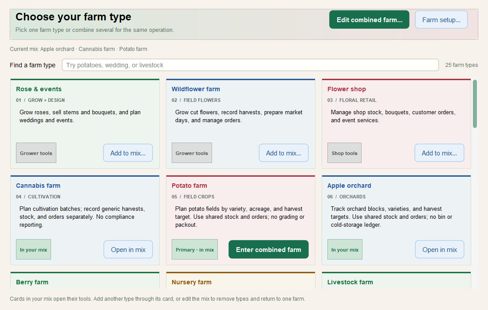</a><br>
  <strong>Potato + cannabis + apple, in one farm workspace.</strong>
</p>

Add a type, remove it, or change the main focus later. Drag a card into the mix or use its button. Saved specialty plans stay available if you add that type again. **Custom farm** can join the mix for work that has no dedicated plan yet; name other crops in Farm setup and products in Inventory.

<p align="center">
  <a href="docs/images/app-combined-farm-search.png">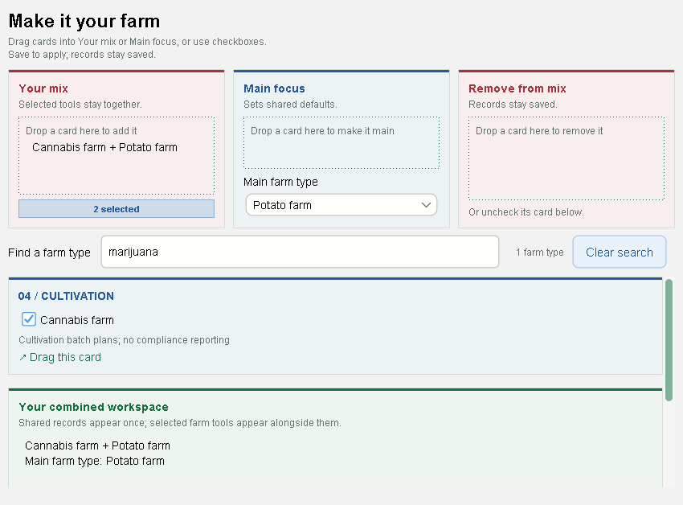</a><br>
  <strong>Search, drag, and shape the mix around your farm.</strong>
</p>

Floral growing and sales have the deepest end-to-end tools in this preview. Other farm types currently bring focused, editable plans or collection logs alongside shared farm records. Cannabis has cultivation planning and general sales records; it does not provide regulated tracking or compliance reporting. [See the exact scope of each farm type](docs/FARM_TYPES.md).

## Follow the work from plan to handoff

For a cut-flower team, one saved harvest updates matching stock and production history. Confirmed orders feed the packing review; completing a handoff deducts stock. A day closeout and searchable lessons draw on the same records. Planned stems stay separate from stock on hand.

<p align="center">
  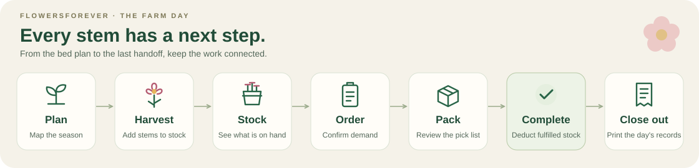
</p>

<table>
  <tr>
    <td width="50%" valign="top">
      <a href="docs/images/app-season-planner.png">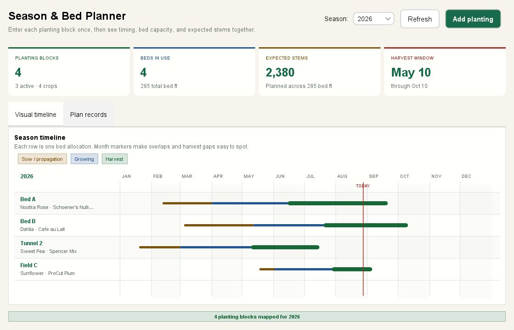</a><br>
      <strong>Plan what comes next.</strong><br>See planting and harvest windows, spot bed overlaps, and compare planned stems with actual cuts.
    </td>
    <td width="50%" valign="top">
      <a href="docs/images/app-harvest-log.png"></a><br>
      <strong>Record the harvest once.</strong><br>Capture a cut while it is fresh, with its crop and bed attached.
    </td>
  </tr>
  <tr>
    <td width="50%" valign="top">
      <a href="docs/images/app-inventory.png"></a><br>
      <strong>Know what is available.</strong><br>Review on-hand stock, prices, and low-stock items before promising an order.
    </td>
    <td width="50%" valign="top">
      <a href="docs/images/app-market-day.png"></a><br>
      <strong>Pack with the full picture.</strong><br>See confirmed loads, stock needs, and missing handoff details before completing an order.
    </td>
  </tr>
  <tr>
    <td width="50%" valign="top">
      <a href="docs/images/app-day-closeout.png">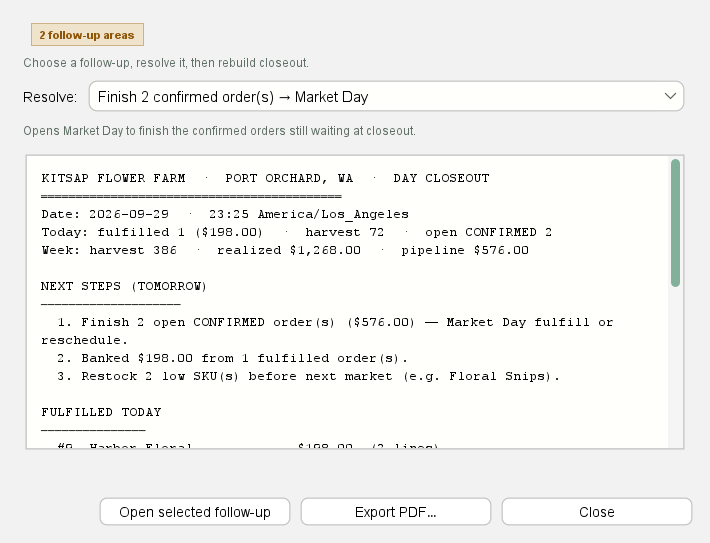</a><br>
      <strong>Close the day clearly.</strong><br>Review what was finished, what remains open, and what needs follow-up.
    </td>
    <td width="50%" valign="top">
      <a href="docs/images/app-knowledge-log.png">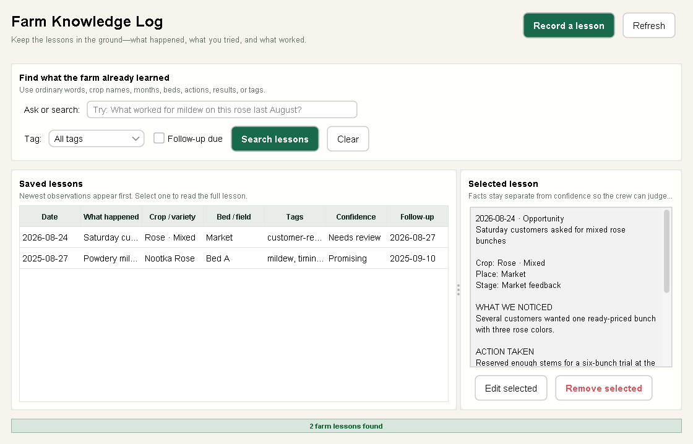</a><br>
      <strong>Keep the lesson with the farm.</strong><br>Find an observation by crop, bed, month, or the words your team remembers.
    </td>
  </tr>
</table>

## Make the workspace yours

Farm setup holds your mix of enterprises and named crops. Edit plan details as the season changes; name inventory products, categories, prices, and selling units in the app. Drag farm cards into a mix, move saved plans between stages, drop harvest lines into a batch, add stock to an order draft, or drag an order card to **Packed** after loading it. Buttons and keyboard paths are available for the same work.

<table>
  <tr>
    <td width="50%" valign="top">
      <a href="docs/images/app-add-item.png">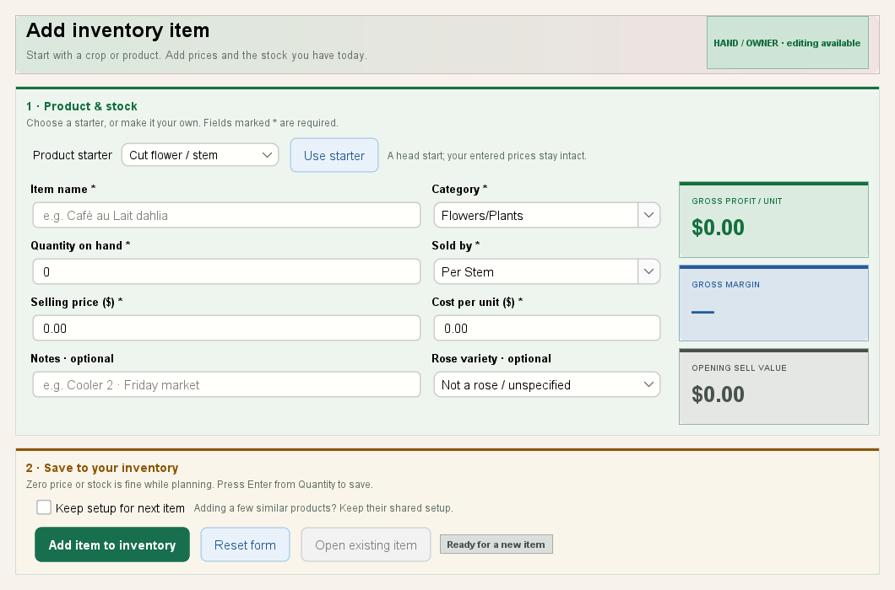</a><br>
      <strong>Your products, your units.</strong><br>Record what this farm actually sells, then edit it when the details change.
    </td>
    <td width="50%" valign="top">
      <a href="docs/images/app-event-services.png">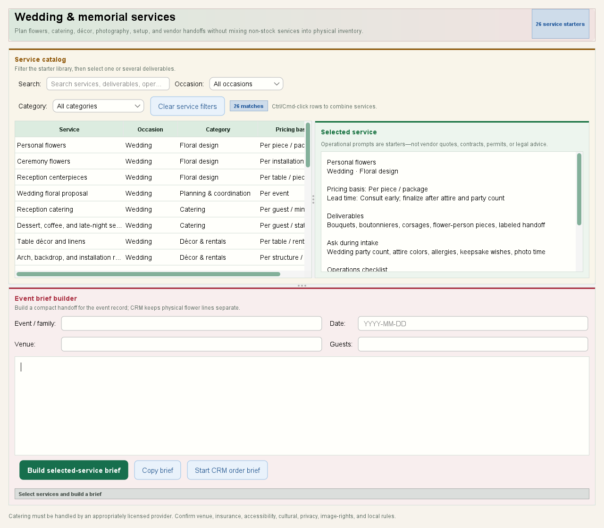</a><br>
      <strong>Flowers for a real event.</strong><br>Build an editable wedding or memorial brief from service starters and keep the customer order nearby.
    </td>
  </tr>
</table>

The optional phone field screen connects to a running, authenticated farm instance. A worker can record field notes and supported work from a phone or tablet while the desktop keeps the full farm view. [See how field entry works](docs/USER_GUIDE.md#phonetablet-field-work).

<p align="center">
  <a href="docs/images/app-field-note.jpg">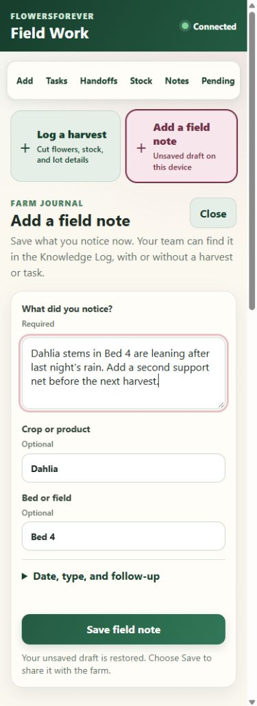</a><br>
  <strong>Capture the note where the work happens.</strong>
</p>

## A place for specialty work, too

The combined workspace can show a berry block plan beside an egg collection log, or a nursery batch beside an orchard plan. Each specialty record can be opened and edited. General harvest, stock, customer, and order records remain shared.

<table>
  <tr>
    <td width="50%" valign="top">
      <a href="docs/images/app-berry-block-plan.png">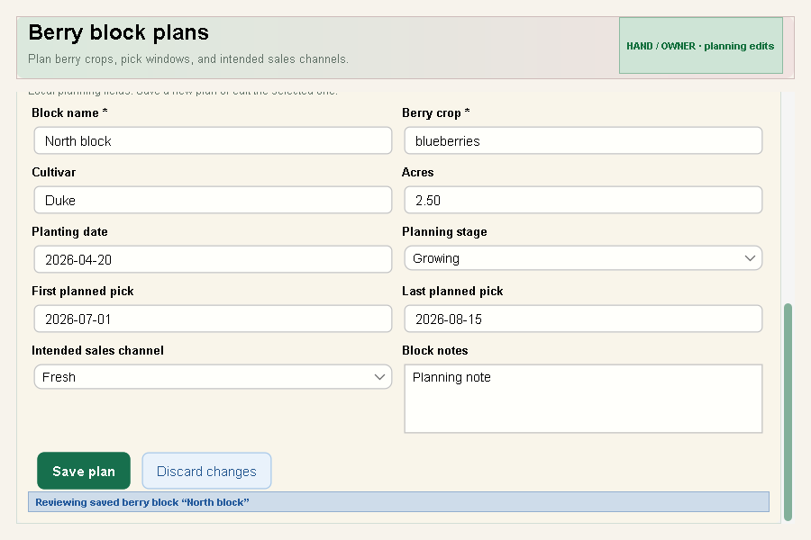</a><br>
      <strong>Plan a berry block.</strong><br>Name its crop, growing area, picking window, and intended channel.
    </td>
    <td width="50%" valign="top">
      <a href="docs/images/app-egg-collection-form.png">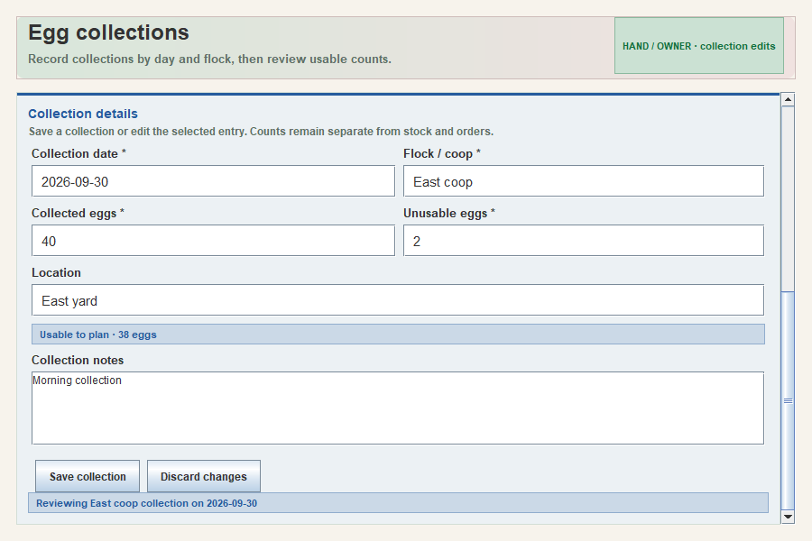</a><br>
      <strong>Log an egg collection.</strong><br>Record counts by flock and day, then correct an entry if needed.
    </td>
  </tr>
</table>

The bundled **Field science** shelf brings relevant offline CSRBT tools into selected farm types. Cannabis growers can open Subcool's Super Soil in Soil Recipes, then save a reviewed text export and link a finding to that source. [Explore the farm-to-tool map](docs/CSRBT_FIELD_KIT_PORT.md).

## Take a five-minute tour

Follow a sample cut-flower farm from the morning overview through a harvest, packing review, day closeout, and saved lesson. The screens use sample data; a guided walkthrough uses a separate sample farm.

1. [**Today:**](docs/images/app-dashboard.png) See what needs attention.
2. [**Harvest Log:**](docs/images/app-harvest-log.png) Record a cut and review the saved entry.
3. [**Market Day:**](docs/images/app-market-day.png) Check confirmed orders against available stock and resolve handoff blockers.
4. [**Day closeout:**](docs/images/app-day-closeout.png) Review finished work and open follow-ups.
5. [**Knowledge Log:**](docs/images/app-knowledge-log.png) Find a lesson worth using next season.

FlowersForever is in development. The public source is available under the MIT License; supported farm installation awaits an approved signed release. Ask your established RicheyWorks contact about a guided walkthrough, fit, and timing. [Check pilot access](docs/PILOT_ACCESS.md).

## Find your next step

| If you want to… | Start here |
|---|---|
| See all 25 farm types and their current scope | [Farm-type guide](docs/FARM_TYPES.md) |
| Get a new grower going in one page | [Getting started guide](docs/GETTING_STARTED.md), also in the app under Help |
| Learn the desktop app | [Grower guide](docs/USER_GUIDE.md) |
| Preview a guided farm day | [Five-minute tour](#take-a-five-minute-tour) and [presenter runbook](docs/DEMO.md) |
| Protect your farm records | [Backup and restore](docs/BACKUP_RESTORE.md) |
| Set up an approved workstation | [Deployment checklist](docs/DEPLOYMENT.md) |
| Check what is still being built | [Known limitations](docs/KNOWN_LIMITATIONS.md) and [roadmap](docs/PRODUCT_ROADMAP.md) |
| Work on the software | [Developer quick start](#help-for-developers) below |

---

## Help for developers

<details>
<summary><strong>Developer quick start</strong></summary>

### Requirements

- JDK 17 or newer
- Maven 3.9 or newer

### Build and run

```bash
git clone https://github.com/RicheyWorks/FlowersForever.git
cd FlowersForever
mvn clean verify

# Desktop app + REST API on 127.0.0.1:8080
mvn spring-boot:run

# Or run the packaged JAR
java -jar target/flowerfarm-manager-1.3.0-SNAPSHOT.jar

# Interactive command-line mode
java -jar target/flowerfarm-manager-1.3.0-SNAPSHOT.jar --cli

# Local MCP server for an AI client (set token, sensitive-read, and mutation env vars)
java -jar target/flowerfarm-manager-1.3.0-SNAPSHOT.jar --mcp

# Preflight the exact database, schema, plug-in, and enabled farm tools
java -jar target/flowerfarm-manager-1.3.0-SNAPSHOT.jar --mcp-doctor
```

### Verification

```bash
# All ordinary tests, release packaging, SBOM, and coverage floors
mvn verify

# Static analysis and source-style gates
mvn -Pquality -DskipTests verify

# Opt-in real-window pointer, typing, focus traversal, and screenshot smoke
# Run only on a workstation whose mouse and keyboard may be temporarily controlled.
mvn -Pinstalled-desktop-smoke test
```

The deterministic Swing harness audits all 36 reachable nested-tab routes and at least 180 visible controls, including selection, input, sorting, navigation, and state restoration. The opt-in installed-desktop profile adds real pointer/keyboard input, native focus, and screenshots. See [desktop user-journey testing](docs/USER_JOURNEY_TESTING.md) and the [harness audit](docs/HARNESS_AUDIT.md) for coverage and platform limits.

The optional provider-neutral harness exposes farm records and desktop actions through MCP or REST, with explicit sensitive-read and mutation permissions. The native `FlowersForeverAI` launcher and `--mcp-doctor` preflight support local AI-client setup. Mapped imports, verified exports, typed observations, reviewed inventory counts, and order handoffs use the same farm services as the human interfaces. Device and robot integrations remain development boundaries; no released robot owner transport is implemented. See the [AI harness guide](docs/AI_HARNESS.md) for exact capabilities, replay behavior, and policy controls.

### Runtime profiles

| Profile | Purpose |
|---|---|
| *(default)* | H2 file database + desktop GUI + loopback REST API |
| `sqlite` | Developer-preview SQLite compatibility profile; not for customer data |
| `auth` | HTTP Basic + desktop login; requires strong credentials from the environment |
| `demo` | Non-destructive sample CRM, harvest, and confirmed orders when the database is empty |
| `cli` | Interactive CLI only, without Tomcat |
| `container` | Headless external bind with mandatory, non-demo HTTP Basic credentials |
| `mcp` | Local stdio MCP server without Swing, Tomcat, or an HTTP listener |

```bash
java -jar target/flowerfarm-manager-1.3.0-SNAPSHOT.jar --spring.profiles.active=sqlite
java -jar target/flowerfarm-manager-1.3.0-SNAPSHOT.jar --spring.profiles.active=demo

FLOWERFARM_AUTH_USERS='owner:replace-with-a-long-password:OWNER' \
  java -jar target/flowerfarm-manager-1.3.0-SNAPSHOT.jar --spring.profiles.active=auth
```

Empty databases seed from `farm_inventory.csv` when it is present, otherwise from sample PNW inventory. The portable JAR stores H2 data under `./data`; the packaged Windows app uses `%LOCALAPPDATA%\\FlowersForever\\data`. `FLOWERFARM_DATA_DIR` overrides the data directory.

</details>

<details>
<summary><strong>Docker and server deployment</strong></summary>

The container is headless and REST-only. Its `container` profile fails closed: HTTP Basic is mandatory, passwords must contain at least 12 characters, and at least one account must have the OWNER role.

```bash
docker build -t flowersforever .
docker run -p 8080:8080 \
  -v flowerfarm-data:/app/data \
  -e FLOWERFARM_AUTH_USERS='owner:replace-with-a-long-password:OWNER' \
  flowersforever

# Published release image
docker run -p 8080:8080 \
  -e FLOWERFARM_AUTH_USERS='owner:replace-with-a-long-password:OWNER' \
  ghcr.io/richeyworks/flowersforever:latest
```

`/actuator/health` remains public for container health checks. See the [deployment guide](docs/DEPLOYMENT.md) for the full checklist.

</details>

<details>
<summary><strong>Connectors and REST API</strong></summary>

### Connectors

Connectors use local files by default for offline demos and CI. To use a live service, clear its `local-file` setting and provide credentials through gitignored local configuration or environment variables.

| Connector | Import | Export | Sync | Offline option |
|---|:---:|:---:|:---:|---|
| CSV | ✓ | ✓ | ✓ | File paths |
| Excel | ✓ | ✓ | ✓ | `.xlsx` |
| Airtable | ✓ | ✓ | ✓ | JSON mirror |
| Google Sheets | ✓ | ✓ | ✓ | JSON mirror |
| Shopify | ✓ | ✓ | ✓ | JSON mirror |
| Square | ✓ | ✓ | ✓ | JSON mirror |
| Farmbrite | ✓ | ✓ | ✓ | JSON mirror |
| Floranext | ✓ | ✓ | ✓ | JSON mirror |
| Webhook |  | ✓ |  | Last-payload JSON |

Full setup details: [connector sandbox guide](docs/CONNECTORS_SANDBOX.md).

### Selected REST endpoints

| Method | Path | Purpose |
|---|---|---|
| `GET` | `/api/dashboard` | Inventory, harvest, sales, and priority overview |
| `GET/POST` | `/api/inventory` | Inventory list and changes |
| `GET/POST` | `/api/harvest` | Structured harvest records |
| `POST` | `/api/harvest/batch` | Batch harvest logging |
| `GET` | `/api/harvest/lot?code={lotCode}` | Exact harvest-lot lookup, including slash-delimited codes |
| `GET` | `/api/harvest/{id}/label.pdf` | Printable QR lot label |
| `GET/POST` | `/api/knowledge` | Search or record farm observations and lessons |
| `GET` | `/api/knowledge/tags` | Reusable farm-knowledge tags |
| `GET` | `/api/plants` | Search/filter the sourced 94-profile PNW plant reference |
| `GET` | `/api/plants/sources` | List its public university and Master Gardener sources |
| `GET` | `/api/event-services` | Search/filter sourced wedding and memorial service starters |
| `GET` | `/api/event-services/sources` | List the official workflow sources behind the event catalog |
| `GET/POST` | `/api/production-studio/templates` | Farm-owned crop templates |
| `GET/PUT` | `/api/production-studio/seasons/{year}` | Frost anchors and loaded field-labor rate |
| `GET` | `/api/production-studio/seasons/{year}/production-costs` | Planting/season task costs joined to matched harvests |
| `POST` | `/api/production-studio/plantings/draft` | Preview a frost-aware succession schedule |
| `POST` | `/api/production-studio/plantings/commit` | Commit plans and generate dependent work |
| `PUT` | `/api/production-studio/tasks/{id}/actuals` | Complete field work with labor, input cost, and an observation |
| `GET/POST` | `/api/production-studio/recipes` | Reusable floral design recipes |
| `GET` | `/api/production-studio/recipes/{id}/estimate` | Pack, supply, labor, markup, margin, and purchasing estimate |
| `GET` | `/api/production-studio/availability` | Planned weekly crop supply plus live inventory |
| `GET/POST` | `/api/production-studio/handoffs` | Reviewed external contract/payment/marketplace references |
| `GET/POST` | `/api/customers` | Customer records |
| `GET/POST` | `/api/orders` | Order records |
| `POST` | `/api/orders/{id}/confirm` | Move a Draft order to Confirmed |
| `POST` | `/api/orders/{id}/fulfill` | Complete an order and deduct inventory |
| `GET` | `/api/worker/today` | Overdue and due-today field work |
| `GET` | `/api/worker/orders` | Bounded confirmed-order handoffs due through a work date |
| `GET` | `/api/worker/inventory` | Bounded, searchable stock-count view |
| `POST` | `/api/worker/harvests` | Retry-safe field harvest capture |
| `POST` | `/api/worker/tasks/{id}/complete` | Retry-safe task actuals and completion |
| `POST` | `/api/worker/attachments` | Retry-safe production-task photo upload |
| `GET` | `/api/worker/attachments` | Photo metadata for one production task |
| `GET` | `/api/worker/attachments/{id}/content` | Verified photo bytes |
| `POST` | `/api/worker/inventory/{id}/count` | Retry- and concurrency-safe physical count |
| `POST` | `/api/worker/orders/{id}/complete` | Retry- and concurrency-safe handoff plus inventory deduction |
| `GET` | `/api/worker/operations/{operationKey}` | Recover a committed field submission |
| `GET` | `/api/market-day/packing.pdf` | Market packing list |
| `GET` | `/api/briefing/report.pdf` | Morning briefing |
| `GET` | `/api/closeout/report.pdf` | Day closeout |
| `GET` | `/actuator/health` | Application health |
| `GET` | `/api/auth/csrf` | Fresh masked token and HttpOnly cookie for HTTP writes |
| `GET` | `/api/harness/manifest` | Opt-in AI tool and schema discovery |
| `POST` | `/api/harness/farm-data/commands` | Opt-in canonical migration and farm operations |

Printable inventory, harvest, invoice, statement, packing, weekly, and audit routes also provide PDF output. Browse `com.flowerfarm.controller` for the full API surface.

HTTP `POST`, `PUT`, `PATCH`, and `DELETE` requests require a CSRF cookie/header handshake in both local open mode and authenticated mode. The worker performs it automatically before each save, including queued replays and photo uploads. External API and HTTP harness clients must retain the cookie from `GET /api/auth/csrf` and send the returned masked token in its named header. See [HTTP client writes](docs/HTTP_CLIENT_WRITES.md) for examples. Desktop, CLI, and MCP stdio calls continue to use application services directly.

When the opt-in AI harness is enabled, `GET /api/harness/manifest` publishes its authenticated protocol, current policy, plug-ins, and provider-neutral JSON-Schema tools. The headless `farm-data` plugin accepts nine mappable operational types—including production templates, planting plans, and nested floral recipes—and exposes production-task attachment metadata as a tenth readable/exportable type, without driving the desktop. Its three-step suggest/preview/import intake maps arbitrary spreadsheet or provider objects, while stable source-system and row keys make migration replay durable across request changes and application restarts. Checksummed snapshots of the plugin's published canonical record types can be created, recovered, and consumed across restarts; dedicated actions upload retry-safe task photos and read their verified bytes in bounded chunks. Farm setup is recovered through a [database backup](docs/BACKUP_RESTORE.md), not those snapshots. The transport is absent in ordinary disabled and CLI modes; an explicitly enabled container deployment requires both normal HTTP authentication and the harness token.

HTTP inventory/harvest/audit CSV exports accept CSV leaf filenames and write beneath `flowerfarm.exports.directory`. Configure that directory on the server. Desktop file chooser and operator-configured connector paths retain their local selection behavior.

</details>

<details>
<summary><strong>Architecture, quality, and release engineering</strong></summary>

FlowersForever is a Spring Boot 4.1.1 application with a modular Swing desktop interface, REST controllers, transaction-aware services, offline-first connectors, and a version-migrated local H2 store. SQLite remains a developer-preview compatibility profile.

```text
com.flowerfarm
├── automation/    provider-neutral harness SPI, policy, discovery, and gateway
├── auth/           roles, desktop session, and user directory
├── model/          inventory, harvest, customer, order, activity, and knowledge records
├── service/        farm rules, knowledge search, reports, market day, briefing, and closeout
├── connector/      offline mirrors, live adapters, and connector registry
├── controller/     REST API
├── gui/            desktop shell, tabs, presenters, and shared UI components
└── lsystem/        rose visualization rules
```

| Automation | What it protects |
|---|---|
| **CI** | `mvn clean verify` on JDK 17 and 21, plus Docker build and smoke test |
| **Quality** | JaCoCo coverage gates, zero-baseline Medium+ SpotBugs, and Checkstyle |
| **Desktop journeys** | Accessible selectors, 36 recursive routes, exhaustive option/state/scroll matrices with restoration, whole-catalog and all-connector button sweeps, async failure capture, and an opt-in native-input smoke |
| **AI harness** | Native stdio launcher and readiness doctor; guided mapping plus canonical farm-data migration, durable exports, and operations, discoverable provider tools, and all 36 desktop routes; durable source-row receipts, nested schemas, value-redacted observations, and replay safety |
| **Security** | Medium+ SpotBugs, source-bound FindSecBugs and OSV gates, public CodeQL/dependency review, role tests, and fail-closed container authentication |
| **Supply chain** | CycloneDX SBOM, bundled third-party notices, incompatible-license gates, dependency submission, and Dependabot |
| **Releases** | One verified JAR feeds both installers; tag/POM versions must match and nothing publishes until every platform passes |

Read the [system architecture](docs/ARCHITECTURE.md), [backend boundaries](docs/BACKEND_ARCHITECTURE.md), [GUI architecture](docs/GUI_ARCHITECTURE.md), [desktop user-journey testing](docs/USER_JOURNEY_TESTING.md), and [architecture decisions](docs/adr/).

</details>

## Project status

Current source: **1.3.0-SNAPSHOT**, licensed under the [MIT License](LICENSE). The previous v1.0.19 artifacts are retired and must not be distributed to customers.

The core harvest → inventory → order → market-day → closeout workflow, visual planning, Production Studio, and Farm Knowledge Log are implemented in this preview. Signed customer distribution still depends on the [release signing gate](docs/SIGNING_SETUP.md). See [known limitations](docs/KNOWN_LIMITATIONS.md), the [product roadmap](docs/PRODUCT_ROADMAP.md), and [ideas being evaluated](docs/FUTURE_IDEAS.md) for what remains.

[](https://github.com/RicheyWorks/FlowersForever/actions/workflows/ci.yml) [](LICENSE)

## Made for growers

Built around Pacific Northwest cut-flower work in Port Orchard, Kitsap County, Washington. The farm-type menu is growing with Washington and Oregon operations, guided by the specific work each farm needs.

Roses, compost, and Cascades mist included free of charge.

## Ownership

FlowersForever is owned by RicheyWorks. Copyright © 2026 RicheyWorks. The [MIT License](LICENSE) grants permission to use, copy, modify, and distribute the owned source and associated materials. Third-party components retain their own licenses and notices.
