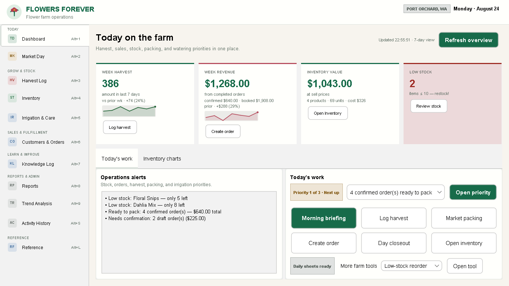
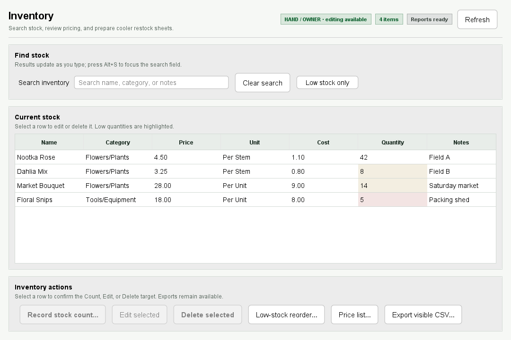
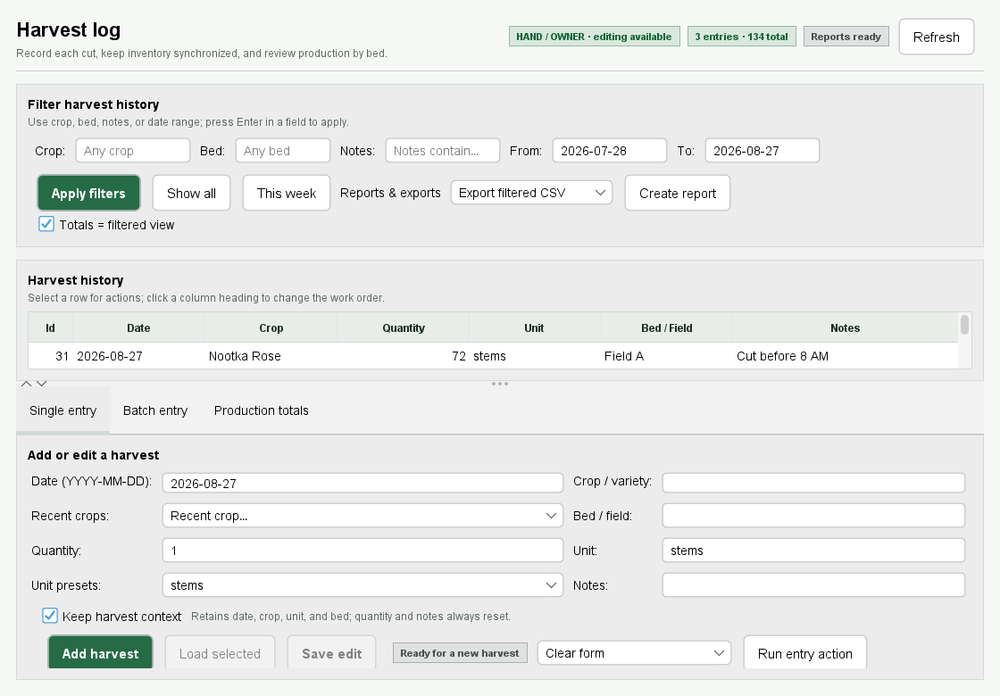
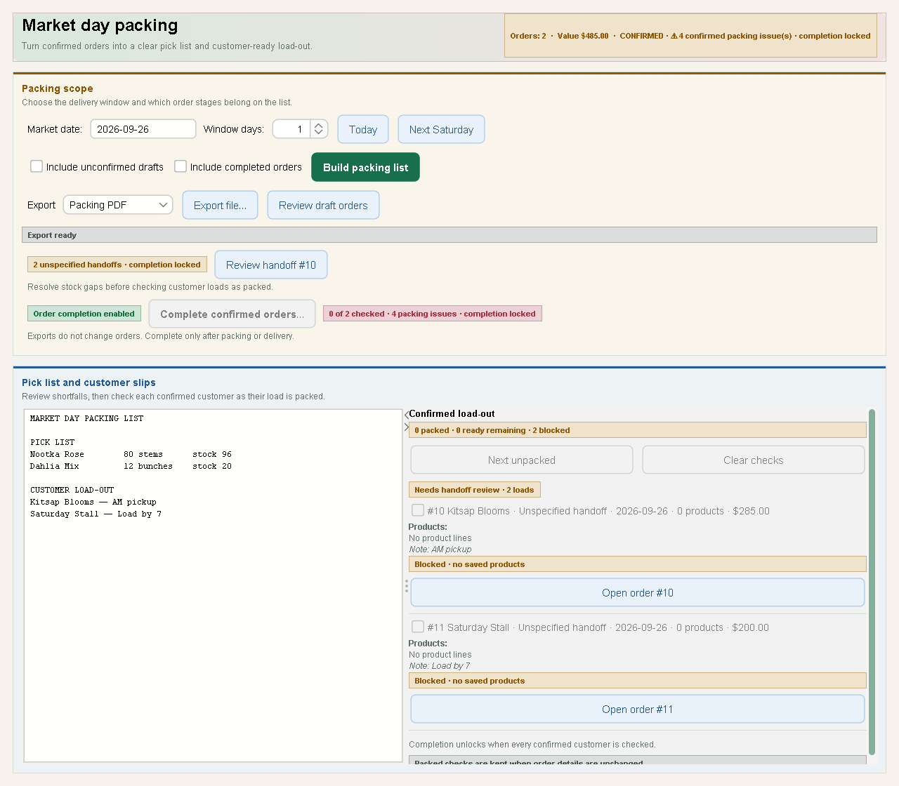

<div align="center">


# FlowersForever

### Run the flower farm—not the spreadsheet.

One calm desktop workspace for harvests, inventory, customers, orders, market packing, and the paperwork that keeps a growing farm moving.

**From first cut to final sale, FlowersForever keeps the details connected—so you can spend less time reconciling records and more time growing, selling, and serving customers.**

[](https://github.com/RicheyWorks/FlowersForever/releases/download/v1.0.19/FlowersForever-1.0.19.msi)
[](https://github.com/RicheyWorks/FlowersForever/releases/download/v1.0.19/FlowersForever-1.0.19.dmg)
[](https://github.com/RicheyWorks/FlowersForever/releases/latest)

[](https://github.com/RicheyWorks/FlowersForever/actions/workflows/ci.yml)
[](https://github.com/RicheyWorks/FlowersForever/actions/workflows/codeql.yml)

</div>

## Your whole farm day, in one place

A flower farm should not need five spreadsheets and a stack of notes to answer one simple question: **What needs to happen next?**

FlowersForever gives small and growing farms a practical operating hub. Log a harvest and stock goes up. Complete an order and stock goes down. Prepare for market, print the paperwork, and see the next priority without rebuilding the same information in several places.

The result is a farm day that feels more visible, repeatable, and ready to grow. FlowersForever was shaped around real cut-flower work in Port Orchard and Kitsap County, Washington—but its core workflow fits small growers anywhere.

| Start the day | Grow and track | Sell and fulfill | Finish with confidence |
|---|---|---|---|
| See priorities, low stock, harvest totals, and sales | Log single or batch harvests and review bed production | Manage customers, orders, pickup, delivery, and market handoffs | Print invoices, packing lists, reports, briefings, and closeouts |

## Less daily friction. More room to grow.

FlowersForever replaces scattered information with one dependable flow from the field to the customer.

| When farm records are scattered… | With FlowersForever… |
|---|---|
| Stock counts become guesswork | Harvests and completed orders update inventory as the work happens |
| Market packing depends on memory | Clear pick lists and readiness checks show what to load and what is missing |
| Customer details hide in messages and notebooks | Contacts, notes, orders, invoices, and statements stay connected |
| The day starts by hunting for answers | The **Today** dashboard surfaces priorities, shortages, sales, and ready-to-pack work |
| Paperwork waits until late at night | Farm-ready PDFs turn current records into useful paperwork in a few clicks |

**Know what you have. Know what is promised. Know what comes next.**

## Start in minutes—no coding required

### 1. Download the app

- **Windows:** [download the `.msi` installer](https://github.com/RicheyWorks/FlowersForever/releases/download/v1.0.19/FlowersForever-1.0.19.msi)
- **macOS:** [download the `.dmg` installer](https://github.com/RicheyWorks/FlowersForever/releases/download/v1.0.19/FlowersForever-1.0.19.dmg)
- **All downloads:** [open the latest GitHub release](https://github.com/RicheyWorks/FlowersForever/releases/latest)

The desktop installers include the runtime they need. You do not need to install Java, Maven, or use a command line.

> [!IMPORTANT]
> The installers are not code-signed yet, so Windows SmartScreen or macOS Gatekeeper may say the publisher is unknown. Download only from this repository's **Releases** page and review the [installer safety note](docs/adr/ADR-002-code-signing.md).

### 2. Open FlowersForever

The app starts with a small sample inventory when no farm data exists. Your records stay on your computer by default, and you can [back them up or restore them](docs/BACKUP_RESTORE.md).

### 3. Begin with **Today**

The dashboard shows what needs attention first: orders ready to pack, low-stock items, recent harvest totals, sales, irrigation guidance, and shortcuts to the next task.

For a guided first visit, follow the [plain-language desktop user guide](docs/USER_GUIDE.md).

## See it in action

<p align="center"><em>Real application screens using sample farm data.</em></p>

<table>
  <tr>
    <td width="50%">
      
      <br><strong>Know what needs attention today.</strong><br>
      Start with clarity instead of searching through yesterday's notes. Stock, harvest, sales, orders, and farm priorities meet in one view.
    </td>
    <td width="50%">
      
      <br><strong>Trust the stock count.</strong><br>
      See what is ready to sell, spot shortages earlier, record physical counts, and print reorder or customer price lists.
    </td>
  </tr>
  <tr>
    <td width="50%">
      
      <br><strong>Turn cuts into usable records.</strong><br>
      Capture the value coming out of the field. Log harvests quickly, keep bed context, and learn from production history.
    </td>
    <td width="50%">
      
      <br><strong>Pack market day with fewer surprises.</strong><br>
      Turn confirmed demand into a clear load-out plan, catch stock gaps before departure, and keep every customer handoff visible.
    </td>
  </tr>
</table>

## What FlowersForever helps you do

### Keep growing work connected

- Log, edit, batch, search, and filter harvests.
- Track production by bed or field.
- Increase inventory automatically when flowers are harvested.
- Get Kitsap-aware irrigation guidance from live weather or an offline seasonal fallback.

### Know what you can sell

- See on-hand quantities, pricing, costs, and low-stock warnings.
- Record physical stock counts without losing the audit trail.
- Print a low-stock reorder sheet or customer-ready price list.
- Export visible information to CSV when you need a spreadsheet.

### Move orders from conversation to completion

- Keep customer contacts, notes, and order history together.
- Build Draft orders, review them, then confirm when they are ready.
- Track Pickup, Delivery, and Market handoffs.
- Deduct inventory only when an order is completed.
- Print invoices and customer statements.

### Make market day easier

- Build packing lists from confirmed orders.
- Compare required products with current stock before loading.
- Review each customer handoff and catch missing information.
- Print the packing PDF and complete orders safely.

### Start and close the day clearly

- **Morning briefing:** what to pack, harvest, water, or restock.
- **Day closeout:** completed sales, harvest activity, open work, and exceptions.
- **Activity history:** a searchable record of imports, exports, harvests, and orders.
- **Reports:** printable PDFs for the farm office, crew, market table, or customer.

## A simple, safer workflow

```text
Harvest flowers
      ↓
Inventory increases
      ↓
Create and confirm an order
      ↓
Build the market or delivery packing list
      ↓
Complete the order → inventory decreases
      ↓
Print the closeout and review activity history
```

FlowersForever keeps those steps linked. It also pauses destructive or inventory-changing actions for review, explains what went wrong in plain language, and keeps unfinished form details available for retry.

## Farm-friendly by design

| Need | How FlowersForever responds |
|---|---|
| **Works when the internet does not** | Core desktop work and local connector mirrors are offline-first. |
| **Keeps farm data close** | Records are stored on the workstation by default, with backup and restore tools. |
| **Supports different helpers** | Optional OWNER, HAND, and VIEWER roles control who can change records. |
| **Avoids surprise stock changes** | Confirming an order does not deduct stock; completion does. |
| **Connects when you are ready** | CSV, Excel, Airtable, Google Sheets, Shopify, Square, Farmbrite, Floranext, and webhooks are available. |
| **Explains the next step** | Status messages, validation highlights, and dashboard priorities use direct farm language. |

## Is it a fit for your farm?

FlowersForever is designed for small and growing cut-flower operations that want one dependable workstation for daily records and paperwork. It is especially useful when:

- harvest, stock, customer, and market information currently lives in separate places;
- the same numbers are being copied into several spreadsheets;
- more than one person needs to understand what is ready, blocked, or running low;
- the farm needs printable paperwork without a cloud subscription workflow;
- internet access is inconsistent or deliberately avoided for core farm records.

Before placing it on a production workstation, review the [deployment checklist](docs/DEPLOYMENT.md), [backup procedure](docs/BACKUP_RESTORE.md), and [known limitations](docs/KNOWN_LIMITATIONS.md).

## Give tomorrow's farm day a calmer start

Open FlowersForever, explore the included sample inventory, and see the harvest-to-sale workflow for yourself. No account setup is required for the default desktop experience, and your farm records stay on your workstation by default.

**Ready to bring the field, cooler, office, and market table into one clear routine?**

- [Download FlowersForever for Windows](https://github.com/RicheyWorks/FlowersForever/releases/download/v1.0.19/FlowersForever-1.0.19.msi)
- [Download FlowersForever for macOS](https://github.com/RicheyWorks/FlowersForever/releases/download/v1.0.19/FlowersForever-1.0.19.dmg)
- [View the latest release](https://github.com/RicheyWorks/FlowersForever/releases/latest)

## Help and documentation

| I want to… | Start here |
|---|---|
| Learn the desktop app | [User guide](docs/USER_GUIDE.md) |
| Try a five-minute walkthrough | [Demo runbook](docs/DEMO.md) |
| Set up a farm workstation | [Deployment checklist](docs/DEPLOYMENT.md) |
| Protect or recover my data | [Backup and restore](docs/BACKUP_RESTORE.md) |
| Understand roles and security | [Security guide](SECURITY.md) |
| Connect another service | [Connector sandbox guide](docs/CONNECTORS_SANDBOX.md) |
| Check current caveats | [Known limitations](docs/KNOWN_LIMITATIONS.md) |

---

<details>
<summary><strong>Developer quick start</strong></summary>

### Requirements

- JDK 17 or newer
- Maven 3.9 or newer

### Build and run

```bash
git clone https://github.com/RicheyWorks/FlowersForever.git
cd FlowersForever
mvn clean verify

# Desktop app + REST API on 127.0.0.1:8080
mvn spring-boot:run

# Or run the packaged JAR
java -jar target/flowerfarm-manager-1.0.19.jar

# Interactive command-line mode
java -jar target/flowerfarm-manager-1.0.19.jar --cli
```

### Runtime profiles

| Profile | Purpose |
|---|---|
| *(default)* | H2 file database + desktop GUI + loopback REST API |
| `sqlite` | SQLite under `./data/flowerfarm.sqlite` |
| `auth` | HTTP Basic + desktop login; requires strong credentials from the environment |
| `demo` | Non-destructive sample CRM, harvest, and confirmed orders when the database is empty |
| `cli` | Interactive CLI only, without Tomcat |
| `container` | Headless external bind with mandatory, non-demo HTTP Basic credentials |

```bash
java -jar target/flowerfarm-manager-1.0.19.jar --spring.profiles.active=sqlite
java -jar target/flowerfarm-manager-1.0.19.jar --spring.profiles.active=demo

FLOWERFARM_AUTH_USERS='owner:replace-with-a-long-password:OWNER' \
  java -jar target/flowerfarm-manager-1.0.19.jar --spring.profiles.active=auth
```

Empty databases seed from `farm_inventory.csv` when it is present, otherwise from sample PNW inventory. The portable JAR stores H2 data under `./data`; the packaged Windows app uses `%LOCALAPPDATA%\\FlowersForever\\data`. `FLOWERFARM_DATA_DIR` overrides the data directory.

</details>

<details>
<summary><strong>Docker and server deployment</strong></summary>

The container is headless and REST-only. Its `container` profile fails closed: HTTP Basic is mandatory, passwords must contain at least 12 characters, and at least one account must have the OWNER role.

```bash
docker build -t flowersforever .
docker run -p 8080:8080 \
  -v flowerfarm-data:/app/data \
  -e FLOWERFARM_AUTH_USERS='owner:replace-with-a-long-password:OWNER' \
  flowersforever

# Published release image
docker run -p 8080:8080 \
  -e FLOWERFARM_AUTH_USERS='owner:replace-with-a-long-password:OWNER' \
  ghcr.io/richeyworks/flowersforever:latest
```

`/actuator/health` remains public for container health checks. See the [deployment guide](docs/DEPLOYMENT.md) for the full checklist.

</details>

<details>
<summary><strong>Connectors and REST API</strong></summary>

### Connectors

Connectors use local files by default for offline demos and CI. To use a live service, clear its `local-file` setting and provide credentials through gitignored local configuration or environment variables.

| Connector | Import | Export | Sync | Offline option |
|---|:---:|:---:|:---:|---|
| CSV | ✓ | ✓ | ✓ | File paths |
| Excel | ✓ | ✓ | ✓ | `.xlsx` |
| Airtable | ✓ | ✓ | ✓ | JSON mirror |
| Google Sheets | ✓ | ✓ | ✓ | JSON mirror |
| Shopify | ✓ | ✓ | ✓ | JSON mirror |
| Square | ✓ | ✓ | ✓ | JSON mirror |
| Farmbrite | ✓ | ✓ | ✓ | JSON mirror |
| Floranext | ✓ | ✓ | ✓ | JSON mirror |
| Webhook |  | ✓ |  | Last-payload JSON |

Full setup details: [connector sandbox guide](docs/CONNECTORS_SANDBOX.md).

### Selected REST endpoints

| Method | Path | Purpose |
|---|---|---|
| `GET` | `/api/dashboard` | Inventory, harvest, sales, and priority overview |
| `GET/POST` | `/api/inventory` | Inventory list and changes |
| `GET/POST` | `/api/harvest` | Harvest records |
| `POST` | `/api/harvest/batch` | Batch harvest logging |
| `GET/POST` | `/api/customers` | Customer records |
| `GET/POST` | `/api/orders` | Order records |
| `POST` | `/api/orders/{id}/confirm` | Move a Draft order to Confirmed |
| `POST` | `/api/orders/{id}/fulfill` | Complete an order and deduct inventory |
| `GET` | `/api/market-day/packing.pdf` | Market packing list |
| `GET` | `/api/briefing/report.pdf` | Morning briefing |
| `GET` | `/api/closeout/report.pdf` | Day closeout |
| `GET` | `/actuator/health` | Application health |

Printable inventory, harvest, invoice, statement, packing, weekly, and audit routes also provide PDF output. Browse `com.flowerfarm.controller` for the full API surface.

</details>

<details>
<summary><strong>Architecture, quality, and release engineering</strong></summary>

FlowersForever is a Spring Boot 3.5.16 application with a modular Swing desktop interface, REST controllers, transaction-aware services, offline-first connectors, and H2/SQLite storage.

```text
com.flowerfarm
├── auth/           roles, desktop session, and user directory
├── model/          inventory, harvest, customer, order, and activity records
├── service/        farm rules, reports, market day, briefing, and closeout
├── connector/      offline mirrors, live adapters, and connector registry
├── controller/     REST API
├── gui/            desktop shell, tabs, presenters, and shared UI components
└── lsystem/        rose visualization rules
```

| Automation | What it protects |
|---|---|
| **CI** | `mvn clean verify` on JDK 17 and 21, plus Docker build and smoke test |
| **Quality** | JaCoCo coverage gates, zero-baseline Medium+ SpotBugs, and Checkstyle |
| **Security** | CodeQL, dependency review, role tests, and fail-closed container authentication |
| **Supply chain** | CycloneDX SBOM on every build and weekly Dependabot updates |
| **Releases** | Fat JAR, SBOM, GHCR image, MSI, and DMG from `v*` tags |

Read the [system architecture](docs/ARCHITECTURE.md), [backend boundaries](docs/BACKEND_ARCHITECTURE.md), [GUI architecture](docs/GUI_ARCHITECTURE.md), and [architecture decisions](docs/adr/).

</details>

## Project status

Current release: **[v1.0.19](https://github.com/RicheyWorks/FlowersForever/releases/tag/v1.0.19)**

The current product includes the complete harvest → inventory → order → market-day → printable closeout loop, offline-first connectors, optional farm roles, native desktop installers, container deployment, and automated quality and security checks.

Longer-term ideas include deeper merchant integrations and a deliberate Spring Boot 4 migration after compatibility review.

## Made for growers

Built for Pacific Northwest flower growers in Port Orchard, Kitsap County, Washington.

Roses, compost, and Cascades mist included free of charge.
