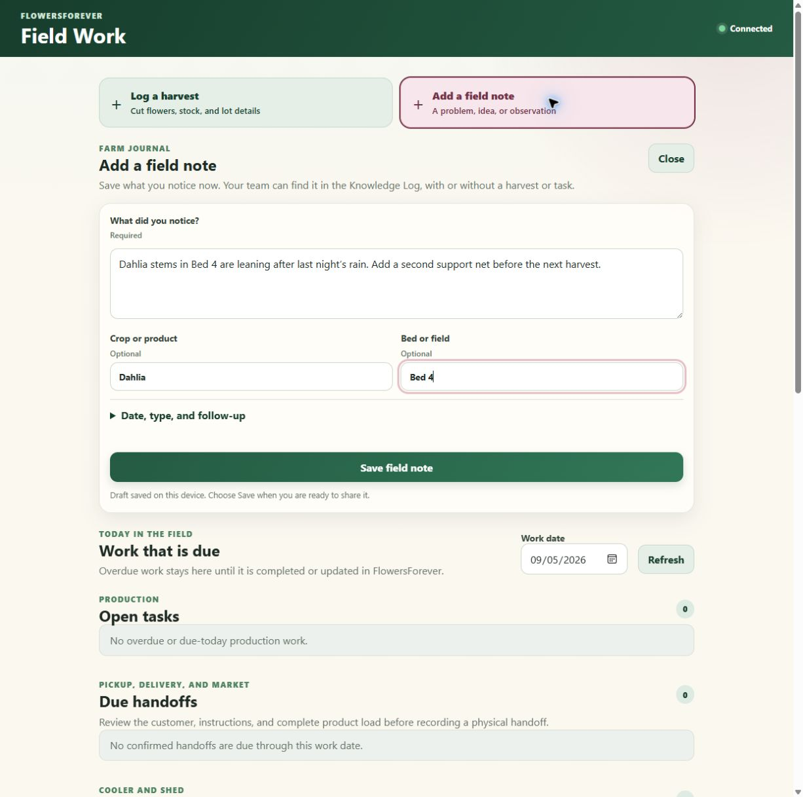
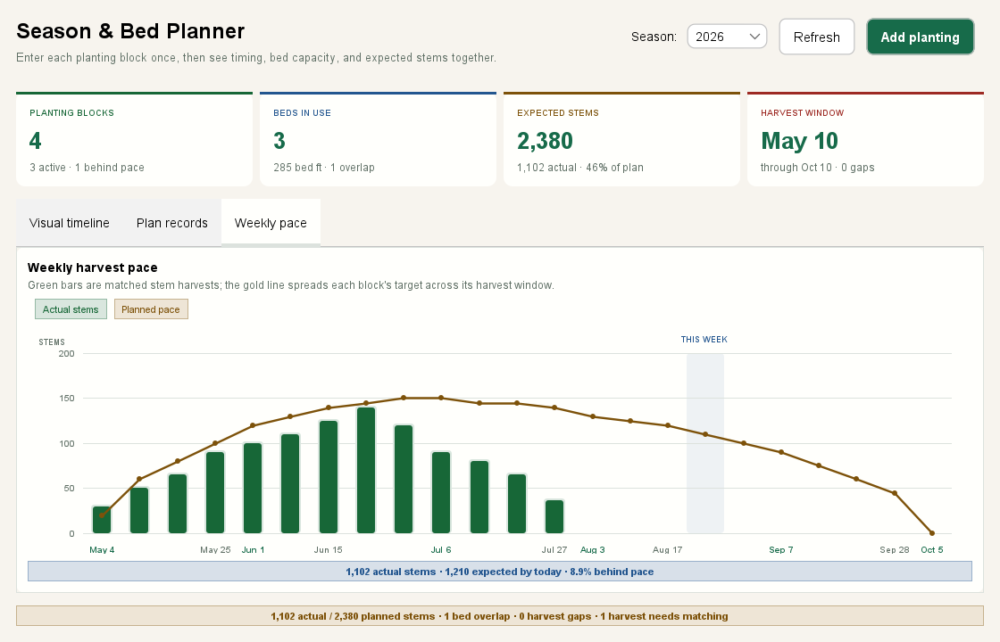

<div align="center">


# FlowersForever

### More time among the flowers. A clearer future for your farm.

Your season, your stems, your customers, your know-how—in one colorful workspace built for cut-flower growers.

**Log the work once. Know what you can sell. Carry this season's lessons into the next.**

From the first succession to the last market bucket, FlowersForever connects what happens in the field with what happens at the cooler, workbench, and customer handoff.

[](docs/PILOT_ACCESS.md)
[](#project-status)
[](#farm-friendly-by-design)

[](#see-it-in-action)
[](docs/DEMO.md)

**[Why growers choose it](#make-the-work-you-do-today-count-next-season)** · **[Easy daily entry](#your-farm-your-records-your-way-to-add-them)** · **[Product tour](#see-it-in-action)** · **[Private pilot](#give-tomorrows-farm-day-a-calmer-start)** · **[Developer setup](#help-and-documentation)**

[](https://github.com/RicheyWorks/FlowersForever/actions/workflows/ci.yml)   

</div>

<table>
  <tr>
    <td align="center" width="25%">
      <h3>🌱 PLAN</h3>
      Beds, successions, expected stems, and harvest windows in one visual season.
    </td>
    <td align="center" width="25%">
      <h3>✂️ HARVEST</h3>
      Fast field entry that keeps crop, bed, quantity, and inventory connected.
    </td>
    <td align="center" width="25%">
      <h3>📦 SELL</h3>
      Customers, orders, packing, handoffs, invoices, and stock-safe completion.
    </td>
    <td align="center" width="25%">
      <h3>📈 LEARN</h3>
      Grounded trends and searchable farm lessons built from your own records.
    </td>
  </tr>
</table>

## Your farm at a glance

<p align="center">
  
  <br><strong>Open the app. See the day. Take the next action.</strong><br>
  Harvest, sales, stock, shortages, packing, and watering priorities meet in one colorful command center.
</p>

> **The promise:** know what you have, know what is promised, and know what needs attention—without rebuilding the answer from five different places.

## Built around the real flow of a flower farm

A flower farm should not need five spreadsheets and a stack of notes to answer one simple question: **What needs to happen next?**

FlowersForever gives small and growing farms a practical operating hub. Log a harvest and stock goes up. Complete an order and stock goes down. Prepare for market, print the paperwork, and save what the farm learned so next season does not start from memory.

The result is a farm day that feels more visible, repeatable, and ready to grow. FlowersForever was shaped around real cut-flower work in Port Orchard and Kitsap County, Washington, while its core workflow fits small growers anywhere.

| Start the day | Grow and track | Sell and fulfill | Finish with confidence |
|---|---|---|---|
| See priorities, low stock, harvest totals, and sales | Plan beds visually, estimate stems, and log single or batch harvests | Manage customers, orders, pickup, delivery, and market handoffs | Print invoices, packing lists, reports, briefings, and closeouts |

## Make the work you do today count next season

Your farm changes every year. New varieties arrive. Buyers ask for different colors. A succession runs late. An experienced helper moves on. The records you keep today should help the farm adapt tomorrow.

| What matters to a grower | How FlowersForever helps today |
|---|---|
| **Get time back at the end of the day** | Harvest entry updates stock; orders, packing lists, invoices, and closeouts reuse the farm's saved records. |
| **Promise flowers with more confidence** | See live inventory, open orders, shortages, and projected harvest windows together. Planned stems remain visibly separate from stock you can commit. |
| **Know what the work costs** | Record labor and inputs against planting tasks. Review production cost per stem and bouquet estimates that include labor, waste, and pack rounding. |
| **Adapt the season as it unfolds** | Set your own frost dates, growing templates, successions, and yield assumptions. Compare planned harvest pace with the stems actually cut. |
| **Help the next person pick up the work** | Due tasks, field observations, handoff instructions, and searchable lessons give helpers shared context. |
| **Keep choices open as technology changes** | Core desktop records live locally. Exports, connectors, and an optional AI bridge let approved tools work with those records as your needs grow. |

<p align="center"><strong>🌱 Know what is growing. &nbsp; 🌸 Know what is available. &nbsp; 📦 Know what is promised. &nbsp; ✅ Know what comes next.</strong></p>

## Your farm, your records, your way to add them

**The input screen is where the app earns its place on the farm.** Clear fields, useful examples, and a visible save action help you capture work while it is fresh. Start with the essentials and add detail when it helps.

Grow something new? Add your own crops, products, growing templates, and recipes. The bundled plant guide gives you a starting point; it does not limit what your farm can record.

<p align="center">
  
  <br><strong>A clear place to put the work. A clear next step.</strong><br>
  Your own products and units, live pricing context, and shared setup for the next item.
</p>

| What you want to add | Where to start |
|---|---|
| A crop, supply, or product you sell | **Inventory → Add item.** Enter your own name, category, selling unit, quantity, and pricing. You can type a new category or unit. |
| The stems you just cut | **Harvest Log → Quick entry**, or **Log a harvest** on the phone/tablet field screen. Keep crop and bed context for the next entry. |
| An observation worth remembering | **Knowledge Log**, or **Add a field note** on the phone/tablet field screen. Tie the observation to a crop, bed, action, or follow-up. |
| Next season's planting | **Season Planner → Add planting**, or start with your own growing template in **Production Studio** and review the generated schedule. |
| A customer, order, or bouquet recipe | **CRM** for buyers and orders; **Production Studio → Design recipes** for reusable flower requirements and pricing assumptions. |

The field screen connects to your farm's running FlowersForever instance. Once opened and cached, it can queue supported entries through a connection loss and show what still needs to sync. Your desktop remains the place for full planning, setup, and reports. See the [field guide](docs/USER_GUIDE.md#phonetablet-field-work) for setup and offline limits.

<details>
<summary><strong>See the field-entry screen</strong></summary>

<p align="center">
  
  <br><strong>Capture the observation while it is fresh.</strong><br>
  Drafts stay on the device; submitted notes join the farm's shared Knowledge Log.
</p>

</details>

## Build a farm that remembers—and stays yours

**This season:** create records that help you harvest, pack, sell, and finish the day with fewer loose ends.

**Next season:** reuse growing templates and recipes, review actual harvest pace and production costs, and search the lessons your crew recorded. Keep the reasoning behind a successful crop alongside the numbers.

**As your farm grows:** bring existing spreadsheets into the same records, connect the services you use, and let your chosen AI assist through explicit, permission-controlled tools. It can read records, help enter work, preview planting schedules, and estimate recipes; you decide when to enable changes.

The next opportunities are practical: turning saved lessons into crew checklists, comparing seasons, showing bed layouts, and matching future demand to expected stems. These are [ideas being evaluated](docs/FUTURE_IDEAS.md), with clear acceptance criteria—not features advertised as already shipped. FlowersForever does not promise autonomous growing or guaranteed yield or profit.

## Start in minutes—no coding required

### 1. Request private pilot access

FlowersForever is privately distributed by RicheyWorks. Approved pilot farms receive the correct installer, checksum, onboarding, and support instructions through an authorized private channel. Start with the [private pilot access guide](docs/PILOT_ACCESS.md).

The desktop installers include the runtime they need. You do not need to install Java, Maven, or use a command line.

> [!IMPORTANT]
> The pilot installers are not code-signed yet, so Windows SmartScreen, antivirus software, or macOS Gatekeeper may block them or say the publisher is unknown. Do not disable security software or create a broad exception. Accept an installer only from your established RicheyWorks contact, verify its SHA-256 checksum, and stop for RicheyWorks review if security software still blocks it. Review the [installer safety note](docs/adr/ADR-002-code-signing.md).

### 2. Open FlowersForever

The app starts with a small sample inventory when no farm data exists. Your records stay on your computer by default, and you can [back them up or restore them](docs/BACKUP_RESTORE.md).

### 3. Begin with **Today**

The dashboard shows what needs attention first: orders ready to pack, low-stock items, recent harvest totals, sales, irrigation guidance, and shortcuts to the next task.

For a guided first visit, follow the [plain-language desktop user guide](docs/USER_GUIDE.md).

## See it in action

<p align="center"><em>Every image below is a real FlowersForever screen rendered with sample farm data.</em></p>

### 1. See the season before the season surprises you

<p align="center">
  
  <br><strong>🌱 Plan beds visually—not in a wall of spreadsheet cells.</strong><br>
  Map sowing, growing, and harvest timing, compare actual stems with the plan, spot double-booked beds, and draft the next succession without retyping the farm data.
</p>

### 2. Turn every cut into stock you can trust

<table>
  <tr>
    <td width="50%" valign="top">
      
      <br><strong>✂️ Fast enough for the field.</strong><br>
      Log one harvest or a batch, preserve the bed context, correct mistakes safely, and build useful production history while the work is still fresh.
    </td>
    <td width="50%" valign="top">
      
      <br><strong>🌸 Clear enough for the cooler.</strong><br>
      See what is ready to sell, catch shortages earlier, record a physical count, and print a reorder sheet or customer-ready price list.
    </td>
  </tr>
</table>

### 3. Pack the promise before loading the van

<p align="center">
  
  <br><strong>📦 Confirmed demand becomes a practical pick list.</strong><br>
  See what each customer needs, catch stock and handoff problems before departure, check loads deliberately, and protect inventory from premature completion.
</p>

### 4. See the signal—and the evidence behind it

<table>
  <tr>
    <td width="50%" valign="top">
      
      <br><strong>📈 A forecast you can inspect.</strong><br>
      See next week's outlook, recent change, data coverage, signal quality, and the recorded weeks behind the result—without pretending uncertainty is certainty.
    </td>
    <td width="50%" valign="top">
      
      <br><strong>🎯 Pace, not just totals.</strong><br>
      Compare weekly actual stems with the planned line and distinguish what should be harvested by today from the full-season target.
    </td>
  </tr>
</table>

### 5. Keep the farm's memory where the farm can use it

<p align="center">
  
  <br><strong>🧠 What worked should not disappear into a notebook.</strong><br>
  Save observations, actions, results, follow-ups, and honest confidence in a searchable farm record—then find the lesson next season in ordinary language.
</p>

## What FlowersForever helps you do

<table>
  <tr>
    <td align="center" width="33%"><strong>⚡ ENTER IT ONCE</strong><br>Reuse saved farm data instead of rebuilding the same record in every workflow.</td>
    <td align="center" width="33%"><strong>🔗 KEEP IT CONNECTED</strong><br>Harvest, stock, orders, packing, trends, and paperwork use the same operational truth.</td>
    <td align="center" width="33%"><strong>🚦 ACT WITH CONTEXT</strong><br>Color, evidence, warnings, and direct actions explain what needs attention next.</td>
  </tr>
</table>

### 🌱 Keep growing work connected

- Save annual spring/fall frost anchors and reusable farm crop templates with spacing, rows, maturity, succession, germination, stems per plant, and work offsets.
- Preview or commit full frost-relative successions; committed planting blocks automatically create soil-prep, sow, transplant, support, harvest-prep, and first-harvest work.
- Regenerate open dependent work after a plan change without erasing completed or custom work.
- Complete field work with actual crew minutes, input cost, and a concise field result retained on its planting-linked task.
- Build a visual season timeline from sowing through each expected harvest window.
- Track bed allocations, bed feet, crop varieties, status, and expected stems in one record.
- Compare actual stem harvests with each crop-and-bed plan without double-counting overlapping blocks.
- See weekly actual stems against a planned harvest-pace line, including a clear expected-by-today summary.
- Read and copy a crop-by-crop weekly availability outlook while keeping planned supply distinct from confirmed inventory.
- Flag overlapping bed allocations, week-long harvest gaps, and harvests that need a crop or bed match.
- Draft the next succession from a saved block with every date shifted together for review.
- Turn plan warnings into color-coded, date-specific insights with direct record-review actions.
- Switch among the at-a-glance timeline, weekly pace chart, and sortable plan table without re-entering data.
- Log, edit, batch, search, and filter harvests with unique lot codes, grade,
  marketable quantity, loss/culls, and storage location.
- Find an exact harvest lot and print a 4×6 QR label for buckets, shelves, or
  cooler inventory.
- Track production by bed or field.
- Increase inventory automatically when flowers are harvested.
- Get Kitsap-aware irrigation guidance from live weather or an offline seasonal fallback.

### 🌸 Know what you can sell

- Build reusable bouquet, event, subscription, or wholesale recipes from named inventory/crop ingredients.
- Calculate required stems after waste, use planned and live supply first, round only the remaining shortage to complete wholesale packs, and show leftovers.
- Include labor, overhead, revenue, profit, margin, and markup in the same estimate instead of treating flower cost as the whole design cost.
- See on-hand quantities, pricing, costs, and low-stock warnings.
- Record physical stock counts without losing the audit trail.
- Print a low-stock reorder sheet or customer-ready price list.
- Export visible information to CSV when you need a spreadsheet.

### 🤝 Move orders from conversation to completion

- Keep customer contacts, notes, and order history together.
- Build Draft orders, review them, then confirm when they are ready.
- Track Pickup, Delivery, and Market handoffs.
- Deduct inventory only when an order is completed.
- Print invoices and customer statements.

### 📦 Make market day easier

- Build packing lists from confirmed orders.
- Compare required products with current stock before loading.
- Review each customer handoff and catch missing information.
- Print the packing PDF and complete orders safely.

### ☀️ Start and close the day clearly

- **Morning briefing:** what to pack, harvest, water, or restock.
- **Day closeout:** completed sales, harvest activity, open work, and exceptions.
- **Activity history:** a searchable record of imports, exports, harvests, and orders.
- **Reports:** printable PDFs for the farm office, crew, market table, or customer.

### 🧠 Keep hard-won farm knowledge on the farm

- Record what happened, where it happened, what the crew tried, and what changed.
- Tag lessons with familiar words such as mildew, irrigation, pests, timing, harvest, or market.
- Search in ordinary language—for example, “What worked for mildew on this rose last August?”
- Mark a lesson as needs review, an early signal, promising, or proven on this farm.
- Add a follow-up date and optionally connect the lesson to a saved harvest, product, order, or customer.

<p align="center"><strong>Keep the lessons in the ground. Less waste. More control.</strong></p>

### 🌿 Use regional references without hiding the source

- Search 94 Pacific Northwest profiles spanning native plants, fruit and berries, vegetables, cut flowers, bulbs, herbs, and climate-ready ornamentals.
- Combine plant type, origin, and light filters, then review moisture, season, uses, and a practical field note.
- Keep the public source beside the guidance, including WSU Extension and Master Gardener material, Oregon State University Extension, University of Washington Botanic Gardens, and The Evergreen State College.
- Send one selected profile into a validated Season Planner draft with source, light, moisture, season, and field context retained in notes—without inventing cultivar, date, or yield values.
- Treat the guide as a research starting point—not a substitute for cultivar confirmation, site assessment, positive edible-plant identification, or current pest advice.

### 💐 Coordinate weddings and memorials with dignity

- Search 26 service starters across floral design, catering, décor and rentals, photography and media, logistics, and coordination.
- Combine several deliverables into one editable brief with contacts, approvals, setup, strike, rentals, privacy, and safety prompts.
- Route the reviewed brief into CRM instructions while keeping flowers and other physical goods as inventory-tracked order lines.
- Keep memorial media private by default and require an appropriately licensed catering provider; the catalog supplies planning prompts, not vendor quotes, permits, contracts, or legal advice.

## One connected flow—from bed plan to closeout

<p align="center">
  <strong>🌱 PLAN</strong> &nbsp;→&nbsp;
  <strong>✂️ HARVEST</strong> &nbsp;→&nbsp;
  <strong>🌸 STOCK</strong> &nbsp;→&nbsp;
  <strong>🤝 ORDER</strong> &nbsp;→&nbsp;
  <strong>📦 PACK</strong> &nbsp;→&nbsp;
  <strong>✅ COMPLETE</strong> &nbsp;→&nbsp;
  <strong>🧾 CLOSE OUT</strong>
</p>

| When this happens | FlowersForever keeps the next step connected |
|---|---|
| A harvest is saved | Matching inventory increases and the crop's production history grows |
| An order is confirmed | Demand becomes visible without deducting stock too early |
| A packing list is built | Confirmed products, shortages, and customer handoffs meet in one review |
| An order is completed | Matching inventory decreases exactly once |
| The day closes | Sales, harvests, open work, and exceptions become printable records |

FlowersForever keeps those steps linked. It also pauses destructive or inventory-changing actions for review, explains what went wrong in plain language, and keeps unfinished form details available for retry.

## Farm-friendly by design

| Need | How FlowersForever responds |
|---|---|
| **Works when the internet does not** | Core desktop work and local connector mirrors are offline-first. |
| **Keeps farm data close** | Records are stored on the workstation by default, with backup and restore tools. |
| **Supports different helpers** | Optional OWNER, HAND, and VIEWER roles control who can change records. |
| **Avoids surprise stock changes** | Confirming an order does not deduct stock; completion does. |
| **Connects when you are ready** | CSV, Excel, Airtable, Google Sheets, Shopify, Square, Farmbrite, Floranext, and webhooks are available. |
| **Explains the next step** | Status messages, validation highlights, and dashboard priorities use direct farm language. |
| **Protects farm know-how** | Searchable lessons keep observations, actions, outcomes, and honest confidence with the farm. |
| **Shows where guidance came from** | Plant and event references retain their public university, Master Gardener, product, or professional source links. |
| **Keeps services out of stock counts** | Event briefs stay in CRM instructions while flowers and other goods remain ordinary inventory-tracked lines. |

## Is it a fit for your farm?

FlowersForever is designed for small and growing cut-flower operations that want one dependable workstation for daily records and paperwork. It is especially useful when:

- harvest, stock, customer, and market information currently lives in separate places;
- the same numbers are being copied into several spreadsheets;
- more than one person needs to understand what is ready, blocked, or running low;
- the farm needs printable paperwork without a cloud subscription workflow;
- internet access is inconsistent or deliberately avoided for core farm records.

Before placing it on a production workstation, review the [deployment checklist](docs/DEPLOYMENT.md), [backup procedure](docs/BACKUP_RESTORE.md), and [known limitations](docs/KNOWN_LIMITATIONS.md).

## Give tomorrow's farm day a calmer start

Join the private pilot, explore the included sample inventory, and see the harvest-to-sale workflow with direct RicheyWorks onboarding. No cloud account is required for the default desktop experience, and your farm records stay on your workstation by default.

**Ready to bring the field, cooler, office, and market table into one clear routine?**

<p align="center">
  <a href="docs/PILOT_ACCESS.md"></a>
  <a href="docs/DEMO.md"></a>
</p>

<p align="center">Explore the <a href="docs/PRODUCT_ROADMAP.md">product roadmap</a> or prepare a farm workstation with the <a href="docs/DEPLOYMENT.md">deployment checklist</a>.</p>

## Help and documentation

| I want to… | Start here |
|---|---|
| Learn the desktop app | [User guide](docs/USER_GUIDE.md) |
| Try a five-minute walkthrough | [Demo runbook](docs/DEMO.md) |
| Set up a farm workstation | [Deployment checklist](docs/DEPLOYMENT.md) |
| Protect or recover my data | [Backup and restore](docs/BACKUP_RESTORE.md) |
| Understand roles and security | [Security guide](SECURITY.md) |
| Connect another service | [Connector sandbox guide](docs/CONNECTORS_SANDBOX.md) |
| Connect an AI or automation tool | [AI harness guide](docs/AI_HARNESS.md) |
| Set up phones and tablets for field work | [Phone/tablet field guide](docs/USER_GUIDE.md#phonetablet-field-work) |
| Review plant and event research | [Competitive and source research](docs/COMPETITIVE_RESEARCH.md) |
| Inspect human-interaction coverage | [Harness audit](docs/HARNESS_AUDIT.md) |
| Check current caveats | [Known limitations](docs/KNOWN_LIMITATIONS.md) |
| Prepare signed release artifacts | [Maintainer signing gate](docs/SIGNING_SETUP.md) |

---

<details>
<summary><strong>Developer quick start</strong></summary>

### Requirements

- JDK 17 or newer
- Maven 3.9 or newer

### Build and run

```bash
git clone https://github.com/RicheyWorks/FlowersForever.git
cd FlowersForever
mvn clean verify

# Desktop app + REST API on 127.0.0.1:8080
mvn spring-boot:run

# Or run the packaged JAR
java -jar target/flowerfarm-manager-1.2.0-SNAPSHOT.jar

# Interactive command-line mode
java -jar target/flowerfarm-manager-1.2.0-SNAPSHOT.jar --cli

# Local MCP server for an AI client (set token, sensitive-read, and mutation env vars)
java -jar target/flowerfarm-manager-1.2.0-SNAPSHOT.jar --mcp

# Preflight the exact database, schema, plug-in, and enabled farm tools
java -jar target/flowerfarm-manager-1.2.0-SNAPSHOT.jar --mcp-doctor
```

### Verification

```bash
# All ordinary tests, release packaging, SBOM, and coverage floors
mvn verify

# Static analysis and source-style gates
mvn -Pquality -DskipTests verify

# Opt-in real-window pointer, typing, focus traversal, and screenshot smoke
# Run only on a workstation whose mouse and keyboard may be temporarily controlled.
mvn -Pinstalled-desktop-smoke test
```

The deterministic Swing layer recursively audits all 35 reachable nested-tab routes and at least 180 visible controls. Its exhaustive option matrix selects every current combo item, bounded spinner value, slider/scroll position, table row and sort direction, list entry, toggle/radio state, editable-text boundary, Enter action, and tab choice; exact discovered-versus-exercised evidence and original-state restoration are required before the whole-catalog button storm runs. The installed-desktop profile complements it with a real `JFrame`, OS-level pointer and keyboard input, native focus ownership, production action clicks, and pixel capture. See the [human-interaction harness audit](docs/HARNESS_AUDIT.md) for the exact evidence and remaining platform limits.

For customer-owned AI, MCP, script, accessibility, device, or future robot integrations, a separate provider-neutral runtime harness offers plug-in discovery, common JSON-Schema tool generation, effective-risk discovery, typed observations, typed commands, and replay-safe request IDs. Native installers now include a dedicated `FlowersForeverAI` stdio launcher and a machine-readable `--mcp-doctor` preflight that verifies the intended data store, schema, plug-in, and complete farm tool set before connection; release builds exercise both the doctor and a real protocol ping. The headless MCP server remains compatible with current stateless MCP and legacy initialize clients, while the opt-in REST adapter remains available for integration services. Its `farm-data` plugin lets an AI suggest mappings for unfamiliar Excel or prior-app columns, preview and coerce rows with field-level errors, atomically import valid data, persist source-row receipts for restart-safe resume, traverse ten readable/exportable farm record types with bounded database queries and explicit continuation offsets, freeze complete restart-stable snapshots into verified chunks, read verified photo chunks, upload retry-safe task evidence, and continue running inventory, customer, harvest, order, knowledge, production-task, growing-template, planting-plan, and floral-recipe workflows through domain services. Its live desktop adapter publishes all 35 primary/nested workflow routes, opens any exact published path, and covers ordinary controls plus Enter submission, double-click rows, menus, and installed shortcuts. Device contracts add typed sensor signals and explicit physical-world annotations; physical actions are independently disabled by default and require a short-lived command deadline. A disabled-by-default Tesla Optimus development boundary adds bounded high-level task staging, exact plan-token execution, exclusive expiring robot-scoped control leases, durable staged-task resume and execution-intent metadata, restart recovery across ambiguous adapter responses and lost successful HTTP responses, truthful replay and durable operation reads during owner-API outages, resilient reads during lifecycle-journal write outages, asynchronous progress, exact cancellation, monotonic durable operation reconciliation, cursor-paginated lifecycle updates for reconnecting AI clients, a replaceable future owner-API adapter, and a deterministic simulator without assuming an undocumented robot protocol. A production-catalog contract rejects blank, ambiguous, or unwired selectors anywhere in the app. An independent, default-denied sensitive-read gate can expose bounded structured values and application-window PNGs while passwords remain unreadable. See the [AI and automation harness guide](docs/AI_HARNESS.md).

### Runtime profiles

| Profile | Purpose |
|---|---|
| *(default)* | H2 file database + desktop GUI + loopback REST API |
| `sqlite` | Developer-preview SQLite compatibility profile; not for customer data |
| `auth` | HTTP Basic + desktop login; requires strong credentials from the environment |
| `demo` | Non-destructive sample CRM, harvest, and confirmed orders when the database is empty |
| `cli` | Interactive CLI only, without Tomcat |
| `container` | Headless external bind with mandatory, non-demo HTTP Basic credentials |
| `mcp` | Local stdio MCP server without Swing, Tomcat, or an HTTP listener |

```bash
java -jar target/flowerfarm-manager-1.2.0-SNAPSHOT.jar --spring.profiles.active=sqlite
java -jar target/flowerfarm-manager-1.2.0-SNAPSHOT.jar --spring.profiles.active=demo

FLOWERFARM_AUTH_USERS='owner:replace-with-a-long-password:OWNER' \
  java -jar target/flowerfarm-manager-1.2.0-SNAPSHOT.jar --spring.profiles.active=auth
```

Empty databases seed from `farm_inventory.csv` when it is present, otherwise from sample PNW inventory. The portable JAR stores H2 data under `./data`; the packaged Windows app uses `%LOCALAPPDATA%\\FlowersForever\\data`. `FLOWERFARM_DATA_DIR` overrides the data directory.

</details>

<details>
<summary><strong>Docker and server deployment</strong></summary>

The container is headless and REST-only. Its `container` profile fails closed: HTTP Basic is mandatory, passwords must contain at least 12 characters, and at least one account must have the OWNER role.

```bash
docker build -t flowersforever .
docker run -p 8080:8080 \
  -v flowerfarm-data:/app/data \
  -e FLOWERFARM_AUTH_USERS='owner:replace-with-a-long-password:OWNER' \
  flowersforever

# Published release image
docker run -p 8080:8080 \
  -e FLOWERFARM_AUTH_USERS='owner:replace-with-a-long-password:OWNER' \
  ghcr.io/richeyworks/flowersforever:latest
```

`/actuator/health` remains public for container health checks. See the [deployment guide](docs/DEPLOYMENT.md) for the full checklist.

</details>

<details>
<summary><strong>Connectors and REST API</strong></summary>

### Connectors

Connectors use local files by default for offline demos and CI. To use a live service, clear its `local-file` setting and provide credentials through gitignored local configuration or environment variables.

| Connector | Import | Export | Sync | Offline option |
|---|:---:|:---:|:---:|---|
| CSV | ✓ | ✓ | ✓ | File paths |
| Excel | ✓ | ✓ | ✓ | `.xlsx` |
| Airtable | ✓ | ✓ | ✓ | JSON mirror |
| Google Sheets | ✓ | ✓ | ✓ | JSON mirror |
| Shopify | ✓ | ✓ | ✓ | JSON mirror |
| Square | ✓ | ✓ | ✓ | JSON mirror |
| Farmbrite | ✓ | ✓ | ✓ | JSON mirror |
| Floranext | ✓ | ✓ | ✓ | JSON mirror |
| Webhook |  | ✓ |  | Last-payload JSON |

Full setup details: [connector sandbox guide](docs/CONNECTORS_SANDBOX.md).

### Selected REST endpoints

| Method | Path | Purpose |
|---|---|---|
| `GET` | `/api/dashboard` | Inventory, harvest, sales, and priority overview |
| `GET/POST` | `/api/inventory` | Inventory list and changes |
| `GET/POST` | `/api/harvest` | Structured harvest records |
| `POST` | `/api/harvest/batch` | Batch harvest logging |
| `GET` | `/api/harvest/lot?code={lotCode}` | Exact harvest-lot lookup, including slash-delimited codes |
| `GET` | `/api/harvest/{id}/label.pdf` | Printable QR lot label |
| `GET/POST` | `/api/knowledge` | Search or record farm observations and lessons |
| `GET` | `/api/knowledge/tags` | Reusable farm-knowledge tags |
| `GET` | `/api/plants` | Search/filter the sourced 94-profile PNW plant reference |
| `GET` | `/api/plants/sources` | List its public university and Master Gardener sources |
| `GET` | `/api/event-services` | Search/filter sourced wedding and memorial service starters |
| `GET` | `/api/event-services/sources` | List the official workflow sources behind the event catalog |
| `GET/POST` | `/api/production-studio/templates` | Farm-owned crop templates |
| `GET/PUT` | `/api/production-studio/seasons/{year}` | Frost anchors and loaded field-labor rate |
| `GET` | `/api/production-studio/seasons/{year}/production-costs` | Planting/season task costs joined to matched harvests |
| `POST` | `/api/production-studio/plantings/draft` | Preview a frost-aware succession schedule |
| `POST` | `/api/production-studio/plantings/commit` | Commit plans and generate dependent work |
| `PUT` | `/api/production-studio/tasks/{id}/actuals` | Complete field work with labor, input cost, and an observation |
| `GET/POST` | `/api/production-studio/recipes` | Reusable floral design recipes |
| `GET` | `/api/production-studio/recipes/{id}/estimate` | Pack, supply, labor, markup, margin, and purchasing estimate |
| `GET` | `/api/production-studio/availability` | Planned weekly crop supply plus live inventory |
| `GET/POST` | `/api/production-studio/handoffs` | Reviewed external contract/payment/marketplace references |
| `GET/POST` | `/api/customers` | Customer records |
| `GET/POST` | `/api/orders` | Order records |
| `POST` | `/api/orders/{id}/confirm` | Move a Draft order to Confirmed |
| `POST` | `/api/orders/{id}/fulfill` | Complete an order and deduct inventory |
| `GET` | `/api/worker/today` | Overdue and due-today field work |
| `GET` | `/api/worker/orders` | Bounded confirmed-order handoffs due through a work date |
| `GET` | `/api/worker/inventory` | Bounded, searchable stock-count view |
| `POST` | `/api/worker/harvests` | Retry-safe field harvest capture |
| `POST` | `/api/worker/tasks/{id}/complete` | Retry-safe task actuals and completion |
| `POST` | `/api/worker/attachments` | Retry-safe production-task photo upload |
| `GET` | `/api/worker/attachments` | Photo metadata for one production task |
| `GET` | `/api/worker/attachments/{id}/content` | Verified photo bytes |
| `POST` | `/api/worker/inventory/{id}/count` | Retry- and concurrency-safe physical count |
| `POST` | `/api/worker/orders/{id}/complete` | Retry- and concurrency-safe handoff plus inventory deduction |
| `GET` | `/api/worker/operations/{operationKey}` | Recover a committed field submission |
| `GET` | `/api/market-day/packing.pdf` | Market packing list |
| `GET` | `/api/briefing/report.pdf` | Morning briefing |
| `GET` | `/api/closeout/report.pdf` | Day closeout |
| `GET` | `/actuator/health` | Application health |
| `GET` | `/api/harness/manifest` | Opt-in AI tool and schema discovery |
| `POST` | `/api/harness/farm-data/commands` | Opt-in canonical migration and farm operations |

Printable inventory, harvest, invoice, statement, packing, weekly, and audit routes also provide PDF output. Browse `com.flowerfarm.controller` for the full API surface.

When the opt-in AI harness is enabled, `GET /api/harness/manifest` publishes its authenticated protocol, current policy, plug-ins, and provider-neutral JSON-Schema tools. The headless `farm-data` plugin accepts nine mappable operational types—including production templates, planting plans, and nested floral recipes—and exposes production-task attachment metadata as a tenth readable/exportable type, without driving the desktop. Its three-step suggest/preview/import intake maps arbitrary spreadsheet or provider objects, while stable source-system and row keys make migration replay durable across request changes and application restarts. Complete farm snapshots can be created, recovered, and consumed as bounded checksummed parts across restarts; dedicated actions upload retry-safe task photos and read their verified bytes in bounded chunks. The transport is absent in ordinary disabled and CLI modes; an explicitly enabled container deployment requires both normal HTTP authentication and the harness token.

</details>

<details>
<summary><strong>Architecture, quality, and release engineering</strong></summary>

FlowersForever is a Spring Boot 3.5.16 application with a modular Swing desktop interface, REST controllers, transaction-aware services, offline-first connectors, and a version-migrated local H2 store. SQLite remains a developer-preview compatibility profile.

```text
com.flowerfarm
├── automation/    provider-neutral harness SPI, policy, discovery, and gateway
├── auth/           roles, desktop session, and user directory
├── model/          inventory, harvest, customer, order, activity, and knowledge records
├── service/        farm rules, knowledge search, reports, market day, briefing, and closeout
├── connector/      offline mirrors, live adapters, and connector registry
├── controller/     REST API
├── gui/            desktop shell, tabs, presenters, and shared UI components
└── lsystem/        rose visualization rules
```

| Automation | What it protects |
|---|---|
| **CI** | `mvn clean verify` on JDK 17 and 21, plus Docker build and smoke test |
| **Quality** | JaCoCo coverage gates, zero-baseline Medium+ SpotBugs, and Checkstyle |
| **Desktop journeys** | Accessible selectors, 35 recursive routes, exhaustive option/state/scroll matrices with restoration, whole-catalog and all-connector button sweeps, async failure capture, and an opt-in native-input smoke |
| **AI harness** | Native stdio launcher and readiness doctor; guided mapping plus canonical farm-data migration, durable exports, and operations, discoverable provider tools, and all 35 desktop routes; durable source-row receipts, nested schemas, value-redacted observations, and replay safety |
| **Security** | Medium+ SpotBugs gate, role tests, and fail-closed container authentication |
| **Supply chain** | CycloneDX SBOM, bundled third-party notices, incompatible-license gates, dependency submission, and Dependabot |
| **Releases** | One verified JAR feeds both installers; tag/POM versions must match and nothing publishes until every platform passes |

Read the [system architecture](docs/ARCHITECTURE.md), [backend boundaries](docs/BACKEND_ARCHITECTURE.md), [GUI architecture](docs/GUI_ARCHITECTURE.md), [desktop user-journey testing](docs/USER_JOURNEY_TESTING.md), and [architecture decisions](docs/adr/).

</details>

## Project status

Current status: **v1.2.0 proprietary private preview.** The previous v1.0.19 artifacts are retired and must not be distributed to customers.

The current product includes the complete harvest → inventory → order → market-day → printable closeout loop, a visual Season and Bed Planner with weekly planning availability, grounded harvest trend analysis, the Farm Knowledge Log, a sourced 94-profile PNW Plant Guide with direct planning handoff, 26 wedding and memorial service starters with CRM brief handoff, offline-first connectors, optional farm roles, native desktop installers, container deployment, and automated quality and security checks.

The Knowledge Log records practical, searchable lessons tied to crops, beds, dates, problems, actions, results, follow-ups, and confidence. Seasonal comparisons and crew-ready playbooks come next; see the [product roadmap](docs/PRODUCT_ROADMAP.md).

## Made for growers

Built for Pacific Northwest flower growers in Port Orchard, Kitsap County, Washington.

Roses, compost, and Cascades mist included free of charge.

## Ownership

**FlowersForever is private, proprietary software owned by RicheyWorks. Copyright © 2026 RicheyWorks. All rights reserved.**

Access to this repository does not grant permission to use, copy, modify, distribute, sublicense, sell, publish, or disclose FlowersForever. Use requires a separate written agreement expressly authorized by RicheyWorks. See the [FlowersForever Proprietary License](LICENSE).

Third-party components remain governed by their own licenses; those terms apply only to the applicable components and do not make FlowersForever open source.
