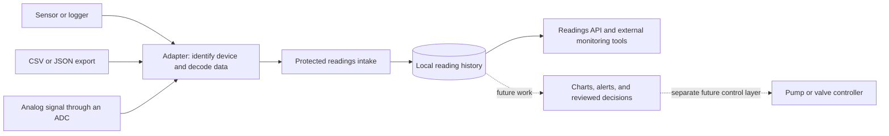

# Readings from your farm equipment

Keep a history of the conditions on your farm: greenhouse temperature, humidity, soil moisture, water flow, or other measurements your equipment records. Each reading keeps its unit, the equipment it came from, and the time it was taken. You can also label the growing area, such as “North greenhouse.”

## Start with readings you already have

Ask the person who set up your sensor or recorder to save a spreadsheet or readings file. Some equipment calls this **Export** or **Download readings**. Supported file types are called “CSV” (a simple spreadsheet) and “JSON” (a readings file used by some equipment).

Your equipment helper can check a file before adding its readings to FlowersForever. Sending the same unchanged file again will not count its readings twice. A missing reading stays missing; it is never treated as zero. The original information is kept alongside each measurement so you can check where it came from.

## What is available now

This is an optional early feature that needs equipment setup help. There is **no sensor connection screen or automatic collection yet**. The setup instructions below are for the person helping you connect your equipment; you do not need to understand the programming terms to understand your farm readings.

Bluetooth connections, automatic readings, charts, and alerts need further work. Pump and valve operation will be a separate later step. Saving a reading does not turn equipment on or off.

The soil and greenhouse tools in **Field science** are available now. They open in your web browser and keep their work separate until you save a copy in FlowersForever.

<details>
<summary><strong>Setup instructions for your equipment helper (technical details)</strong></summary>

## Pluggable farm readings · contract 1.0

FlowersForever stores adapter-reported measurements in its local H2 database. CSV/JSON logger exports or a program can send readings through the protected intake. A Bluetooth, USB/serial, network, or analog-to-digital gateway can use the same format once its adapter translates the hardware protocol. The plugin receives and retrieves data; it does not pair devices, open MQTT subscriptions, or operate pumps.



## Enable the intake

This is an optional development feature in the 1.3 source candidate. Enable it on a separate sample farm first. The ordinary app and existing pilot keep their current configuration.

| Environment variable | Value / purpose |
|---|---|
| `FLOWERFARM_READINGS_ENABLED` | `true`: register the `farm-readings` plugin |
| `FLOWERFARM_HARNESS_ENABLED` | `true`: enable the existing protected harness transport |
| `FLOWERFARM_HARNESS_TOKEN` | A private token of at least 24 characters |
| `FLOWERFARM_HARNESS_ALLOW_MUTATIONS` | `true`: permit recording readings |
| `FLOWERFARM_HARNESS_ALLOW_SENSITIVE_READ` | `true`: permit reading the measurement history |

The HTTP route is `POST /api/harness/farm-readings/commands`. It requires the existing harness token header and [CSRF handshake](HTTP_CLIENT_WRITES.md). Authenticated/server profiles also require the normal farm login. Local HTTP defaults to loopback; the importer requires HTTPS for remote connections. The same plugin actions are discoverable through the [MCP harness](AI_HARNESS.md). Enabling physical actions is unnecessary for readings.

The harness token grants configured access to the local farm instance. `source-id` and `deviceId` are attribution labels supplied by an adapter, not separate device credentials or proof of a hardware identity. Per-device credentials and adapter-specific authorization are future work.

## Reading format

```json
{
  "requestId": "unique-command-id",
  "action": "record-readings",
  "arguments": {
    "source-id": "north-greenhouse-gateway",
    "readings": [
      {
        "readingKey": "sensor-1-air-temperature-20261001T120000Z",
        "deviceId": "sensor-1",
        "metric": "air.temperature",
        "unit": "C",
        "value": 21.125,
        "quality": "GOOD",
        "observedAt": "2026-10-01T12:00:00Z",
        "location": "North greenhouse",
        "rawFrame": "{\"temperature_c\":21.125}"
      }
    ]
  }
}
```

`readingKey`, `deviceId`, `metric`, `unit`, and `observedAt` are required. `quality` defaults to `GOOD`. `location` and `rawFrame` are optional. A source identifier is required for the whole batch. Source/device/metric/key identifiers use letters, numbers, dots, underscores, colons, slashes, or hyphens. Identifier limits are respectively 80, 120, 80, and 160 characters; units allow 40 characters, and location allows 180.

- **Value:** an exact finite JSON number with at most 18 integer digits and 12 fractional digits. Extra nonzero precision is rejected rather than rounded. Negative values and real zeroes are valid measurements.
- **Unit:** explicitly reported and stored unchanged after trimming surrounding whitespace. There is no automatic unit conversion or inferred calibration. A voltage reading is a voltage reading until an adapter applies a declared calibration and records its evidence.
- **Quality:** `GOOD`, `SUSPECT`, `MISSING`, or `ERROR`. `GOOD` and `SUSPECT` require a numeric value. `MISSING` must omit it. `ERROR` can omit a value or retain a reported number for diagnosis. Quality is adapter-reported, not a certification by the application.
- **Observation time:** an ISO-8601 instant with an offset. UTC normalization preserves nanoseconds. It must be on/after the Unix epoch and no more than five minutes ahead of the receiving farm clock. Delayed and out-of-order readings are accepted. The app separately records its own receipt time.
- **Raw frame:** optional exact text, including line endings, up to 8192 UTF-8 bytes. Binary radio frames must be represented as text by an adapter, with the encoding declared in that text. Do not include login credentials in measurement frames.
- **Retry identity:** the pair `(source-id, readingKey)` identifies one reading. Use distinct keys for each channel, even when several measurements share a hardware packet timestamp. Exact retries return the existing ID and preserve the original receipt time. Reusing a key with changed value, unit, metric, time, quality, location, or raw text is rejected. A correction needs a new key; saved history is not overwritten.

Each command accepts 1–500 readings. A database lock protects duplicate checks and inserts across processes, and a transaction makes the entire batch succeed or roll back. Independent source identifiers can use the same reading key. The response gives submitted, inserted, and replayed counts and the saved reading IDs.

## Start with a logger file

Python 3.10+ and its standard library are enough; no paid service is required. Preview the supplied sample before writing anything:

```bash
python scripts/import-farm-readings.py docs/examples/farm-readings.csv --source-id sample-logger
```

For a real temperature log with `timestamp` and `temperature_c` columns, explicitly map the columns and declare its device, metric, and unit:

```bash
python scripts/import-farm-readings.py logger.csv --source-id house-gateway \
  --columns docs/examples/greenhouse-columns.json \
  --device-id house-1 --metric air.temperature --unit C
```

Add `--send` after reviewing the file and mapping. Use `--url https://your-farm-host` for a configured remote farm; the default is `http://127.0.0.1:8080`. The importer reads the harness token from the environment, and optional HTTP Basic credentials from `FLOWERFARM_HTTP_USER` / `FLOWERFARM_HTTP_PASSWORD`. It retains the CSRF cookie, obtains a fresh token before every batch, refuses redirects, and never prints authentication headers.

Files must be UTF-8 CSV or a JSON array of objects, at most 10 MiB. CSV supports `--delimiter comma`, `tab`, or `semicolon`; quoted fields are parsed normally, and duplicate headers or uneven rows are rejected. JSON numeric values remain decimal tokens without a binary-float conversion; repeated object field names are rejected. A mapping file maps declared reading field names to source columns. Constants cannot silently replace a populated input column that disagrees.

If a file has no `readingKey`, the importer derives one from the reported device, metric, and exact timestamp text. Keep those identifiers and timestamp formatting stable between retries. This deliberately does not hash the value into the identity: a changed measurement must conflict rather than masquerade as a retry. Explicit logger event keys are preferable when available. The original row is retained as JSON text in `rawFrame` unless the file supplies its own raw frame; this is a row representation, not a byte-for-byte archive of the original file.

The importer stages and checks the full file locally, then submits batches of at most 25 readings. The farm performs the authoritative validation. Successful earlier batches remain saved if a later batch fails; retrying the same file skips exact matches and exposes conflicting keys. Preview makes no network request and is not proof that the server will accept every timestamp or metadata field.

## Read history or monitor incoming data

`get-reading-contract` returns the schema, version, limits, and `equipmentControl: false`. It is a nonsensitive discovery action. `record-readings` requires mutation permission. `list-readings` requires sensitive-read permission and accepts:

```json
{
  "requestId": "unique-history-request",
  "action": "list-readings",
  "arguments": {
    "source-id": "north-greenhouse-gateway",
    "after-id": 0,
    "limit": 100
  }
}
```

The result contains `readings`, `nextAfterId`, and `hasMore`. Save `nextAfterId` and request the next page with a fresh command ID. Pages contain at most 200 readings and use receipt order, so a late observation is still delivered. The cursor is a database receipt identifier, not a device sequence or measurement time. Individual records retain both times and the reported source/device identity.

Polling this endpoint lets an external monitor see new readings as they arrive. There is currently no built-in continuously running collector, push subscription, sensor tab, chart, or stale-device alarm. Data remains available after reopening and enters the normal full H2 backup; the separate farm-data export/snapshot plugin does not currently include these readings. Keep device-side buffers and original logger files until their receipts are confirmed.

## CSRBT and future adapters

The bundled Greenhouse Monitor already supports controller CSV/JSON files, a local HTTP/JSON source, Web Serial on supported browsers, manual entry, and a labeled generated example. Its source registry is useful integration groundwork. Soil Bench has its own observation and export workflows. They still run in separate browser workspaces: the text archive does not automatically populate this readings store, and this store does not inject records into their calculations. See the [complete port audit](CSRBT_COMPLETENESS_AUDIT_20261010.md).

Implement adapters against published device formats. A future adapter should declare device identity, sampling interval, units, calibration/version information, timestamp handling, quality mapping, buffering, and retry keys. For an analog sensor, the ADC/gateway performs acquisition; Bluetooth or a network connection transports the resulting digital records. Keep original voltage/count readings when useful and label derived measurements and their calibration separately.

The next application layer should show freshness and sensor health beside time-series charts, with explicit metric/unit definitions and retention/export policies before sustained high-rate collection. The present H2 append store and global intake lock suit initial local logger intake, not an unbounded industrial telemetry fleet.

Equipment operation is a separate future adapter capability. A pump controller needs reviewed commands, feedback that distinguishes requested from actual state, bounded run time, local stop/override, and defined behavior when data or connectivity is lost. Measurement receipt alone must never imply authorization to run a pump.

</details>
