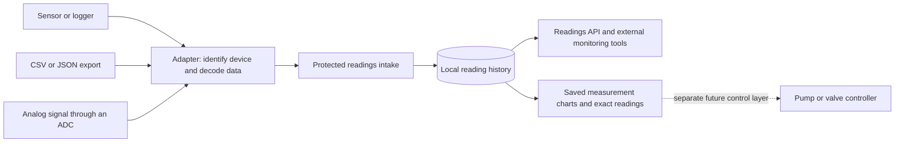

# Readings from your farm equipment

Keep a history of the conditions on your farm: greenhouse temperature, humidity, soil moisture, water flow, or other measurements your equipment records. Each reading keeps its unit, the equipment it came from, and the time it was taken. You can also label the growing area, such as “North greenhouse.”

## Start with readings you already have

Open **Equipment readings** in your farm workspace. To record a reading yourself:

1. Name the equipment and growing area, such as “North greenhouse probe” and “Tomato house.”
2. Choose the measurement, then enter the number and the unit shown by your equipment. The app does not convert units.
3. Check the measured date and time. The time includes your local offset so daylight-saving changes remain visible.
4. Choose **Measured**, **Needs checking**, **No reading**, or **Equipment error**. Leave the value blank for **No reading**; zero is an actual measurement.
5. Select **Review and save reading**, check the summary, then confirm.

**Latest readings** shows the most recent 200 received observations across your equipment. **Older readings** moves through earlier pages. Each row keeps the equipment, area, measurement, value, unit, condition, measured time, and source. Viewers can review history; farm hands and owners can save readings.

Use **Show → Latest reported measurements** to see the most recently measured observation for each equipment/measurement, keeping its source, unit, and growing area separate. Importing an old log later does not replace a newer measurement in this view. A newer **No reading**, **Needs checking**, or **Equipment error** remains visible; the app does not fill it with an older good value. Choose **All saved readings** to see the complete received history again. Both views use pages of up to 200 rows.

**Age of reading** tells you how long ago the measurement was taken, using your farm computer's clock. It does not use the upload time and does not prove that equipment is connected or working. A time ahead of the computer is labeled **Clock ahead — check time**. Age is a snapshot: the line below the table shows when it was calculated. Select **Latest readings** again to update it. These are reported conditions, not automatic health alarms or recommendations to run equipment.

If a save cannot be confirmed, your draft stays in place. Check **Latest readings**, then retry the unchanged draft if needed: the app reuses its identity to avoid a duplicate. To enter a separate observation, use **Start a new reading**. Changing a saved reading is not an overwrite; history stays intact.

Changing farm types is blocked while a reading is unfinished or its save is still running. Closing or signing out asks whether you want to keep working or explicitly leave unfinished work. Drafts are held in memory; an intentional exit discards them. Saved readings remain in the farm records.

## Find readings from one piece of equipment

Select a saved row, then choose **Show this equipment**. The saved list follows that equipment and its source in either **All saved readings** or **Latest reported measurements**. **Older readings** stays within that selection; **Latest readings** refreshes it. Choose **Show all equipment** to return to the whole farm. Viewers can use these controls too, without changing an unfinished entry or kept spreadsheet preview.

The caption states which equipment and source are actually displayed. **Entered on this farm** means a manual entry, and **Equipment spreadsheet** means a desktop sheet brought into this farm. Other sources retain their supplied names. Two devices with similar names, or the same displayed name from different sources, are kept separate. All of the selected equipment's measurements, growing areas, and units are included; the list still keeps each measurement's identity and condition. A failed refresh retains the previous rows and their actual caption; use **Latest readings** to retry or **Show all equipment** to return.

**See changes…** still follows just the selected measurement, area, and unit. **Save readings spreadsheet…** still copies the full farm history across **all equipment and sources**, even while this filter is active. The review states the complete count before you confirm. Source codes in that reference copy are preserved for your equipment helper.

## See how a measurement changed

Select a saved row, then choose **See changes…**. The view follows that exact equipment, measurement, unit, growing area, and source. For example, it can show soil moisture changing at your seedling bench without combining another probe's readings. Viewers can open it too. Your unfinished entry and any kept spreadsheet preview stay intact.

The chart runs from oldest to newest **measured time**, with actual time intervals. A delayed upload goes where its measured time belongs. Green dots show **Measured** values; green lines join only adjacent measured observations. Amber squares mark **Needs checking**. Gray crosses mark **No reading**, and red crosses mark **Equipment error**. These are gaps, never zero; an error's reported number remains in the table but is not plotted. Lines connect saved points and do not establish continuous monitoring. The displayed value range fits the points and is not a recommended operating range.

The table underneath keeps exact numbers, complete UTC measured and received times (including fractions of a second), conditions, and saved references. Scroll across for the additional columns. It is a read-only view, with no unit conversions, corrections, calibration, automatic health alarms, or equipment operation.

Each view loads **up to the latest 200 measured observations** for the selected measurement. It states when older history exists or the selected old reading lies outside that window. Use **Save readings spreadsheet…** for the full history. This is a snapshot: close it and choose **See changes…** again for new arrivals. Changing the selected row, refreshing history, or leaving the tab while the view is loading discards that obsolete result.

## Save a copy of your readings

Choose **Save readings spreadsheet…** to keep or share a readable copy of **all saved readings**, including older pages and every equipment source. It copies the full history even when **Latest reported measurements** is selected. Pick a filename ending in **.csv**, then review the count, snapshot time, and destination. If the file already exists, the review states that it will be replaced. Viewers can copy the history they can already read.

The copy keeps equipment names, growing areas, measurements, exact numbers, units, conditions, measured and received times, and source/equipment/reading references. **No reading** has a blank value; measured zero remains zero. Times use a universal time format with `Z` for UTC and retain any fractions of a second. Some spreadsheet programs round long numbers or reinterpret dates when opening a file: import those columns as text when exact digits matter. The file itself keeps the original precision.

The copy includes readings saved before the reviewed snapshot; new arrivals and unfinished entries are not included. Your manual draft and any kept bring-in preview stay intact. The app copies small batches in the background, writes a temporary file first, and publishes the completed copy. A detected change to the destination requires a fresh review. Wait for the result before leaving the app.

This is a readable spreadsheet **(CSV)** for reference and sharing, rather than a bring-in sheet or a restoration backup. Text beginning like a spreadsheet formula is prefixed with an apostrophe. Original equipment messages are omitted; a [full farm backup](BACKUP_RESTORE.md) retains the complete stored records. Use that backup to restore your farm.

## Bring in an equipment spreadsheet

Some equipment calls saving a spreadsheet **Export** or **Download readings**. In **Equipment readings**, choose **Spreadsheet layout** for the headings, then **Bring in equipment spreadsheet…**. Select a spreadsheet saved as **CSV UTF-8** (a simple spreadsheet format), up to 1 MB and 500 readings. The app checks every row before showing the review. Scroll across to check the units and measured times, then confirm to save all rows together. A bad row or a conflict saves none of this batch. Your unfinished manual reading stays intact.

Use these headings in any order: **Equipment, Growing area, Measurement, Value, Unit, Condition, Measured at**. Measurements use the same names as the entry screen. Conditions are **Measured**, **Needs checking**, **No reading**, or **Equipment error**. Keep units separate from values and use a decimal point. Leave Value blank for No reading; missing is never zero. A measured time must include its offset, such as `2026-10-01T08:30:00-07:00`. [Download an example sheet](examples/equipment-spreadsheet.csv) and replace its example rows with your own readings.

Give each device a different, consistent equipment name. Equipment name, measurement, and measured time identify an observation, so reopening the unchanged sheet adds no duplicates—even after renaming the file. An optional **Reading reference** column can hold the equipment's event number instead of using the measured time as its identity. Keep names, references, and times stable when retrying. A changed value or growing area for an existing observation conflicts; it does not replace history.

Declining the review keeps the checked preview in memory. Use **Review and retry spreadsheet…** to reopen it, or **Leave spreadsheet preview** to discard it explicitly. If a save cannot be confirmed, check **Latest readings** first, then retry the kept preview: the app uses those exact checked rows even if the original file has changed. Farm-type changes and exit warnings include previews and pending spreadsheet saves. An intentional exit discards unsaved previews; keep the original file for later retries.

The desktop stores the checked measurements, units, names, conditions, and times; it does not archive the original file or extra columns. Keep your original equipment file. For other column layouts, larger files, or readings files (JSON), your equipment helper can use the optional import tool described below. That helper also keeps a representation of each original row alongside its measurement.

## What is available now

Manual entry, spreadsheet selection with review, saved history, latest reported measurements with reading ages, a selected-measurement history chart with exact readings, and a reviewed spreadsheet copy of all saved readings are available directly in the desktop app. Direct spreadsheet selection uses the headings above; arbitrary logger columns and JSON still use the optional helper. The setup instructions below are for the person helping you connect your equipment; you do not need to understand the programming terms to understand your farm readings.

Bluetooth connections, automatic readings, live chart refresh, and health alerts need further work. Pump and valve operation will be a separate later step. Saving a reading does not turn equipment on or off.

The soil and greenhouse tools in **Field science** are available now. They open in your web browser and keep their work separate until you save a copy in FlowersForever.

<details>
<summary><strong>Setup instructions for your equipment helper (technical details)</strong></summary>

## Pluggable farm readings · contract 1.0

FlowersForever stores adapter-reported measurements in its local H2 database. CSV/JSON logger exports or a program can send readings through the protected intake. A Bluetooth, USB/serial, network, or analog-to-digital gateway can use the same format once its adapter translates the hardware protocol. The plugin receives and retrieves data; it does not pair devices, open MQTT subscriptions, or operate pumps.



## Enable the intake

This is an optional development feature in the 1.3 source candidate. Enable it on a separate sample farm first. The ordinary app and existing pilot keep their current configuration.

| Environment variable | Value / purpose |
|---|---|
| `FLOWERFARM_READINGS_ENABLED` | `true`: register the `farm-readings` plugin |
| `FLOWERFARM_HARNESS_ENABLED` | `true`: enable the existing protected harness transport |
| `FLOWERFARM_HARNESS_TOKEN` | A private token of at least 24 characters |
| `FLOWERFARM_HARNESS_ALLOW_MUTATIONS` | `true`: permit recording readings |
| `FLOWERFARM_HARNESS_ALLOW_SENSITIVE_READ` | `true`: permit reading the measurement history |

The HTTP route is `POST /api/harness/farm-readings/commands`. It requires the existing harness token header and [CSRF handshake](HTTP_CLIENT_WRITES.md). Authenticated/server profiles also require the normal farm login. Local HTTP defaults to loopback; the importer requires HTTPS for remote connections. The same plugin actions are discoverable through the [MCP harness](AI_HARNESS.md). Enabling physical actions is unnecessary for readings.

The harness token grants configured access to the local farm instance. `source-id` and `deviceId` are attribution labels supplied by an adapter, not separate device credentials or proof of a hardware identity. Per-device credentials and adapter-specific authorization are future work.

## Reading format

```json
{
  "requestId": "unique-command-id",
  "action": "record-readings",
  "arguments": {
    "source-id": "north-greenhouse-gateway",
    "readings": [
      {
        "readingKey": "sensor-1-air-temperature-20261001T120000Z",
        "deviceId": "sensor-1",
        "metric": "air.temperature",
        "unit": "C",
        "value": 21.125,
        "quality": "GOOD",
        "observedAt": "2026-10-01T12:00:00Z",
        "location": "North greenhouse",
        "rawFrame": "{\"temperature_c\":21.125}"
      }
    ]
  }
}
```

`readingKey`, `deviceId`, `metric`, `unit`, and `observedAt` are required. `quality` defaults to `GOOD`. `location` and `rawFrame` are optional. A source identifier is required for the whole batch. Source/device/metric/key identifiers use letters, numbers, dots, underscores, colons, slashes, or hyphens. Identifier limits are respectively 80, 120, 80, and 160 characters; units allow 40 characters, and location allows 180.

- **Value:** an exact finite JSON number with at most 18 integer digits and 12 fractional digits. Extra nonzero precision is rejected rather than rounded. Negative values and real zeroes are valid measurements.
- **Unit:** explicitly reported and stored unchanged after trimming surrounding whitespace. There is no automatic unit conversion or inferred calibration. A voltage reading is a voltage reading until an adapter applies a declared calibration and records its evidence.
- **Quality:** `GOOD`, `SUSPECT`, `MISSING`, or `ERROR`. `GOOD` and `SUSPECT` require a numeric value. `MISSING` must omit it. `ERROR` can omit a value or retain a reported number for diagnosis. Quality is adapter-reported, not a certification by the application.
- **Observation time:** an ISO-8601 instant with an offset. UTC normalization preserves nanoseconds. It must be on/after the Unix epoch and no more than five minutes ahead of the receiving farm clock. Delayed and out-of-order readings are accepted. The app separately records its own receipt time.
- **Raw frame:** optional exact text, including line endings, up to 8192 UTF-8 bytes. Binary radio frames must be represented as text by an adapter, with the encoding declared in that text. Do not include login credentials in measurement frames.
- **Retry identity:** the pair `(source-id, readingKey)` identifies one reading. Use distinct keys for each channel, even when several measurements share a hardware packet timestamp. Exact retries return the existing ID and preserve the original receipt time. Reusing a key with changed value, unit, metric, time, quality, location, or raw text is rejected. A correction needs a new key; saved history is not overwritten.

Each command accepts 1–500 readings. A database lock protects duplicate checks and inserts across processes, and a transaction makes the entire batch succeed or roll back. Independent source identifiers can use the same reading key. The response gives submitted, inserted, and replayed counts and the saved reading IDs.

## Start with a logger file

Python 3.10+ and its standard library are enough; no paid service is required. Preview the supplied sample before writing anything:

```bash
python scripts/import-farm-readings.py docs/examples/farm-readings.csv --source-id sample-logger
```

For a real temperature log with `timestamp` and `temperature_c` columns, explicitly map the columns and declare its device, metric, and unit:

```bash
python scripts/import-farm-readings.py logger.csv --source-id house-gateway \
  --columns docs/examples/greenhouse-columns.json \
  --device-id house-1 --metric air.temperature --unit C
```

Add `--send` after reviewing the file and mapping. Use `--url https://your-farm-host` for a configured remote farm; the default is `http://127.0.0.1:8080`. The importer reads the harness token from the environment, and optional HTTP Basic credentials from `FLOWERFARM_HTTP_USER` / `FLOWERFARM_HTTP_PASSWORD`. It retains the CSRF cookie, obtains a fresh token before every batch, refuses redirects, and never prints authentication headers.

Files must be UTF-8 CSV or a JSON array of objects, at most 10 MiB. CSV supports `--delimiter comma`, `tab`, or `semicolon`; quoted fields are parsed normally, and duplicate headers or uneven rows are rejected. JSON numeric values remain decimal tokens without a binary-float conversion; repeated object field names are rejected. A mapping file maps declared reading field names to source columns. Constants cannot silently replace a populated input column that disagrees.

If a file has no `readingKey`, the importer derives one from the reported device, metric, and exact timestamp text. Keep those identifiers and timestamp formatting stable between retries. This deliberately does not hash the value into the identity: a changed measurement must conflict rather than masquerade as a retry. Explicit logger event keys are preferable when available. The original row is retained as JSON text in `rawFrame` unless the file supplies its own raw frame; this is a row representation, not a byte-for-byte archive of the original file.

The importer stages and checks the full file locally, then submits batches of at most 25 readings. The farm performs the authoritative validation. Successful earlier batches remain saved if a later batch fails; retrying the same file skips exact matches and exposes conflicting keys. Preview makes no network request and is not proof that the server will accept every timestamp or metadata field.

## Read history or monitor incoming data

`get-reading-contract` returns the schema, version, limits, and `equipmentControl: false`. It is a nonsensitive discovery action. `record-readings` requires mutation permission. `list-readings` requires sensitive-read permission and accepts:

```json
{
  "requestId": "unique-history-request",
  "action": "list-readings",
  "arguments": {
    "source-id": "north-greenhouse-gateway",
    "after-id": 0,
    "limit": 100
  }
}
```

The result contains `readings`, `nextAfterId`, and `hasMore`. Save `nextAfterId` and request the next page with a fresh command ID. Pages contain at most 200 readings and use receipt order, so a late observation is still delivered. The cursor is a database receipt identifier, not a device sequence or measurement time. Individual records retain both times and the reported source/device identity.

The desktop **Equipment readings** tab uses a separate bounded, descending receipt cursor to show all sources, newest first. Its manual observations use source `desktop.manual`, a generated reading key retained through failed-save retries, and a reversible UTF-8 equipment-name encoding in `deviceId` (maximum 84 UTF-8 bytes before encoding). Desktop spreadsheets use source `desktop.spreadsheet` and the same name encoding. Their SHA-256 event key covers the encoded equipment name, metric, and normalized observation instant, or an explicit reading reference (up to 160 characters); value and filename are excluded. Thus equivalent time-zone offsets identify the same instant. File parsing is strict UTF-8, comma-delimited CSV with optional BOM, quoted cells, exact decimal numbers, bounded rows/columns/cells, and duplicate/unknown heading rejection. Only locally selected regular non-link `.csv` files are read, with a bounded stream; parsing and database work run off the event thread. The whole desktop batch enters one transaction. Adapter IDs remain unchanged. This does not enable the harness HTTP transport: helper/API intake still requires its opt-in settings and authorization. Desktop entry follows the signed-in barn role, with access checked after file selection, after confirmation, and again before calling the transactional intake. An already started transaction is not canceled by a later account change.

Polling this endpoint lets an external monitor see new readings as they arrive. There is currently no built-in continuously running collector, push subscription, chart, or stale-device alarm. Data remains available after reopening and enters the normal full H2 backup; the separate farm-data export/snapshot plugin does not currently include these readings. Keep device-side buffers and original logger files until their receipts are confirmed.

The desktop latest-reported view ranks all observations by their actual instant, retaining nanoseconds, within `(source_id, device_id, metric, unit, location)`. Equal observation times use the greatest receipt ID as a deterministic tie-breaker, including missing/error reports. The outer result pages by descending selected receipt ID; ranking happens before applying the cursor so earlier pages cannot revive superseded values. New or updated groups arriving after a page starts are seen on a first-page refresh. This view is a read-only H2 window query suited to the current initial local logger scale, not a sustained industrial telemetry dashboard. Ages use one clock snapshot per displayed page; no background acquisition or timed age update is implied.

The desktop spreadsheet copy captures `MAX(id)` and `COUNT(*)` in one read-only query, then streams ascending receipt pages of up to 200 rows through that fence. The append-only history and serialized transactional intake ensure later commits cannot insert a lower receipt behind the fence. Rolled-back identity gaps are allowed. A count/order mismatch fails without publishing the partial copy. This is a finite receipt snapshot, not a long-running database transaction or an industrial export service.

Only a locally chosen `.csv` destination with an existing, resolved parent is admitted. Existing targets must be regular non-link files. Review captures file identity/size/mtime; checks before and after staging reject detected changes. This is not an OS-level compare-and-replace guarantee against a malicious local directory owner. Staging is flushed before atomic replacement when available, with the existing file-move fallback. A new destination uses a move without replacement. Failed staging is removed. CSV uses a UTF-8 BOM, CRLF records, quoted cells, plain exact decimal strings, ISO UTC instants with nanoseconds, and apostrophe-prefixed formula-looking text after leading whitespace/BOM. Raw frames are excluded. All database/file work runs off the Swing event thread; drafts/previews are preserved and pending-copy exit/farm-change warnings use the existing shell guards. This readable copy has additional provenance columns and is deliberately not accepted by the seven-column bring-in layout.

## CSRBT and future adapters

The bundled Greenhouse Monitor already supports controller CSV/JSON files, a local HTTP/JSON source, Web Serial on supported browsers, manual entry, and a labeled generated example. Its source registry is useful integration groundwork. Soil Bench has its own observation and export workflows. They still run in separate browser workspaces: the text archive does not automatically populate this readings store, and this store does not inject records into their calculations. See the [complete port audit](CSRBT_COMPLETENESS_AUDIT_20261010.md).

Implement adapters against published device formats. A future adapter should declare device identity, sampling interval, units, calibration/version information, timestamp handling, quality mapping, buffering, and retry keys. For an analog sensor, the ADC/gateway performs acquisition; Bluetooth or a network connection transports the resulting digital records. Keep original voltage/count readings when useful and label derived measurements and their calibration separately.

Beyond the current reading ages and bounded saved-history charts, future work should add sensor health and live refresh, with explicit metric/unit definitions and retention policies before sustained high-rate collection. The present H2 append store and global intake lock suit initial local logger intake, not an unbounded industrial telemetry fleet.

Equipment operation is a separate future adapter capability. A pump controller needs reviewed commands, feedback that distinguishes requested from actual state, bounded run time, local stop/override, and defined behavior when data or connectivity is lost. Measurement receipt alone must never imply authorization to run a pump.

The desktop history chart uses a fixed prepared query anchored to a saved receipt ID. It joins source/device/metric/unit/location exactly, orders by a nanosecond-capable timestamp cast and receipt ID, and reads at most 201 rows (200 displayed plus a truncation check). Delayed uploads and equal-time events remain deterministic. It normalizes exact `BigDecimal` value differences and seconds-plus-nanoseconds time differences before converting bounded fractions to chart pixels. Stored/table values are never converted to floating point. Raw equipment frames are not displayed. This adds no HTTP operation, device credential, hardware action, background timer, schema, or dependency.

</details>

Equipment-focused paging resolves source/device identity from a saved receipt with fixed prepared queries. It reads at most 201 rows per page, uses receipt cursors in saved history, and ranks latest measurements before applying that cursor. Display labels do not change stored source codes or copy identities. This adds no schema, HTTP operation, continuous collector, or equipment command.
