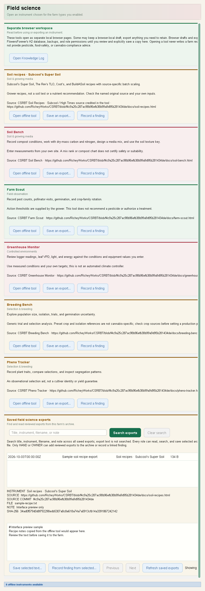
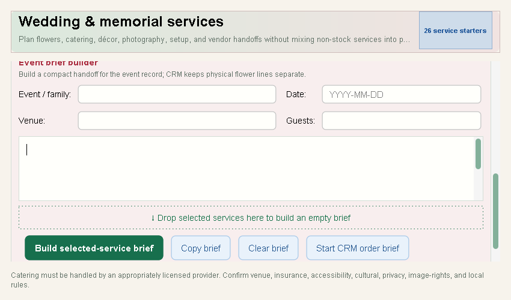

# FlowersForever desktop guide

This guide follows the everyday desktop workflow: check the farm, record the
morning cut, prepare customer orders, pack for market, and close the day.

## Access roles

- **OWNER** can add and change records, run imports and exports, and clear the
  activity history.
- **HAND** can add and change inventory, harvests, customers, and orders. A hand
  can view and export activity history but cannot clear it.
- **VIEWER** can search, filter, review, print, and export. Editing controls are
  disabled and identify the access needed.

Open **Account → My access** at any time to review the current role. In local
mode the app provides full OWNER access.

## Farm setup and farm types

At desktop startup, choose one farm type or select **Combine farm types…** to
enter a workspace with several specialties. A single choice is marked
**Current type**; a combination marks its main card **Primary · in mix** and
the others **In your mix**. Use **Find a farm type** to narrow the menu cards;
if no cards match, **Clear search** shows all types again without changing the
saved selection. Choose **Rose & events** for a rose grower selling
stems, bouquets, or wedding work; **Wildflower farm** for cut-flower growing and
market work; **Flower shop** for a floral retailer or designer; **Cannabis farm** for a
cultivation planning notebook; **Potato farm** for field plans; **Apple orchard**
for orchard block plans; **Berry farm** for berry blocks and picking windows;
**Vineyard farm** for grape block and harvest-window plans;
**Hay & forage** for field cutting plans;
**Hops farm** for hop-yard and season plans;
**Grains farm** for field and crop rotation plans;
**Seed farm** for seed-crop field and season plans;
**Tree nut orchard** for nut block and season plans;
**Vegetable farm** for field or bed succession plans;
**Aquaculture farm** for aquatic cohort plans;
**Christmas tree farm** for tree block and replacement planting plans;
**Apiary farm** for dated hive checks;
**Mushroom farm** for growing batch plans;
**Cranberry farm** for perennial bed and harvest-method plans;
**Pumpkin patch** for planting, picking, and sales-mode plans;
**Nursery farm** for live-plant growing batches; **Livestock farm** for herd
group plans; **Poultry & eggs** for a dated egg collection log; **Dairy farm** for
dated milk collections; or **Custom farm** for other
operations. Any role can enter the saved workspace or open a type already in
the mix. In a combination, an OWNER can use **Add to mix…** on any unselected
type, including Custom farm, or edit the combination;
**File → Choose or combine farm types…** returns to the menu later.

Open **File → Farm setup…** to record the operation's state, primary enterprise,
additional enterprises, specialties such as crops or breeds, and cut-flower
offerings. A mixed farm can name all its enterprises and combine the specialty
tools it uses. The selected farm types are saved separately from the broader
enterprise list. A flower shop can select **Floral retail** as its
enterprise without claiming to grow cut flowers or plan beds. OWNER can save
these details. HAND and VIEWER can inspect them.

Existing installations begin with **Washington · Cut flowers · Rose & events**
selected so their current workflow remains available. Review and save Farm
setup if the operation runs a shop, grows wildflowers, is in Oregon, or has
other enterprises. Choosing a nonflower card from the original single **Cut
flowers** starter profile replaces that default and clears flower offerings.
Switching a farm that already records multiple enterprises keeps its additional
lines and offerings. Review Farm setup after choosing a type to confirm the
operation's actual mix.

Changing a single selected type or saving a new combination changes the saved selection and opens
its navigation. Finish unfinished drafts and pending saves first: the menu
checks for them before changing the saved selection. Farm setup
also checks unfinished work before allowing an OWNER to save changes that could
rebuild navigation. **Rose & events** opens on the familiar **Dashboard** under **Today**;
the other choices open a **Workspace** overview with links to their available
tools. Switching does not move or split records. The setup is saved in the
local database.

### Combine several farm types

Choose **Combine farm types…** from the farm-type menu. Select two or more
types, choose the **Main farm type**, and save the combination. The
combined **Workspace** overview opens first; the main type sets context and
shared defaults. For example, select **Potato farm**, **Cannabis farm**, and
**Apple orchard**. The workspace then offers **Field plans**, **Cultivation**,
and **Orchard blocks**.
Field plans and orchard blocks are independent planning notebooks; each keeps
its own saved areas and edits. The shared **Harvest Log**, **Inventory**,
**Customers & Orders**, and **Knowledge Log** appear once.

In the combination dialog, drag a farm card by **↗ Drag this card** onto
**Your mix** to include it, **Main focus** to include it as the main type, or
**Remove from mix** to take it out of the current mix. The card checkboxes and
**Main farm type** choice do the same work without dragging. These moves change
only the dialog draft: choose **Save combination** to apply them, or **Cancel**
to leave the saved mix as it was. Removing a type hides its tools but keeps its
saved records.

Search in the combination dialog to narrow the visible farm cards, then choose
**Clear search** to show all types. Filtering does not remove selected types or
change the main type, including when those cards are hidden by the search.
The drag targets, card checkboxes, and **Main farm type** choice remain available
while searching.

Choose **Open in mix** on any included farm card to jump to its main tool without
changing the saved combination. This is available to all roles. On an unselected
card, **Add to mix…** opens the editor with that type and the current mix
in a draft. **Save combination** applies it; **Cancel** keeps the saved mix.
Custom farm can join a mix for an unlisted line of work while named specialty
tools stay available. It can also be the main type. Name the other crops or
products in **Farm setup…**; those names appear in the combined overview.
Custom adds the shared Harvest Log and no separate production plan.

Open **File → Choose or combine farm types…**, then **Edit combined farm…** to add or
remove a specialty or change the main type. The action reads **Combine farm
types…** when only one type remains. Removing a type hides that tool;
its saved plans remain in the local database and become available when the type
is added again. You can edit an existing combination down to one type if the
operation no longer needs its other specialty tools. Finish any open draft or
pending save before changing the combination. In Farm setup, edit the broader
enterprise mix and specialty crop names; in the workspace, edit supported plan
details and product records. These choices do not add arbitrary custom fields
or connect a specialty plan to harvest, stock, or sales automatically.

Today's deep season planning, floral recipes, and production calculations remain
designed for cut flowers. The cannabis workspace adds a limited cultivation
planning notebook. Potato farm, Apple orchard, Berry farm, Vineyard farm, Hay & forage, Hops farm, Grains farm, Seed farm, Tree nut orchard, and Vegetable farm add field and block
planning notebooks. Aquaculture farm adds aquatic cohort plans; Christmas tree farm adds tree block and replacement planting plans; Mushroom farm adds growing batch plans; Cranberry farm adds perennial bed plans; Pumpkin patch adds seasonal patch plans. Nursery farm adds live-plant growing batch plans, and
Livestock farm adds current herd group plans. Poultry & eggs and Dairy farm add
editable, dated collection entries; Apiary farm adds dated hive observations.
Those specialty records
are separate from generic harvest, stock, and order records; they do not add
grading, packout, storage, weight conversion, U-pick booking, nursery licensing,
or food-safety traceability workflows.
Custom farm does not add a crop-specific production model. For the current scope
of potato, apple, berry, vineyard, hay, hops, grains, seed, tree nuts, vegetables, pumpkins, aquaculture, Christmas trees, mushrooms, cranberries, apiaries, nursery, livestock, poultry, dairy, cannabis, and other farm types, see [farm types and workflow
scope](FARM_TYPES.md). Include the [database backup](BACKUP_RESTORE.md) when
moving or restoring Farm setup.

## Field science tools

Open **Field science** after choosing a farm type. The tab shows CSRBT field-kit
tools matched to the selected type; a combined farm shows the matching tools
for its mix. Select **Open offline tool** on a card to launch its bundled page
in the default browser. For example, Cannabis farm offers **Soil recipes ·
Subcool’s Super Soil**; Mushroom farm offers wild fungal specimen references;
Aquaculture farm offers Food Web Builder as an ecology study. Cards for a farm
type are described in the [farm-to-tool map](CSRBT_FIELD_KIT_PORT.md).



Enter data and use the browser page's copy, export, or print action to keep a
result. To archive its text in FlowersForever, choose **Save an export…** on
that instrument's card. Paste the copied text, browse for a `.eco`, `.txt`, or
`.csv` file, or drop text or one such file into the draft. Files must be UTF-8
text, and the saved text must be no more than **512 KiB** in UTF-8. Give the
export a title, optionally add a note, inspect or edit the staged text, then
choose **Save export**. Browsing and dropping do not save by themselves;
**Cancel** leaves no archive entry. Select a row under **Saved field science
exports** to read or copy its reviewed text and see the selected instrument,
source URL, pinned CSRBT commit, and SHA-256 hash of that saved text. Search
the full archive by title, instrument, filename, or note with **Search exports**
or Enter; **Clear search** restores all entries. The saved text itself is not
searched. **Previous** and **Next** browse matching entries, 200 at a time.
The archive is available from Field science even when the selected farm type
has no matching offline tool cards.

To make a standalone file from an archived entry, select its row and choose
**Save selected text…** after its text loads. The app checks the saved length
and SHA-256 before writing. The file contains only the reviewed saved text in
UTF-8, preserving its BOM, line endings, and trailing spaces. It does not
include the archive title, source metadata, or the original browser file.
Choose a `.eco`, `.txt`, or `.csv` destination; the app prompts before replacing
an existing file, and canceling leaves that file in place. VIEWER can use this
read-only export action.

If a tool helps explain something you actually observed or tried on your farm,
select **Record a finding** on its card. An editable Knowledge Log draft opens
with the tool's title and source URL and a `field-science` tag. Describe your
observation and follow-up, review it, and confirm to save. This is separate
from **Save an export**: the card action does not copy the browser page or
attach an archive entry. The tab's **Open Knowledge Log** button opens the log
without preparing a sourced draft.

To cite reviewed text already in the archive, select its row, wait for the
saved body to load, and choose **Record finding from selected…**. In the
editable draft, write your own farm observation and follow-up; no calculation
or tool output is filled in as an observation. Confirming saves the finding
with a link to the exact reviewed H2 export by ID. In the saved Knowledge Log
detail, **Open linked export** opens that entry for reading. The link does not
refer to the original browser file. VIEWER can open a linked export, but only
OWNER and HAND can create a finding.

Opening a browser tool never saves a farm record or changes a crop plan,
inventory, or order. The saved export archive contains only the text you
reviewed and confirmed, with catalog provenance for the card you selected; it
does not verify the text's scientific accuracy or include the original file.
OWNER and HAND can save reviewed exports and findings. VIEWER can open tools,
search and read saved exports, save selected archive text to a file, and open
an export linked from a saved finding, but cannot save farm records. The
browser's own local drafts and downloaded originals remain outside desktop
roles and H2 backups;
keep those files separately. Reviewed archive entries and confirmed findings
are in H2 and return with its [data-directory backup](BACKUP_RESTORE.md).

## Cannabis cultivation planning

Choose **Cannabis farm** from the farm-type menu or Farm setup and open
**Cultivation**. Create a named batch with its growing area, plant count, start
date, planned harvest date, and stage. A cultivar and notes are optional. Select
a saved batch to review or edit
those planning details. The available stages are Planned, Propagating,
Vegetative, Flowering, Harvested, Complete, and Cancelled; the stage is a local
planning label, not a state tracking event.

To change a saved batch's planning stage, drag its row onto a stage under
**Move planning stage**. You can also select the row and click a stage. The
stage change saves immediately and changes no other batch details. Save or
discard an open draft before moving a batch so the move cannot overwrite
unsaved work. VIEWER access cannot change stages.

Use **Inventory** for general products and **Customers & Orders** for customer
sales records. A cultivation batch does not automatically create a harvest lot,
change inventory, or link an order to its plants. These tools do not provide
license identifiers, regulated plant counts, testing, transfers, manifests, or
state reporting. Follow the farm's required state system separately; see
[cannabis and hemp workflow scope](FARM_TYPES.md#cannabis-and-hemp-require-a-separate-track).

## Potato field and apple orchard planning

Choose **Potato farm** and open **Field plans**, or choose **Apple orchard** and
open **Orchard blocks**. Select **New field plan** or **New orchard block**,
enter a field or block name, and choose **Save plan**. Variety, acres, planting
date, target harvest date, and notes are optional. Set a planning stage to show
where the area stands. Select a saved row to review or edit it; **Discard changes**
restores the saved details.

To change a saved field or block's stage quickly, drag its row onto a stage in
**Move by stage**. You can also select the row and click a stage, or use the
**Planning stage** field and **Save plan**. A drop or stage click saves that stage
change immediately. Finish or discard any open plan draft first; a drag cannot
overwrite unsaved details. VIEWER access cannot change stages.

These are local planning notebooks. Saving a field or block does not create a
harvest lot, change inventory, or link an order to that area. Use the
**Open Harvest Log**, **Open Inventory**, and **Open Customers & Orders** links for
general records. The notebooks do not track potato grades or packout, apple
bins or cold storage, or crop-specific traceability. [Farm types and workflow
scope](FARM_TYPES.md#choose-a-workspace-for-the-days-work) lists the current
boundaries.

## Berry block planning

Choose **Berry farm** and open **Berry blocks**. Create a plan with a block name
and berry crop. Add a cultivar, acres, planting date, first and last planned
pick, and notes when known. Set a planning stage and choose an intended channel:
**Fresh**, **Processing**, **U-pick**, **Mixed**, or **Undecided**. Select a saved
block to review or edit its plan.


The pick dates describe the planned window; they are not records of actual picks.
Use **Harvest Log**, **Inventory**, and **Customers & Orders** for general records.
A berry block does not create a harvest lot or stock, and those general records
are not linked back to the block. This notebook does not manage packout, cold
storage, U-pick bookings, weight conversion, or food-safety traceability. See
[farm types and workflow scope](FARM_TYPES.md#choose-a-workspace-for-the-days-work)
for the current boundaries.

## Vineyard block planning

Choose **Vineyard farm** and open **Vineyard blocks**. Save a named grape block
with its variety. Add a location, acreage, first and last planned harvest
dates, intended destination, planning stage, and notes as they become known.
The dated window belongs to the season being planned; update the saved block
when that plan changes. Select a saved row to review or edit its details.
A farm growing grapes alongside other crops can add Vineyard farm to its
combination while keeping shared customers, products, and notes.

To change only a saved block's planning stage, drag its row onto a stage under
**Move a saved block**. Selecting the row and clicking a stage does the same
work. Both save the stage change immediately. Save or discard an open form
draft first so the move cannot overwrite unsaved details. VIEWER access cannot
change stages.


The harvest window and destination describe intentions. They do not record
picked grape weight or a delivery, and a vineyard block does not create a
harvest lot, stock, or customer order. **Inventory** and **Customers & Orders**
remain separate general tools. Grape quality, crush and
wine production, contract fulfillment, plant-health events, and regulatory
records need their own workflows. See [farm types and workflow
scope](FARM_TYPES.md#choose-a-workspace-for-the-days-work).

## Hay and forage cutting plans

Choose **Hay & forage** and open **Hay cuttings**. Save a named field, forage
crop, cutting number, and planned cut date. Add optional acreage, a planned
bale date, stage, and notes as they become known. Select a saved cutting to
review or edit its plan. A dairy or livestock operation can add Hay & forage
to its farm mix and keep the other specialty tools and shared records together.

To plan another pass through the same field, select a saved cutting and choose
**Plan next cut**. The new draft carries over its field, forage crop, and acres,
sets the cutting number one higher, and leaves both planned dates blank. Enter
the next planned cut date before saving. Save or discard an open draft first;
VIEWER access cannot use this action, and cutting 99 cannot be advanced.

To change only a saved cutting's planning stage, drag its row onto a stage
under **Move a saved cutting**. Select the row and click a stage for the same
action. Both save the stage change immediately. Save or discard an open form
draft first so the move cannot overwrite unsaved details. VIEWER access cannot
change stages.


These dates and stages are plans. A cutting entry does not record harvested
forage, bale counts or weights, feed rations, or forage quality. It does not
create stock, update a Herd groups or Milk collections entry, link an order,
or serve as a compliance record. **Inventory** and **Customers & Orders**
remain separate general tools. See [farm types and workflow
scope](FARM_TYPES.md#choose-a-workspace-for-the-days-work).

## Hop yard season plans

Choose **Hops farm** and open **Hop yards**. Save a yard, hop variety, and
planned harvest start date. Add acreage, a planned stringing date and harvest
end date, stage, and notes as the season plan becomes clear. Select a saved yard
to review or edit it. A farm that also grows other crops can add Hops farm to its mix;
the other selected tools and shared records remain available.

Select a saved yard and choose **Plan next season** to begin another plan for
the same yard and variety. The draft carries over its yard, variety, and acres
and leaves the planned dates blank for the new season. Enter a new planned
harvest start date before saving. Save or discard an open draft first; VIEWER
access cannot create or edit plans.

To change only a saved yard's planning stage, drag its row to a stage under
**Move a saved yard**. Select the row and click a stage for the same action.
Both save the stage change immediately. Save or discard an open form draft
first so the move cannot overwrite unsaved details. VIEWER access cannot
change stages.


These dates and stages are plans. A yard entry does not record picked yield,
drying, pellets, product stock, contract commitments, or customer orders.
**Inventory** and **Customers & Orders** remain separate general tools. The
yard notebook is not a regulatory record. See [farm types and workflow
scope](FARM_TYPES.md#choose-a-workspace-for-the-days-work).

## Grain field rotation plans

Choose **Grains farm** and open **Grain fields**. Save a named field and grain
crop with a planned harvest start. Add a variety, acres, previous crop, planned
seeding date, planned harvest end, stage, and notes when known. The seeding date
must be on or before the harvest start, and the harvest end must be on or after
the start. Select a saved field to review or edit its plan. In a mixed farm,
Grain fields appears alongside the other selected specialty tools and shared
records.

Select a saved field and choose **Plan next rotation** to start another crop
plan for that field. The new draft retains the field and acres, sets **Previous
crop** to the saved grain crop, and clears the next grain crop, variety, dates,
and notes. Its stage begins at Planned. Enter a new grain crop and planned
harvest start before saving. Save or discard an open draft first; VIEWER access
cannot create or edit plans.

To change only a saved field's planning stage, drag its row onto a stage under
**Move a saved field**. Select the row and click a stage for the same action.
Both save the stage change immediately. Save or discard an open form draft
first so the move cannot overwrite unsaved details. VIEWER access cannot
change stages.


These dates and stages are plans. A field entry does not record harvested
grain yield, grade, moisture, storage, or contracts, and it does not create
stock or link an order. **Inventory** and **Customers & Orders** remain
separate general tools. See [farm types and workflow
scope](FARM_TYPES.md#choose-a-workspace-for-the-days-work).

## Seed field season plans

Choose **Seed farm** and open **Seed fields**. Save a named field, seed species
or crop, and planned harvest start. Add a variety, acres, previous crop, planned
sowing and flowering dates, planned harvest end, intended use, manual isolation
notes, stage, and general notes when known. Select a saved field to edit its
plan. In a mixed farm, Seed fields appears beside the other selected specialty
tools and shared records.

Select a saved field and choose **Plan next season** to start another plan. The
draft carries forward the field, crop, variety, and acres, clears its planned
dates, and starts at Planned. Enter the new planned harvest start before saving.
Save or discard an open draft first; VIEWER access cannot create or edit plans.

To change only a saved field's planning stage, drag its row onto a stage under
**Move a saved field**. Select the row and click a stage for the same action.
Both save the stage change immediately. Save or discard an open form draft
first so the move cannot overwrite unsaved details. VIEWER access cannot
change stages.


Isolation notes are text supplied by the grower. The notebook does not
calculate isolation distances, check nearby seed fields, determine eligibility,
or certify seed. A field plan does not record actual yield, cleaned seed lots,
test results, stock, or order links. **Inventory** and **Customers & Orders**
remain separate general tools. See [farm types and workflow
scope](FARM_TYPES.md#choose-a-workspace-for-the-days-work).

## Tree nut block season plans

Choose **Tree nut orchard** and open **Nut blocks**. Save a named block, nut
crop, and planned harvest start. Add a variety, pollinizer variety, acres, tree
count, planned bloom start, floor preparation date, planned harvest end,
intended destination, stage, and notes when known. Select a saved block to edit
its plan. In a mixed farm, Nut blocks appears beside the other selected
specialty tools and shared records. Planned bloom and floor preparation dates
must be on or before harvest start; harvest end must be on or after start.

Select a saved block and choose **Plan next season** to start another plan.
The draft carries forward its block, crop, variety, pollinizer variety, acres,
tree count, and destination. Dates and notes are cleared, and the stage begins
at Planned. Enter a new planned harvest start before saving. Save or discard
an open draft first; VIEWER access cannot create or edit plans.

To change only a saved block's planning stage, drag its row onto a stage under
**Move a saved block**. Select the row and click a stage for the same action.
Both save the stage change immediately. Save or discard an open form draft
first so the move cannot overwrite unsaved details. VIEWER access cannot
change stages.


The pollinizer variety is a grower-entered field. The notebook does not check
whether it is compatible with the crop variety. A nut block plan does not
record actual harvested yield, cleaning, drying, or grading, and does not
create stock or link orders. **Inventory** and **Customers & Orders** remain
separate general tools. See [farm types and workflow
scope](FARM_TYPES.md#choose-a-workspace-for-the-days-work).

## Vegetable planting succession plans

Choose **Vegetable farm** and open **Vegetable plantings**. Save a field or
bed, crop, succession number, and planned harvest start. Add a variety,
previous crop, acres, sowing and transplant dates, planned harvest end,
intended channel, stage, and notes when known. All dates are entered by the
grower. Select a saved planting to edit its plan. In a mixed farm, Vegetable
plantings appears beside the other selected specialty tools and shared records.
Sowing and transplant dates must be on or before planned harvest start; a
planned harvest end must be on or after that start.

Select a saved planting and choose **Plan next succession** to start another
plan. The draft carries forward its field or bed, crop, variety, previous
crop, acres, and intended channel, increases the succession number, clears its
dates and notes, and starts at Planned. Enter a new planned harvest start
before saving. Save or discard an open draft first; VIEWER access cannot
create or edit plans.

To change only a saved planting's planning stage, drag its row onto a stage
under **Move a saved planting**. Select the row and click a stage for the same
action. Both save the stage change immediately. Save or discard an open form
draft first so the move cannot overwrite unsaved details. VIEWER access cannot
change stages.


These dates and stages are plans. The notebook does not forecast crop
development or harvest readiness, record actual yield, grade, wash or pack
produce, manage storage, certify food safety, create stock, or link orders.
**Inventory** and **Customers & Orders** remain separate general tools. See
[farm types and workflow scope](FARM_TYPES.md#choose-a-workspace-for-the-days-work).

## Aquatic cohort plans

Choose **Aquaculture farm** and open **Aquatic cohorts**. Save a cohort name,
species, growing site, and planned harvest start. Add a culture method, planned
stocking date, planned harvest end, intended destination, and notes when known.
The app offers planning stages of Planned, Stocking window, Growing out, and
Harvest window. Select a saved cohort to edit its plan. In a mixed farm,
Aquatic cohorts appears beside the other selected specialty tools and shared
records. A planned stocking date must be on or before planned harvest start;
a planned harvest end must be on or after that start.

Select a saved cohort and choose **Plan next cohort** to start another draft.
It carries species, growing site, culture method, and intended destination;
clears the cohort name, dates, and notes; and resets the stage to Planned.
Enter a new name and planned harvest start before saving. To change only a
saved cohort's planning stage, drag its row to a stage under **Move a saved
cohort**, or select the row and click a stage. Both save the stage change
immediately. Save or discard an open form draft first so the move cannot
overwrite unsaved details. VIEWER access cannot create, edit, or move cohorts.


The dates and stages are grower-entered plans. They do not check whether a
species, site, or culture method is approved, whether a shellfish area is open,
or whether harvest is permitted. The notebook does not monitor water quality,
issue shellfish tags, provide regulatory traceability, record actual harvest,
create stock, or link orders. **Inventory** and **Customers & Orders** remain
separate general tools. Consult the relevant state agencies for current
requirements; [Oregon's commercial shellfish guidance](https://www.oregon.gov/oda/food-safety/fs-licensing/Pages/commercial-shellfish.aspx)
describes why area classification and licensing matter. See [farm types and
workflow scope](FARM_TYPES.md#choose-a-workspace-for-the-days-work).

## Christmas tree block and replacement planting plans

Choose **Christmas tree farm** and open **Tree blocks**. Save a block name,
tree species, and target harvest year. Add a planting year, acres, planted
tree count, target height in your own words, next shearing date, planned cut
start and end, intended channel, stage, and notes when known. Planned cut
dates belong to the target harvest year. Select a saved block to edit its
plan. In a mixed farm, Tree blocks appears beside the other selected
specialty tools and shared records. If entered, planting year cannot follow
the target harvest year; planned cut end requires a cut start and cannot
precede it; next shearing date cannot follow the planned cut start.

Select a saved block and choose **Plan replacement planting** to draft the
next planting for that block. It carries the block name, species, acres,
target height, and intended channel; clears planting and target harvest
years, planted tree count, dates, and notes; and resets the stage to Planned.
Review and enter the new planting details and target harvest year before
saving. To change only a saved block's planning stage, drag its row onto a
stage under **Move a saved block**, or select the row and click a stage. Both
save the stage change immediately. Save or discard an open form draft first
so a move cannot overwrite unsaved details. VIEWER access cannot create,
edit, or move tree blocks.


Tree blocks hold plans, including the intended selling channel. They do not
record actual cut counts, create stock, link customer orders, manage
choose-and-cut bookings, or verify a grower's license, inspection, or export
clearance. **Inventory** and **Customers & Orders** remain separate general
tools. Washington's [Christmas tree program](https://agr.wa.gov/services/licenses-permits-and-certificates/plant-permits-and-certification-programs/christmas-trees)
and Oregon's [nursery and Christmas tree licensing guidance](https://www.oregon.gov/oda/nursery-christmas-tree/Pages/nursery-licensing.aspx)
describe separate state requirements. See [farm types and workflow
scope](FARM_TYPES.md#choose-a-workspace-for-the-days-work).

## Apiary hive checks

Choose **Apiary farm** and open **Hive checks**. Save an apiary or site name,
hive label, and check date. Add the hive's purpose, choose a status, and enter a
next check date, observations, and actions when useful. Select a saved check
to review or edit it. A hive can have multiple dated checks; the status is the
beekeeper's entry for that check, not a diagnosis from the app. In a mixed
farm, Hive checks appears beside the selected orchard, berry, or other tools
and the shared Inventory and Customers & Orders records.

Select a saved check and choose **Start next check**. The draft carries the
apiary/site, hive label, and purpose forward and clears the check date, next
check date, status, observations, and actions. Enter the new check date and
review the draft before saving. To change only a saved check's status, drag
its row to a status target or select it and click the target. The status
change saves immediately; first save or discard an open form draft so the
move cannot overwrite unsaved details. VIEWER access cannot create, edit, or
move checks.


Hive checks do not diagnose colony health, recommend or verify treatments,
verify registration, manage pollination contracts, record honey extraction,
or post honey stock or sales. Use the shared Inventory and Customers & Orders
tools for general products and orders separately. [Washington WSDA](https://agr.wa.gov/services/licenses-permits-and-certificates/summary-descriptions/apiary-registration)
and [Oregon ODA](https://www.oregon.gov/oda/ippm/Pages/bees-apiaries.aspx)
publish their own apiary registration guidance; this log does not apply or
check those rules. See [farm types and workflow
scope](FARM_TYPES.md#choose-a-workspace-for-the-days-work).

## Mushroom batch plans

Choose **Mushroom farm** and open **Mushroom batches**. Save a batch name and
mushroom species. Add a growing method, substrate, growing area, planned
inoculation date, planned fruiting start and end, intended channel, stage,
and notes when known. These are grower-entered details; the notebook does
not assume every species grows on logs or in an indoor room. Select a saved
batch to edit its plan. In a mixed farm, Mushroom batches appears beside
the other selected specialty tools and shared records. If entered, planned
fruiting start cannot precede inoculation; fruiting end requires a start and
cannot precede it.

Select a saved batch and choose **Plan next batch** to start another draft.
Species, growing method, substrate, growing area, and intended channel carry
forward; batch name, dates, and notes clear; and stage returns to Planned.
Enter a new batch name and this batch's own dates when known before saving.
To change only a saved batch's planning stage, drag its row onto a stage
under **Move a saved batch**, or select the row and click a stage. The stages
are Planned, Inoculation window, Incubating, and Fruiting window. A stage
move saves immediately. Save or discard an open form draft first so a move
cannot overwrite unsaved details. VIEWER access cannot create, edit, or
move batches.


The planned fruiting window is a grower's estimate, not a prediction. A
batch plan does not record actual harvested weight, control temperature or
humidity, certify food safety, create stock, or link customer orders.
**Inventory** and **Customers & Orders** remain separate general tools.
[WSU Extension describes log-grown shiitake in the Pacific Northwest](https://pubs.extension.wsu.edu/product/a-hobbyist-guide-to-growing-shiitake-mushrooms-on-logs-for-woodland-owners/),
and [OSU Extension describes reishi on logs and fruiting blocks](https://extension.oregonstate.edu/catalog/pub/em-9364-nontimber-forest-products-small-woodland-owners-reishi-mushroom-growing-guide).
See [farm types and workflow scope](FARM_TYPES.md#choose-a-workspace-for-the-days-work).

## Cranberry bed plans

Choose **Cranberry farm** and open **Cranberry beds**. A bed name is required.
Optionally record variety, acres, a planned harvest method (Undecided, Wet,
Dry, or Mixed), planned harvest start and end, intended channel, stage, and
notes. Select a saved bed to edit its plan. In a mixed farm, Cranberry beds
appears beside the other selected specialty tools and shared records.

Select a saved bed and choose **Plan next season**. The new draft carries bed
name, variety, acres, harvest method, and intended channel forward. Planned
harvest dates and notes clear, and stage returns to Planned. Enter the next
season's own dates before saving. To move only a saved bed's planning stage,
drag its row onto a target under **Move a saved bed**, or select the row and
click a stage. The stages are Planned, Growing, Harvest prep, and Harvest
window. A stage move saves immediately after an open form draft is saved or
discarded. VIEWER access cannot create, edit, or move beds.


These are grower-entered plans. A Wet or Dry label does not operate flood or
water controls, record actual harvested fruit, grade it, provide food-safety
traceability, or post stock or customer orders. [OSU Extension describes
perennial cranberry beds and wet versus dry harvest](https://extension.oregonstate.edu/catalog/pub/em-9212-integrated-pest-management-strategic-plan-oregon-washington-cranberries),
and [WSU Extension documents Washington cranberry production](https://extension.wsu.edu/graysharbor/ag/cranberry/).
See [farm types and workflow scope](FARM_TYPES.md#choose-a-workspace-for-the-days-work).

## Pumpkin patch plans

Choose **Pumpkin patch** and open **Pumpkin patches**. A patch name is required.
Optionally record variety, acres, planned planting date, planned picking start
and end, a sales mode (Undecided, Pick your own, Farm stand, Wholesale, or
Mixed), visitor-area notes, planning stage, and general notes. Select a saved
patch to edit its plan. In a mixed farm, Pumpkin patches appears beside the
other selected specialty tools and shared records.

Select a saved patch and choose **Plan next season**. The new draft carries
patch name, variety, acres, sales mode, and visitor-area notes forward.
Planting and picking dates and general notes clear, and stage returns to
Planned. Enter the next season's own dates before saving. To move only a
saved patch's planning stage, drag its row onto a target under **Move a saved
patch**, or select the row and click a stage. The stages are Planned,
Planting window, Growing, and Picking window. A stage move saves immediately
after an open form draft is saved or discarded. VIEWER access cannot create,
edit, or move patches.


The sales mode and visitor-area notes help plan how the farm might welcome
pick-your-own visitors or sell from a farm stand or wholesale channel. The
board does not issue tickets, take bookings, verify visitor arrangements,
record actual harvest, or link the plan to inventory or sales. [OSU Extension
describes U-pick planning](https://extension.oregonstate.edu/catalog/pub/em-9520-adding-u-pick-or-u-cut-options-your-farm)
and [names pumpkin patches among agritourism activities](https://extension.oregonstate.edu/catalog/em-9909-adding-agritourism-developing-your-plan-working-your-county).
See [farm types and workflow scope](FARM_TYPES.md#choose-a-workspace-for-the-days-work).

## Nursery growing batches

Choose **Nursery farm** and open **Growing batches**. Create a plan with a batch
name and the living plant being grown. Add a cultivar, plant form (starts or
plugs, potted, bare root, bulbs or cuttings, or other), growing area, start date,
planned ready date, starting plant count, intended retail, wholesale, landscape,
or mixed channel, stage, and notes when known. Select a saved batch to review or
edit it. The count is a starting plan, not a running plant inventory.

To change only a saved batch's stage, drag its row to a stage under **Move by
stage**. Selecting the row and clicking a stage does the same work without
dragging; both save the stage change immediately. Finish or discard an open
draft first so the stage move does not overwrite unsaved details. VIEWER access
cannot change stages.


Use **Inventory** and **Customers & Orders** for general stock and sales
records. Saving a nursery batch does not create stock or an order, update
inventory as plants grow, or reconcile plant losses. The notebook does not
manage nursery licensing, inspections, quarantines, shipment certification, or
purchasing. It is separate from cut-flower growing and bouquet work; see
[farm types and workflow scope](FARM_TYPES.md#choose-a-workspace-for-the-days-work).

## Livestock herd groups

Choose **Livestock farm** and open **Herd groups**. Create a group with a name,
species, and headcount. The count may be zero for a group still being planned.
Add a current pasture or pen, purpose, next check date, and notes when useful.
Select a saved group to edit those details as the plan changes. A farm can
combine this workspace with crop types and keep its customer, stock, order, and
knowledge records together.

A herd group is a current planning snapshot. Editing its count or location does
not record an animal movement or preserve a count history. The notebook does
not identify individual animals, track health or breeding events, record milk
or egg production, create inventory or livestock sales, or provide regulatory
traceability. Use **Inventory** and **Customers & Orders** only for general
products and orders; they are not linked to a herd group. See [farm types and
workflow scope](FARM_TYPES.md#choose-a-workspace-for-the-days-work).

## Poultry egg collections

Choose **Poultry & eggs** and open **Egg collections**. Record the collection
date, flock or coop name, collected count, and unusable count; location and notes
are optional. The displayed usable count is collected minus unusable. You can
save another collection for the same flock and date, and select a saved entry to
correct its details. A farm with both poultry and crops or livestock can add
Poultry & eggs to its combined farm and keep the other specialty tools available.


An egg collection entry is a dated record of counts. Its calculated usable count
does not add eggs to Inventory, reserve them for an order, grade or pack them, or
record flock health. Use **Inventory** and **Customers & Orders** for separate,
general product and sales records. They are not linked to a collection entry.
See [farm types and workflow scope](FARM_TYPES.md#choose-a-workspace-for-the-days-work).

## Dairy milk collections

Choose **Dairy farm** and open **Milk collections**. Record a collection date,
herd or group name, session name such as Morning or Evening, amount, and unit.
Choose lb, gal, or L to match the measurement entered. Tank or location and
notes are optional. Save more than one session for the same group and day, and
select a saved entry to correct its details. A mixed operation can add Dairy
farm alongside Livestock farm, Poultry & eggs, or a crop type without changing
its shared customer and product records.


Each amount keeps its selected unit; the app does not convert lb, gal, and L or
combine them into a derived total. A Milk collections entry does not update a
Herd groups plan, add milk to Inventory, or link to a customer order. Use the
shared Inventory and Customers & Orders tools for separate general records.
The collection log does not track milk quality, processor delivery, food
safety, or compliance requirements. See [farm types and workflow
scope](FARM_TYPES.md#choose-a-workspace-for-the-days-work).

## Phone/tablet field work

An authenticated server deployment also serves a responsive field screen at
`https://<farm-server>/worker/`. OWNER and HAND accounts can record work;
VIEWER accounts can review the screen but cannot submit changes.

The two large actions at the top start new records: **Log a harvest** and
**Add a field note**. They open the input form above the work lists so you can
record what just happened without scrolling through the day's tasks first.
The sticky **Add, Tasks, Handoffs, Stock, Notes, Pending** row jumps directly to
each part of the field screen on a phone or tablet.

For a field note, enter **What did you notice?** Crop and bed are optional.
Expand **Date, type, and follow-up** when you need a different observation date,
problem/opportunity type, action taken, or follow-up. Saved notes appear in the
shared desktop Knowledge Log. They do not need a harvest or production task.
A queued note keeps its operation key through retries, so a lost response does
not create another copy. The recent-note list provides a way to read back what
the farm has received.

Use **Work date** to load incomplete production tasks due that day or earlier.
Open a task, enter crew minutes, input cost, and the field result, then choose
**Record completed work**. The completed task leaves the due list and the same
actuals are immediately available to the desktop app, REST API, and AI
`farm-data` tools.

To preserve field evidence, choose or take an optional **Field photo** before
recording the work and add a short caption describing what the farm or AI should
notice. JPEG, PNG, WebP, HEIC, and HEIF images up to 15 MiB are accepted. The
device queues the photo before the completion, and the server verifies its type,
size, and SHA-256 before saving it. If the connection fails, both entries remain
visible under **Pending on this device** and replay in that order after reconnect.

Use **Due handoffs** for Confirmed Pickup, Delivery, and Market orders dated on
or before the selected work date. Each card shows the customer contact, account
delivery note, order instructions, and every product quantity without exposing
prices. Choose **Review handoff**, verify that the physical handoff and complete
load actually left the farm, then choose **Complete handoff & deduct stock**.
FlowersForever marks the order Fulfilled, deducts matching inventory, and makes
both results immediately visible to desktop and AI `farm-data` reads. If the
customer, date, handoff type, instructions, or product load changed after the
card loaded, the pending entry stays on the device and the current order must be
reviewed before retrying. If another worker already completed the same unchanged
load, retry reconciliation clears the device entry without deducting stock again.

Use **Log a harvest** for crop, quantity, unit, bed or field, and notes. A saved
harvest updates the normal Harvest Log and matching inventory record. Each
submission receives one device-generated operation key. If a response is lost,
FlowersForever recovers the committed result instead of recording it twice.

Use **Count inventory** to search by product or category. Each card shows the
system quantity that the count is based on. Enter the whole-number physical
quantity and choose **Save count**. If inventory changed after the card loaded,
FlowersForever does not overwrite it: the card refreshes, keeps the entered
count in this device's pending queue, and asks you to review and retry. Choose
**Discard pending** only when that device copy is no longer needed. Saved counts
appear immediately in desktop Inventory and AI `farm-data` inventory reads;
cost and notes are not returned to the field count screen.

When the server cannot be reached, the entry stays in this browser's pending
queue. Reopen the screen, restore the connection, or choose **Retry now** to
continue. A queued task is locked on that device so it cannot be submitted a
second time under a new key; a queued stock count can be reviewed, updated, or
discarded from its product card, and a queued order handoff can be reviewed or
discarded from its order card. **Pending on this device** also lists every queued
photo, harvest, field note, task, count, and handoff with an explicit discard action. Keep the
pending count at zero before clearing site data, changing browsers, or retiring
a device; photo bytes and queue metadata belong to that browser profile. Installation and offline
shell caching require HTTPS (or localhost), but queued submissions retry whenever
the loaded page can reach the server.

## Start the morning
New farm? Use **Help > Start here…** (or the Dashboard banner when Inventory and Harvest are empty): log today’s first cut, import a CSV/Excel spreadsheet, or add one product by hand. You do not need every tab on day one.


1. Open **Dashboard** and choose **Refresh overview**.
   The inventory, harvest, sales, packing, and watering snapshot loads in the
   background. If another app-wide refresh arrives while it is loading, one
   newer snapshot is queued instead of running competing queries. A failed
   refresh keeps the last good values and leaves inline retry guidance.
2. Read **Operations alerts** for low stock, confirmed orders to review for packing, beds needing
   attention, and watering guidance.
3. Review the ranked priority queue, then use **Open priority** to jump directly
   to the selected resolving workflow. The most urgent task is selected first;
   the line below the queue explains what to do, where it opens, and whether it
   is urgent, next up, or a follow-up. Priority actions lock while the farm-wide
   snapshot refreshes so an older recommendation cannot be started as if it
   were current. If refresh fails, the last good priority is clearly marked and
   can still be opened for verification in its destination workspace.
   Low-stock priorities carry the named products into a focused Inventory queue
   with **Return to Dashboard**. Draft-order priorities open the complete Draft
   queue in Customers & Orders with the same return route, rather than leaving
   the worker to recreate either filter.
   Market Day priorities keep the current market date, scope, packing list, and
   checked customer loads intact and provide **Return to Dashboard**.
   Watering priorities open the real **Irrigation & Care** workspace—not a stale
   alias—and preserve its forecast mode, field plan, and completed checks behind
   **Return to Dashboard**.
   Missing-harvest priorities open Harvest Log’s **Single entry** workspace with
   crop entry focused. Any unfinished harvest draft remains intact, and **Return
   to Dashboard** restores the ranked task queue.
4. Choose **Morning briefing** for the printable daily checklist. When startup
   work is waiting, its ranked **Start** queue selects the most urgent job first
   but lets you choose any task. The detail line identifies its urgency and
   destination before **Start selected task** opens the resolving workspace. A
   low-stock task carries its exact product queue into Inventory, so the worker
   does not need to recreate the filter. Choose **Return to Dashboard** from the
   focused-queue banner after the stock review, then rebuild the briefing to
   confirm the task is resolved.
   A Market Day task opens the retained packing workspace with the same Dashboard
   return route; it never silently replaces the worker’s current date or scope.
   Briefing preparation runs in the background; Morning briefing and Day
   closeout lock together until the snapshot returns so repeated clicks cannot
   launch overlapping farm-wide queries. The daily-sheet badge keeps the result
   or retry guidance visible. PDF export also runs in the background and writes
   through a temporary file before replacing the selected destination, so a
   renderer or write failure does not silently leave a partial daily sheet.
5. Use the quick actions to open the next relevant screen. **Log harvest** opens
   the retained Single entry form, and **Market packing** opens the retained
   packing scope; both provide **Return to Dashboard** and keep unfinished work.

Open **Irrigation & Care** to turn the current weather recommendation into
field work. Check each item in the **Field checklist** as it is completed; the
progress count makes remaining work visible during a handoff. Refreshing the
same plan keeps its checks for the current app session, while a changed plan
starts a new checklist. If live weather is unavailable, the screen clearly
marks the checklist unavailable and keeps the standing maritime notes visible.
If a refresh fails after a plan has loaded, the last plan and completed checks
stay on screen with a warning to verify current conditions. Repeated refreshes
coalesce so only the newest live-weather or climatology request runs next.

Open **Trend Analysis** when planning next week's harvest capacity. The forecast
uses weekly totals from the real Harvest Log for the crop and unit with the
strongest history. It never substitutes demo quantities. At least three
separate recorded weeks are required; otherwise the screen explains exactly
what history is missing. Use the projected output and planning guidance with
weather, bed conditions, crop maturity, committed orders, and the Market Day
packing plan—not as an automatic production decision.

### Plan the season and beds

Open **Season Planner** to map crop timing before the work becomes a pile of
calendar notes. Choose the season, then select **Add planting**. Enter the crop,
variety, bed or field, sow and optional transplant dates, expected harvest
window, bed length, and expected stems. Direct-sown crops can leave the
transplant date blank.

You can also begin in **Reference & Planning → PNW Plant Guide**. Filter the
sourced profiles, select one row, and choose **Plan selected crop**. The normal
planting form opens with the common crop name and a concise source block in
Notes. FlowersForever does not treat the scientific name as a cultivar and does
not guess the bed, dates, spacing, or expected stems. Confirm those farm-owned
values before saving; cancelling leaves the reference and season plan unchanged.

The **Visual timeline** shows every saved block across the year: gold for sowing
or propagation, blue for growing, and an outlined green harvest plan. Solid
green fills that outline as matching stem harvests are recorded. A harvest only
counts when its crop, bed or field, unit, and date match a saved planting block;
when two blocks could match, it is assigned to the closest harvest start so it
is never counted twice.

Beds shown in red overlap another allocation. The planning signal below the
timeline also calls out week-long harvest gaps and stem harvests that could not
be matched. Correct the crop or bed on the harvest or the plan instead of
guessing where it belongs.

The cards above it summarize active blocks, beds and bed feet, expected stems,
actual stems and percent of plan, and the first-to-last harvest dates. Open
**Plan records** to compare Expected, Actual, percent of plan, and current Pace,
or to edit or remove the selected block. To schedule a repeat planting, select
its block and choose **Plan succession**. FlowersForever copies the crop,
variety, bed, capacity, expected stems, and notes into a new unsaved draft,
moves every schedule date forward 14 days, and resets the status to Planned.
Review any bed or timing changes in the form before saving; the original block
is never changed. Pace compares actual stems with the
amount expected by today, while percent of plan compares with the full-season
target. Removing a plan never removes a harvest log.

Open **Weekly pace** to see matched actual stems as green bars against the gold
planned-pace line. The planner spreads each block's expected stems evenly over
its own harvest window, then combines overlapping crops into one weekly target.
The message below the chart compares recorded stems with the amount expected by
today, so you can distinguish an unfinished season from one that is genuinely
behind pace. Unmatched harvests and units other than stems are not added to the
green bars.

Open **Availability outlook** to read expected stems by Monday-based crop week.
Each planting target is allocated in proportion to the days where its harvest
window overlaps that week, and matching crop/variety blocks are combined. Choose
**Copy planning availability** for a tab-separated summary suitable for a buyer
conversation or spreadsheet. This is planned supply, not a reservation: check
the live Inventory and committed orders before promising stems.

Open **Plan insights** for a guided review instead of decoding the summary
counts alone. Color-coded cards name the exact crops, beds, and dates involved
in each bed overlap or harvest gap, show which planting blocks are behind their
expected-to-date pace, and total stem harvests that do not match the plan. Use
the action on a card to jump to the relevant Plan records row or Harvest Log.
An all-clear state appears when none of those signals needs attention.

### Build production from farm-owned assumptions

Open **Reference & Planning → Production studio → Frost & crop templates**.
Save the season's last-spring-frost and first-fall-frost anchors from the farm's
own weather station, extension guidance, or reviewed estimate. Save the loaded
field-labor hourly rate beside those anchors; it can include wage, payroll burden,
and other labor assumptions the farm chooses to count. Existing seasons begin at
zero until the farm reviews this value. Then save crop
templates with spacing, rows per bed, sow and transplant offsets from spring
frost, sow-to-harvest days, harvest window, succession interval, germination,
stems per viable plant, and task offsets. These values are farm records; the app
does not silently replace them with a generic regional schedule.
Enter a season year and press Enter, or choose **Reload frost anchors**. Loading
a season without saved anchors clears the previous season's values
and shows dated farm-estimate defaults for review, so an older year's frost dates
cannot silently remain in the form. Saving anchors also selects that year in the
schedule builder.

Open **Plantings & work → Plan plantings**, select a template, and enter the bed, bed feet, season,
and number of successions. **Preview schedule** shows every sow, transplant, and
harvest window, the plant-site and viable-plant math, expected stems, and any
first-fall-frost warning. **Commit plan & tasks** first reviews the exact block,
stem, warning, and generated-work impact so a double submission is not silent.
After confirmation it creates ordinary Season Planner blocks plus soil-prep, sow,
transplant, support, harvest-prep, and first-harvest work. The work queue defaults
to open items, labels overdue/today/upcoming timing, and can mark a task done,
skipped, or reopened. Regeneration removes only open generated work; completed,
skipped, and custom work remain part of the farm record. An exact duplicate block
is rejected at the shared service boundary even when submitted through REST, and
regeneration locks the plan and verifies that the selected template created its
work. Reopen a done or skipped task before switching it to the other final state.
Templates that already own generated work cannot be deleted because those saved
assumptions are required to reproduce the task chain.
Changing the template, year, bed, bed feet, or succession count clears an older
preview and asks for a fresh calculation. Task actions activate only when the
selected row supports them: open work can be completed or skipped, final work can
be reopened, and linked generated work can be regenerated. Regeneration has its
own impact confirmation before open work is replaced.
To finish real field work, open **Plantings & work → Field work**, select its row,
then scroll to **Record the selected task**. Check the repeated task, crop, bed,
and due date above the editor. Enter total **Crew minutes**, the task-specific
**Input cost ($)**, and a concise **Field result or observation**. **Save actuals +
done** stores those values and the completion time on the exact plan-linked task.
Select a completed row to correct its actuals. Skipped work must be reopened
before actuals can be entered. Reopening does not erase earlier labor, cost, or
field evidence, and regeneration preserves any task that still contains those
actuals.

**Refresh studio** and **Refresh work** load in the background. Switching pages,
refreshing, and changing the task filter keep unsaved frost settings and task
drafts; task drafts stay attached to their original task. If a task changes or
disappears from the current view, the draft remains available and saving is
disabled until you review it. **Discard task draft** asks before replacing an
unsaved draft; when drafts remain for other tasks, the confirmation names that
scope. **Reload frost anchors** asks before replacing edited frost dates or the
labor rate with saved settings for the chosen year.

A failed refresh keeps the previous records and explains how to retry. If task
actuals save successfully but the following read fails, the message says the work
was saved: refresh the view without repeating the save. Keep the app open until
a pending save reports its result. Closing with unsaved frost or task drafts
offers **Keep working**; exiting during a save does not undo records already saved.
Forms scroll vertically at smaller window sizes, while wide record tables have
their own horizontal scrollbar.

Open **Economics & handoffs → Production costs** and choose the season. The
report groups task actuals by their exact planting-plan ID, applies the saved
loaded labor rate, and combines labor plus direct input cost. The same planting
rows show expected stems, harvests matched by crop/bed/date, cost per expected
stem, and cost per matched harvested stem. The season summary keeps missing
actuals, calendar-year work without a planting link, and harvests that could not
be matched visible. These totals intentionally exclude sales revenue because an
order product name does not yet prove which planting block supplied it.
The confirmation is also bound to the exact preview. If frost anchors or template
assumptions change between review and commit, nothing is written and the app asks
you to preview the updated dates, yield, and warning first. REST clients receive
the same preview token as an `ETag`; send it back with `If-Match` (or as
`previewFingerprint`) when committing.

Open **Design recipes** for a bouquet, event design, subscription, or wholesale
pack. Each ingredient line uses `Item | stems/design | pack size | pack cost`.
The saved recipe also owns its sale price, labor minutes and hourly rate,
overhead, waste, and notes. In **Economics & handoffs → Recipe profitability**,
choose a fulfillment date and quantity. FlowersForever first allocates matching
live inventory and that week's planned crop supply, then rounds the remaining
shortage to complete wholesale packs and reports leftovers. The result keeps
flower cost, labor, overhead, revenue, profit, margin, and markup distinct.
It also shows per-design cost, profit, and break-even sale price. Recipe and crop
template selections stay in place across refreshes, edited frost settings stay
in the form until saved or explicitly reloaded, and a double-click on a library
row opens it for editing.

**Planned + live availability** is a sales planning view, not a reservation. It
omits completed crop plans and empty inventory-only rows so stale supply does not
inflate the sellable list. Review confirmed orders before promising those stems.
A bouquet recipe estimates stems and costs; it does not reserve or consume stems
or create bouquet stock. Record assembled bouquets as separate inventory products
and counts before fulfilling bouquet orders.
**External handoffs**
records the provider, status, amount, related order/recipe, and external
reference for contract, payment, or marketplace work. It deliberately stores
no card/bank credentials, signature data, access tokens, or substitute legal
contract text; finish and verify those actions in the selected provider.
Sent, accepted, and paid records require an external provider reference. A
provider reference cannot be reused for the same handoff type, linked order and
recipe identifiers must exist when recorded, payment amounts must be positive,
and currency uses a three-letter code.
Status choices follow the selected workflow: contracts can be accepted, payments
can be paid, and every workflow can be marked failed or cancelled. Semantically
invalid combinations, such as a paid marketplace handoff, are also rejected at
the shared service boundary. The handoff ledger shows both related order and
recipe identifiers.
After a handoff is recorded, transaction-specific fields clear to reduce the risk
of submitting the same reference twice. The status strip at the bottom of every
Production Studio workspace keeps success, warning, and failure feedback visible.

## Record a harvest

Open **Harvest Log**. For one cut, complete the date, crop, marketable quantity,
unit, and optional bed, lot code, grade, loss/culls, storage location, and notes,
then choose **Add harvest**. Quantity starts at `1`, and only marketable quantity
increases inventory. Leave the lot blank when FlowersForever should assign a
unique code. The form badge distinguishes a new entry,
a loaded edit, and a copied entry; pressing `Enter` in Notes submits the correct
add-or-save action. **Keep harvest context** is on by default for repeated cuts:
after a save it retains the date, crop, unit, bed, grade, and storage while
resetting quantity to `1`, loss/culls to `0`, and clearing the lot and notes.
Turn it off when the next cut is unrelated.

The history table keeps marketable quantity, loss/culls, grade, lot, and storage
separate so unusable stems never inflate stock. Select a row and use **Export
selected lot label** to save a printable 4×6 PDF. Its QR code identifies the
exact lot; the printed text remains usable when a camera or scanner is not
available. Lot codes are case-insensitive and must be unique.

If a crop name has no matching Inventory product, harvest logging creates the
SKU so the cut is not lost, but its price and cost start at zero. The Harvest
Log shows a persistent **new Inventory SKU needs setup** warning for single and
batch entry. Choose **Review new Inventory SKU(s)** to open those exact products,
complete their price, cost, unit, and notes, then return to Harvest Log.

Single-entry adds and edits save in the background from a captured form and edit
target. While the inventory-coupled transaction runs, the single and batch
mutation controls lock so Enter, buttons, or a second entry mode cannot submit
the same cut twice. The form resets only after the harvest and inventory update
succeed. If either fails, every field, the loaded edit target, and **Keep harvest
context** choice remain available for retry.

The quick-entry form has two wide columns, with crop, quantity, unit, and date
first. Scroll within the form for optional traceability fields, and down the
workspace to review history. Save controls and the selected edit target have
their own rows. History keeps crop names and dates readable; scroll its table
sideways for notes, lot, grade, loss, and storage details.

Loading another saved harvest, copying one as today's cut, or choosing **Clear
form** asks before replacing changed quick-entry fields. **Keep draft** leaves
the form and its exact edit target intact. An unchanged loaded record and the
setup retained after a successful save do not need a discard decision. A copied
harvest is an unsaved new entry until you log it. History double-clicks cannot
replace the form while a harvest write is running.

Exit and sign-out warnings include unfinished quick-entry fields, nonempty batch
lines, and pending harvest saves or deletions. Choose **Keep working** to finish.
Exiting during a write does not undo saved harvests or inventory adjustments;
check the saved history after reopening before submitting the same cut again.

Invalid single-entry values stay in place and are handled inline: the exact
field is highlighted, keyboard focus moves to it, and the entry badge explains
the correction. Fix the value and submit again; no dismissible error window
interrupts repeated harvest entry.

For a morning cut with several crops, use **Batch entry**. Its visible Date,
Unit, Bed / field, and Notes fields apply to every row unless a
line supplies its own unit or bed. New batches start empty; **Use sample lines**
asks before replacing existing lines with examples. Enter one `Crop,Quantity[,Unit][,Bed]` row per
line and review the live row count, totals, and rounded inventory impact before
choosing **Log batch harvest**. After a successful save, the lines clear to
prevent duplicate logging while the visible batch defaults remain ready for the
next group; a failed save preserves the complete batch for retry.

You can also drag text or one UTF-8 `.csv` or `.txt` harvest list onto the
**Batch entry** lines area. The drop fills the unsaved lines using the same
`Crop,Quantity[,Unit][,Bed]` format; it does not log a harvest. If lines are
already entered, review the replace prompt before they change. Check the
preview, date, and unit, then choose **Log batch harvest** as usual. Paste or
type lines when dragging is inconvenient.

Deleting a harvest also runs in the background because it reverses that cut's
inventory quantity. The selected harvest, entry controls, and report actions
lock until the combined deletion and inventory reversal finishes, preventing a
second reversal. Success clears the deleted target and refreshes harvest and
inventory views. If either part fails, the original row stays selected and the
entry badge reports that no reversal result was received, so the worker can
review the reason before retrying.

Harvest dates may be today or earlier. A future date is rejected before any
harvest row or Inventory quantity changes; correct the highlighted date on the
single-entry form. Batch entry keeps every line in place and disables logging
until that shared date is corrected.

Harvest history records decimals exactly, while inventory is counted in whole
units. Enter at least `0.5`; inventory rounds each saved harvest to the nearest
whole unit. For example, `1.5 lbs` remains `1.5 lbs` in production history and
adds `2 lbs` to inventory.

For a morning batch, use **Batch entry**. Enter one line per crop in this form:

```text
Crop,Quantity[,Unit][,Bed]
Nootka Rose,40,stems,Bed A
```

The readiness badge checks the batch while you type, shows exact line numbers
for problems, and summarizes the rows and quantities that will be logged. When
any row uses a decimal, it also previews the whole-unit inventory increase and
labels that adjustment as rounded by row. The
log button remains unavailable until every row is valid. After a successful
batch, the entry area clears to prevent the same cut from being logged twice.
Logging runs in the background, so the rest of the app remains responsive; the
batch controls lock until it finishes to prevent a duplicate submission. If the
save fails, every entered line stays in place and the readiness badge explains
that nothing was logged and can be tried again.

Use the filters to review a crop, bed, note, or date range. Click a history
column heading to sort the work list, then select or double-click a row to edit
it. The form badge names the exact saved harvest targeted by Load, Duplicate,
Edit, and Delete even while the visible order is sorted. Deleting a harvest asks
for confirmation and removes its amount from inventory. The status area confirms
each inventory adjustment.

A malformed harvest **From** or **To** date highlights only that field; a range
ending before it starts highlights **To**. The last good history, totals,
selection, and entry work remain visible until the corrected range is applied.

Harvest history, production totals, and recent-crop choices reload together in
the background. If another refresh arrives while one is loading, the older
snapshot is discarded and one newer load runs next. A failed reload keeps the
current rows, totals, filters, selection, and entry details visible with an
inline retry message; row mutations remain locked until the visible snapshot is
current.

The **Reports & exports** menu uses the currently reviewed date range or visible
harvest rows. CSV exports, bed-production grouping, printable harvest-log
assembly, lot-label generation, and PDF rendering run in the background. CSV
and harvest reports include the traceability fields and separate marketable,
loss, and gross quantities. Report controls lock while
one captured job is running, preventing duplicate files or competing database
queries. The header reports progress and the final row/bed count. A failure
keeps the harvest rows, filters, selection, and entry form intact with a visible
retry state; correct a highlighted report date before trying again.

## Keep a farm lesson

Open **Knowledge Log** when something is worth remembering: a problem, an
opportunity, or a practice the crew may want to repeat. Choose **Record a
lesson**, then describe what happened and what you noticed. Crop, variety, bed
or field, production stage, action, action owner, result, and follow-up date add
useful context without turning the entry into a technical report.

Choose confidence honestly:

- **Needs review** means the result is not known yet.
- **Early signal** means it worked once or the evidence is still limited.
- **Promising** means the farm has a useful result worth trying again.
- **Proven on this farm** means repeated farm records support the practice.

Add comma-separated tags the farm already uses, such as `mildew`, `irrigation`,
`timing`, `pests`, `harvest`, or `market`. FlowersForever normalizes tags so the
same idea stays grouped. Optional saved-record numbers can connect a lesson to
one harvest, inventory item, order, or customer. If one of those operational
records is later removed, the farm lesson remains and only its link is cleared.

The search box accepts ordinary language. A question such as **What worked for
mildew on this rose last August?** finds matching words across the crop,
observation, action, result, confidence, and tags, and understands the month as
a date filter. Use **Follow-up due** for lessons whose review date is today or
earlier. Select a result to read the facts, action, result, and confidence in
separate sections.

HAND and OWNER sessions may record, edit, or remove lessons. VIEWER sessions
keep search and reading access but cannot change the farm record. Removing a
lesson never changes its linked harvest, inventory, order, or customer.

## Count physical inventory

Open **Inventory**, search or sort the list into the order you want to count,
and select the first product. Choose **Record stock count** and enter the
quantity physically on hand. The adjustment badge shows whether inventory will
increase, decrease, or remain unchanged before anything is saved.

Inventory reloads run in the background. If an app-wide refresh arrives while
one is already loading, the older result is discarded and one newer reload is
run next. Existing rows, search, filters, and selection remain available after
a failed reload, with an inline retry state; count, edit, and delete actions stay
locked until the displayed snapshot is current.

If a count, edit, or deletion saves but its inventory reload fails, the badge
keeps the saved result and asks you to **Refresh**. Do not repeat the saved action.
Counts, edits, and deletions remain unavailable until a reload succeeds; changing
the search or selection does not clear this warning. Refresh requests received
during a save wait for that save to finish. An open confirmation also rechecks
the selected product and access before submitting changes.

Closing or signing out warns about retained inventory drafts and running writes.
Exiting while a write is running cannot undo records already saved. Check the
product when you reopen before trying that action again.

Failed counts and item edits are retained separately for each product. Saving
one count or edit clears only that draft, so unfinished work for other products
remains available through search, filtering, refresh, and product renames.
The saved product ID keeps a draft from attaching to a different product with
the same name. Reopening a retained draft restores its entered values; **Cancel**
keeps that draft and any corrections for later. Cancelling a new entry still
closes it without retaining work.

Choose **Review retained drafts…** in Inventory actions to select a count or edit,
read and copy its entered values, and compare the latest loaded saved details.
**Open product** finds the original product even when it is filtered out or
renamed, without saving anything. If it is missing, its draft remains readable.
**Discard draft** asks before removing only the selected draft; it never changes
saved stock. VIEWER sessions may review and discard these local drafts.

When saved product details change, reopening its draft warns before retrying.
In particular, an item edit includes quantity, and a count was entered in the
selling unit shown in the draft: compare current values and recount if necessary.
Deleting a product also discards its local drafts after the database confirms
deletion, and the confirmation explains that consequence. Drafts stay in this
running desktop session; exit warnings include drafts for missing or filtered
products. They are not restored after the application exits.

Low-stock and price-list reports also build in the background from a single
inventory snapshot. While a report or export is running, its controls are
locked to prevent duplicate work, but the current rows, search, sorting, and
selection stay visible. A failed job restores the controls and keeps that
working state intact for retry.

The selected-product badge names the exact product and current quantity targeted
by Count, Edit, and Delete. Selection stays attached to the saved product when
the table refreshes or when two products share the same display name, rather
than relying on a row position that may have changed.

Edits and confirmed deletions run in the background against that captured
product identity. The table, filters, refresh, and mutation actions lock until
the database responds, preventing a double submission or a changed sort from
redirecting the action. A successful edit reloads and reselects the updated
product; a successful deletion clears the selection only after confirmation.
If an edit fails, every edited field is retained and **Edit selected** reopens
the complete draft for retry. If deletion fails, the product remains selected
and the badge explains that no deletion result was received.

Choose **Save & count next** to continue through the visible list without
reselecting each product. The workflow follows the current search and sort, so
workers can count one cooler, category, or market load at a time. Each count is
saved in the background while the captured product and queue position are
locked, preventing a slow save from being submitted twice. The next product
opens only after authoritative inventory reloads successfully. If a save fails,
the same product stays selected and the entered physical quantity is retained
for retry.

## Manage customers and orders

Open **Customers & Orders**.

Customer, filtered-order, and inventory-choice refreshes run in the background.
Customer **Search** (including Enter in the search field) and customer **Show all**,
as well as order **Apply filters**, **Show all**, **Ready to complete**, **Needs
handoff review**, and order handoffs all use that same background path, so a slower
database does not freeze typing or navigation. If a worker changes a customer
search or order filter while a load is already running, CRM queues one newer
snapshot and discards the older result instead of briefly showing stale rows.
If an app-wide refresh arrives while one is loading, the older snapshot is
discarded and one newer load runs next. Existing rows, filters, selection, and
unfinished order-entry details remain available after a failed refresh, with an
inline retry message. Customer and order mutations stay locked until the visible
snapshot is current.
When an empty order result still has a status, handoff, customer, or date filter,
the empty state says that the filters matched nothing and provides **Show all
orders** in place. That one action clears every order filter while preserving the
unfinished new-order and product entry. Press `Alt+L` for the same safe recovery
from anywhere in the Orders workspace. If the unfiltered list is also empty, the
message changes to **No orders yet**, hides the unnecessary reset action, and
directs the worker to select or add a customer before creating the first Draft.
Product, quantity, unit, and price previews use that captured inventory snapshot,
so typing never waits on the database. The preview still updates immediately to
show the line total, exact product match, quantity on hand, or expected shortfall.
In the order entry area, drag a product from **Stock items · drag or select** to
**Drop inventory product here to fill this draft**. The drop fills the editable
product, unit, and price fields; review the quantity and use **Create & select
order** or **Add product to selected order** to save. A drop never saves a line
by itself, and an unfinished product draft blocks a replacement drop. Select a
stock item and choose **Use selected product**, or use the existing Inventory
product chooser, for the same entry without dragging.
Because Inventory stores whole units, each product line must round to at least one
inventory unit. A matched SKU must also use the same unit shown in Inventory;
the form names the required unit and keeps saving disabled until it is corrected.

Use the **Handoff** filter to isolate Pickup, Delivery, Market, or **Needs review**
orders without changing the customer or date search. Choose **Needs handoff
review** for the complete correction queue: CRM selects Open orders, clears
customer and date limits, and shows only Draft or Confirmed legacy orders whose
handoff is still Unspecified. **Show all**, lifecycle queue handoffs, newly created
order selection, and exact-order handoffs reset the handoff filter so required work
cannot remain hidden. The REST equivalent is
`GET /api/orders/filter?status=OPEN&handoff=UNSPECIFIED`.

Use **Ready to complete** for the complete, current fulfillment queue. CRM clears
customer, date, and handoff limits, selects Confirmed, and shows only orders that
have a specific Pickup, Delivery, or Market handoff, at least one saved product,
usable contact or saved instructions for Delivery, quantities that round to valid
inventory units, matching order and inventory units, and enough stock after
earlier confirmed orders in the captured inventory snapshot. Ready work
is ordered by earliest pickup/delivery/market date, then order ID, and each ready
order is counted against available stock for the rest of that displayed queue. This
prevents two individually covered orders from both appearing ready when their
combined demand exceeds stock. This calculation does not change inventory. The
result badge also counts confirmed orders that
were excluded. Select **Needs attention**
in the **Status** filter and apply it to review those excluded orders; its
guidance points workers back to handoff, delivery context, products, quantities,
units, and stock.
Selecting an otherwise-valid order that lost coverage to earlier work shows a
**queue stock gap**, names the quantity short after earlier orders, and
advises completing the earlier ready orders first or replenishing Inventory.
The readiness choice survives background refreshes. Use **Show all**, an exact
order handoff, a lifecycle queue, or **Needs handoff review** to leave the readiness
queue. Refresh Customers & Orders after resolving inventory so readiness uses the
new stock snapshot; transactional completion still performs the final authoritative
check before changing inventory.

1. Add or select a customer in the upper workspace.
   Customer names are unique regardless of capitalization. If a matching account
   already exists, no duplicate is created and every entered customer detail stays
   in the form. Choose **Review existing customer** to find and select that exact
   account without discarding the draft, or enter a unique name and retry.
   Pressing Enter in **Customer notes** follows the same rules as Add/Save:
   wait for any running save or CRM refresh, and refresh successfully after a
   failed reload before writing. Entered fields remain available for correction.
   Double-clicking a customer or choosing **Load selected** cannot replace the
   form while a customer save, deletion, or refresh is running. Deletion rechecks
   the selected account and entered fields after confirmation; if either changed,
   review the account again. Deleting the loaded account also clears its form,
   including unsaved changes, as stated in the confirmation.
   If you change customer details, **Load selected**, double-clicking an account,
   and **Clear form** first ask **Discard customer changes?**. **Keep editing**
   is selected by default and preserves all fields and the account being edited.
   Choose **Discard and load** or **Discard and clear** only when replacing those
   details is intentional. If the form or selected account changes while that
   decision is open, the current work is kept for another review.
   An unchanged loaded account does not need this extra decision. Failed saves
   remain unfinished until successfully saved or explicitly discarded. Searching,
   refreshing, and opening an account from an order preserve the entered form.
   Closing or signing out now warns about these customer-only drafts too; they
   are kept in this running session and are not restored after exit.
   In the order workspace, **Customer & delivery context** immediately shows the
   selected new-order customer's account type, contact person, phone, email, and
   shortened account note. A missing-contact message does not block Pickup or Market,
   so walk-up customers remain valid. A Delivery order cannot be confirmed or completed
   when the customer has no contact person, phone, email, or account delivery note and
   the order also has no saved delivery instruction. When **Delivery** is selected, this
   panel shows live **Delivery readiness**: it names customer contact, the account delivery
   note, or the new-order instruction as the source making the handoff ready, and changes
   immediately as the instruction is typed. If every source is absent it shows **Missing**
   before the Draft is saved, so the worker knows exactly what confirmation will require.
   Draft creation remains available so incomplete phone orders can be retained safely.
   Choose **Open customer** to add
   usable account context, or save an explicit destination or handoff instruction on
   the order, then refresh and review it again. The context and customer selection
   remain attached to the unfinished new-order draft across refreshes and while a
   saved order is temporarily selected. Choose **Open draft customer** (`Alt+V`)
   to select that exact account in Customer accounts before adding a missing phone,
   email, contact, or delivery note. The handoff never creates an order and preserves
   the draft customer, date, handoff, instructions, product, quantity, unit, and
   price. A contextual banner remains above Customer search while the account is
   reviewed or saved. Choose **Return to unfinished order entry** (`Alt+R`) to go
   straight back and focus Product; manually opening Orders also dismisses the
   completed return handoff.
2. Create a draft order with its first product in the lower workspace. Desktop
   orders always start as Draft so the complete saved order can be reviewed before
   it becomes eligible for packing; the read-only **Starting status** control makes
   this explicit.
   Choose the required **Handoff** type: **Pickup**, **Delivery**, or **Market**.
   New desktop orders default to Pickup, so change it before saving when a driver
   or market load is responsible. Older orders created before this field existed
   remain compatible and appear as **Needs review** in the order table and
   Unspecified in historical handoff documents. They cannot be confirmed or
   completed until Pickup, Delivery, or Market is saved.
   Set **Order date** to the actual pickup, delivery, or market date; it defaults
   to today and accepts `YYYY-MM-DD`. This date determines which delivery window
   and Market Day packing list includes the order. The date and **Notes** are
   checked while you type: an invalid date or more than 2,000 instruction
   characters disables **Create & select order**, preventing a mouse submission.
   Enter or `Ctrl+Enter` highlights the exact field without starting a save and preserves
   the customer, handoff, first product, quantity, unit, price, and instructions
   for correction. Historical dates remain available for corrections, but the
   confirmation review explicitly warns when the handoff date is in the past.
   Before saving, CRM checks in the background for Draft or Confirmed orders
   belonging to that customer on the same handoff date. If one exists, the review
   names its order number, status, handoff, product count, and value. Choose
   **Open selected order** to bind the unsaved first product to that exact order,
   reload its current details, and review it before adding anything. When several
   active orders match, select the intended order from the review. Choose **Create
   separate order** only for an intentional split; **Keep draft** creates nothing
   and preserves the customer, date, handoff, instructions, and complete
   first-product entry. The final save locks that customer and rechecks the exact
   active-order set reviewed by the worker. If another workstation creates or
   changes the same-customer/date queue between the review and save, no order is
   created, the complete draft stays available, and CRM refreshes for another
   duplicate review. An intentional split is accepted only while the exact orders
   shown in its review remain current, including their customer contact, account
   delivery note, status,
   handoff, date, instructions, products, quantities, units, and prices.
   Choose an inventory product
   to fill its exact name, unit, and current price, or enter a custom product
    manually. The line preview shows the total and
   warns about missing SKUs or likely stock shortfalls before you save. Enter a
   unit price of `0` for a complimentary sample or donation; the preview shows
   `$0.00` and still checks the physical quantity against Inventory. Blank,
   negative, or out-of-range prices keep the save action disabled with a clear
   correction message. Product validation is field-specific while you type: the
   exact product, quantity, unit, or price field receives an error outline and an
   accessible explanation without moving keyboard focus. Product names may contain
   up to 255 characters, units up to 64, quantities must be greater than zero and
   no more than 2,147,483,647, and unit prices must be between $0 and
   $1,000,000,000. Correcting one value immediately clears its marker or moves the
   marker to the next value needing attention; no submission is required to see it.
3. Choose **Create & select order**. The saved order remains selected, so use
   **Add product to selected order** for each additional product without finding
   the order again. The target badge names the selected order, customer, status,
   handoff type, product count, and total. After the exact saved order reloads,
   keyboard focus moves to the re-enabled Product field—not while it is still
   locked by refresh—and its accessible instruction announces that `Ctrl+Enter`
   submits the next reviewed product. **New order details** and **Product entry** are kept
   visually separate. While a Draft or Confirmed order is selected, its product
   editor stays active but the new-order customer, date, status, and notes are
   visibly locked; those retained draft values are not applied to the selected order. Choose
   **Start another order** to unlock them and return to new-order mode intentionally.
   Unfinished product entry is also target-bound: selecting another saved order
   pauses the current product values and opens that order's own entry. Reselect the
   original order to restore its exact product, quantity, unit, price, and any saved-
   line correction. **Start another order** does not silently carry a selected
   order's product into the separate new-order draft.
   Each later-product save is also bound to the exact displayed customer, order
   date, status, instructions, and complete saved-product list. If another worker
   changes or deletes that order after entry begins, the product is not added and
   inventory is unchanged. CRM refreshes the saved order, keeps the entered
   product for that order when it is still available, and asks the worker to
   compare the current load before choosing **Add product** again.
   If the order was deleted while the product was saving, CRM shows **Order #…
   missing · product preserved** and leaves every entered product value visible.
   Create/Add and `Ctrl+Enter` remain locked so the entry cannot silently become
   a different order. Choose **Move product to new order** to deliberately reuse
   it, then review the customer, delivery date, and instructions before creating
   the replacement. **Clear product entry**, then **Discard product entry**, removes
   it intentionally instead. If a separate
   new-order product draft already existed, it is paused and restored after the
   recovered entry is saved or cleared.
   Completed and Cancelled orders are read-only: their inventory picker and product,
   quantity, unit, and price fields are disabled while their saved products remain
   available for review. If another worker completes or cancels an order while a
   product draft is open, the draft remains visible and cannot be submitted to that
   immutable order. Choose **Move product to new order** to transfer it deliberately,
   then verify the new customer and delivery context, or choose **Clear product
   entry** to discard it. A pre-existing new-order product draft is paused and
   restored afterward.
   After the first product is saved, CRM focuses the order list on that exact
   Draft customer and date before reloading it. This keeps future-dated and
   previously filter-hidden orders visible and selected for the next product.
    While this exact-order reload is pending, the status explicitly says the order
    is already saved so it must not be submitted again. If reload fails or the
    exact customer-and-date view does not contain it yet, CRM shows a durable
    **saved once** receipt and locks the cleared new-order and product fields.
    **Refresh CRM** is the only available recovery action and repeats the same
    instruction for assistive technology; never recreate the order.
   The customer context directly below the target shows the account type, contact
   person, phone, email, and a shortened account note. It remains copyable on a
   compact screen. Choose **Open customer** to review the full account without
   losing the selected order or unfinished product entry. If that account is
   already visible, CRM selects it immediately while refreshing the full customer
   list in the background. If a customer search had hidden it, CRM opens the
   customer workspace first and selects the exact linked account when the background
   refresh returns. Keyboard focus moves to the selected customer row, and the
   customer badge announces the exact account and preserved order work. If the
   refreshed search still excludes the account, focus moves to **Customer search**
   and the badge directs the worker to **Show all**. A failed reload keeps the order
   and product draft intact, announces the exact account target, focuses **Refresh
   CRM**, and retains the handoff for that refresh to retry. The contextual
   **Return to order #…** button (`Alt+R`) restores the originating saved-order row
   and keyboard focus without clearing its unfinished product entry.
   While adding another product, the line preview includes matching quantities
   already saved on the selected order. For example, `6 already saved + 4 entered`
   is checked as `10 required`, so a repeated product cannot appear covered when
   only the new line fits. The preview also subtracts inventory counted toward
   earlier completion-ready Confirmed orders in the complete fulfillment queue,
   following handoff date and then order number. This review calculation uses the
   complete queue even when a customer, date, handoff, or status filter hides an
   earlier commitment. The preview names the units counted toward those orders
   beside the resulting
   coverage or shortfall, so a line cannot appear available merely because another
   customer load has not yet deducted its committed stock. The product can still be
   saved as a future commitment, but resolve the named shortfall before completion.
   It also warns **Already saved on this order** and names
   the existing line count. The first click or `Ctrl+Enter` pauses without writing
   and changes the action to **Add separate product line**. Review **Saved products**,
   then choose that explicit action again only for an intentional price, grade, or
   allocation split. Any edit to product, quantity, unit, or price, a different
   selected order, or refreshed saved-order details cancels the approval, so stale
   or accidental second submissions cannot reuse it. When
   correcting a saved product, the old quantity is
   replaced rather than counted twice. A shortfall remains a planning warning—the
   product can be saved for a future commitment—but it must be resolved before
   completion deducts inventory.
   If **Refresh CRM** finds that the selected order changed while a new product
   entry was unfinished, the product stays bound to that order and the Add control
   changes to **Review changed order before adding**. The review shows the originally
   reviewed and current customer, contact, account delivery note, date, handoff,
   status, instructions, and
   saved products. Acknowledging the review does not add anything or change inventory;
   choose **Add product to selected order** afterward only when the preserved product
   still belongs on the changed order.
    After a product saves, CRM reloads and reselects that exact order, clears the saved
    entry, and returns focus to Product for the next line; **Ctrl+Enter** adds the next
    reviewed line without reaching for the mouse. If the saved order is outside the
    refreshed filters or cannot reload, the cleared form and warning explicitly say the
    product was saved once. Product entry and every order-changing action stay locked,
    including Confirm and Complete, so stale pre-save order data cannot be used. Choose
    **Show all** or correct the filters, then use **Refresh CRM**, whose accessible
    guidance repeats the saved-once warning. Do not enter the product again, which would
    create a duplicate line.
   The order-stock badge checks all saved lines together, including repeated
   products, against the captured inventory snapshot. A cumulative shortage or
   missing inventory match locks completion. Choose **Resolve order stock** to
   open Inventory with only the blocking products, correct their counts, then
   choose **Return to order #…** from the focused-queue banner and **Refresh CRM**
   to verify the order again. Older imported orders can contain a quantity below
   one rounded inventory unit. This appears as an order packing issue and locks
   completion; choose **Correct saved quantity** to load the exact saved line,
   enter a valid quantity, and save it. If a saved order unit differs from the
   matching Inventory unit, the badge names both values and offers **Correct order
   unit**. It loads the first affected saved line, prefills Inventory's canonical
   unit, and leaves the correction unsaved for review; choose **Save product
   changes** only after confirming that unit is right. If several lines disagree,
   repeat the exact correction after each refreshed order. Genuine count shortages
   and products with no Inventory match continue to use **Resolve order stock**.
   The transactional fulfillment check also
   rejects such a line if the UI is bypassed. Confirmation remains
   available for future commitments; only inventory-deducting completion is gated.
4. To change who handles a saved commitment, select the order, choose its exact
   **Selected handoff type**, and choose **Save handoff type**. Use Pickup for a
   customer collection, Delivery for a farm delivery, and Market for a market
   load. Legacy Unspecified orders can be corrected here. Unspecified is display-only:
   it cannot be saved onto new work or used to advance an order. To move the commitment,
   correct **Selected order date** and choose **Save order date**. Draft and
   Confirmed orders can be corrected; Completed and Cancelled handoff details
   remain historical and read-only. Either save refreshes Market Day, invoices,
   packing documents, dashboard summaries, and other farm views without changing
   inventory.
5. To correct pickup, delivery, packing, or customer instructions, select the
   order, edit **Pickup / packing instructions**, and choose **Save order
   instructions**. This editor always loads the selected order's saved value; the
   **Notes** field in the new-order form remains a separate unfinished draft and
   is never used to update an existing order. Draft and Confirmed instructions
   can change, while Completed and Cancelled instructions remain historical and
   read-only. The selected date, handoff, instructions, saved-products, and more-actions
   labels are explicitly associated with their controls for screen readers and other
   assistive technology. If you inspect another order before saving a handoff, date, or
   instruction correction, the app keeps that draft with its original order and restores it
   when you return. Saving refreshes invoices, packing lists, Market Day, and other farm
   handoffs without changing inventory. Each save compares the locked database
   value with the handoff type, date, or instructions originally loaded into the editor. If
   an ordinary CRM refresh finds a newer saved value while your correction is unfinished,
   your draft and its original reviewed value stay together. The relevant Save control
   changes to **Review newer saved date**, **Review newer saved handoff**, or **Review
   newer saved instructions** and shows the exact saved value beside your preserved draft.
   That review click only acknowledges the newer value; it does not save anything. The
   normal Save control returns afterward, so choose it only if your draft should replace
   the value you just reviewed. After a date, handoff, or instruction save succeeds,
   CRM reloads the exact order before allowing any other order change. If that reload
   fails, both order badges retain the exact value with a durable **saved once** receipt.
   Product entry, further corrections, confirmation, completion, cancellation, and
   deletion remain locked; **Refresh CRM** is the only safe retry action. Do not save
   the correction again or act from the retained pre-save row. A successful reload
   restores the authoritative saved value and unlocks the workspace without changing
   inventory. If
   another worker saved a newer value first, FlowersForever refuses to overwrite
   it, refreshes the order table, and keeps your entered correction for comparison.
   The error names the newer saved handoff, date, or instructions and confirms that no order
   or inventory value changed. Review both values before choosing whether to save
   your correction again.
6. If a saved quantity, unit, product, or price is wrong, choose it under **Saved
   products**, select **Edit selected product**, correct the entry fields, then
   choose **Save product changes**. To abandon the unsaved correction, choose
   **Clear product entry** once to review the consequence, then choose **Discard
   product entry** while every field and target is still unchanged. Any edit or
   order-selection change cancels that discard approval. Pressing Enter in Unit
   price submits the same context-aware action:
   create a new order, add a product, or save the selected product edit. To discard
   a line instead, choose **Remove selected product**. Editing and removal are
   available for Draft and Confirmed orders before completion. A Confirmed order
   must retain at least one product, so add the replacement first when removing
   its only line. Both actions refresh the order total, stock check, Market Day,
   and other farm views in the background but do not add inventory back—the stock
   was never deducted. Wait for the destination's current-status badge before
   acting on the refreshed data. Completed and
   Cancelled orders remain read-only. Product edits are bound to both the exact saved
   line and the complete order the worker reviewed, including customer, date, handoff,
   status, instructions, account context, and all saved products. Removals use the same
   complete-order binding and their confirmation names the exact quantity, unit, price,
   customer, date, handoff, status, and instructions. If another worker changes the line
   or order context first, nothing is overwritten or removed and inventory remains
   unchanged. CRM refreshes the order while preserving the unfinished correction in
   the entry fields. Compare
   the current customer, delivery context, instructions, and **Saved products**, then
   save again only if the correction is still intended for that refreshed order.
   For removal conflicts, review the refreshed product and choose **Remove selected
   product** again only if that newer line should still be deleted.
   After a correction or removal succeeds, CRM reloads that exact order before any
   other order change is allowed. If the reload fails, the saved-product status keeps
   a durable **updated once** or **removed once** receipt even though the old row may
   still be visible. Product entry, correction, removal, confirmation, completion,
   and the other order-changing controls stay locked. Use **Refresh CRM** as the only
   safe retry action; do not re-enter the correction or remove the product again.
   Once the exact refreshed order returns, the controls unlock and the receipt confirms
   that inventory was not changed. If the refreshed filters hide the order, the receipt
   still confirms the one committed operation; use **Show all** or adjust the filters
   before reviewing it.
7. Confirm a draft after reviewing the customer commitment. The confirmation review names
   the exact order, customer, pickup or delivery date, customer contact, account
   delivery note, and every
   saved product's quantity, unit, unit price, and line total, plus the order
   total, instructions, and current stock state. The review is scrollable so a
    large multi-product order remains complete and usable on a compact screen.
   The order table includes a **Handoff** column so Pickup, Delivery, Market, and
   **Needs review** commitments can be distinguished before selection. Confirmation
   stays locked for **Needs review** until an exact operational handoff is saved.
   Confirming makes the order eligible
   for packing and Market Day date windows but does not deduct inventory. The
   database compares the exact reviewed customer/contact and account delivery note,
   status, date,
   instructions, and canonical product list under the order's write lock. If
   another worker changes any reviewed detail while the confirmation is open,
   the order stays Draft and the badge requires a CRM refresh and fresh review;
   unseen changes are never confirmed.
   A successful confirmation produces a durable **confirmed once · review packing**
   receipt. If the refreshed Confirmed order remains visible, CRM keeps it selected.
   Review the current handoff, products, delivery context, and stock before
   completing the order.
   If a Draft-only queue correctly hides it, the receipt directs workers to **Show
   all** or the Confirmed filter. If the exact-order reload fails, retry **Refresh
   CRM** only. Confirmation never deducts inventory, and the saved status has already
   changed—never confirm the order again.
   A legacy, imported, or partially corrected draft with no saved products stays
   locked in Draft status. The order badge shows **0 products**, and the Confirm
   action directs the worker to enter and save at least one product first. The
   service also rejects new empty Confirmed orders if another interface bypasses
   the desktop checks. If older imported data already contains one, Market Day
   labels it as an empty confirmed order, disables its packed check and completion,
   and provides **Open empty order #…** to correct that exact order. Batch completion
   performs the same check before changing any order or inventory.
   Confirmation and completion
   stay locked while the selected order has an unsaved product entry, product
   correction, handoff change, date change, or instruction change. Use the matching Save action,
   restore the saved handoff, date, or instructions, or use the two-step **Clear
   product entry** / **Discard product entry** action. Confirm and Complete remain
   locked after the first click, and any field or target change cancels approval.
   The button guidance names the unfinished work; nothing is silently discarded.
8. Choose **Complete order** only when the products leave the farm; inventory
   is deducted at that point. If its saved handoff date is in the past, the first
   click pauses with **Overdue handoff · completion paused** and changes the action
   to **Review overdue completion**. Nothing is written. Verify that this exact
   pickup, delivery, or market handoff really happened late and still belongs on
   the selected order. Otherwise correct the date or cancel the abandoned order.
   A product entry, date/handoff/instruction edit, selection change, refresh, or
   saved-order change cancels the approval. A second unchanged action opens the
   normal completion dialog with an overdue warning.
   If its saved handoff date is still in the future,
   the first click pauses with **Future handoff · completion paused** and changes
   the action to **Review early completion**. Nothing is written. Verify that the
   physical pickup, delivery, or market load actually happened early, or correct
   the date. Any product entry, date/handoff/instruction edit, selection change,
   refresh, or saved-order change cancels approval. Only a second unchanged action
   opens the normal completion dialog, which repeats the early-completion warning.
   Before the write, a scrollable review names the
   exact customer, contact, account delivery note, pickup or delivery date,
   instructions, every saved
   product and price, order total, current stock coverage, and the rounded number
   of inventory units that each line will deduct. Cancel if the physical handoff
   or any saved detail is not exact. Completion then runs in the background, and
   the chosen order plus its filters lock until the result returns so a slow
    inventory update cannot be submitted twice. Live stock is rechecked before
    inventory changes. The same locked snapshot protection used for confirmation
   rechecks the customer/contact, account delivery note, status, date, instructions,
   and canonical
   product list before any decrement. If another worker changed the reviewed
   load, the order stays Confirmed and no inventory changes. CRM automatically
   reloads that exact selected order and current inventory, then the badge says
   **Order changed · review refreshed order**. A live-stock rejection follows the
   same recovery path: stale availability is replaced before Complete can become
   available again, and the refreshed stock badge explains the current shortage.
   Other completion failures keep the order selected, reload current guidance,
   and retain the exact reason in the badge. If that automatic reload fails, use
   **Refresh CRM** before attempting completion again.
   A successful completion produces a durable **completed once · inventory
   deducted** receipt. If the refreshed Completed order remains visible, CRM keeps
   it selected. If a Confirmed-only queue correctly hides it, the receipt says the
   order is outside the current view and directs workers to **Show all** or the
   Completed filter. If the exact-order reload fails, retry **Refresh CRM** only.
   The Refresh CRM control repeats that safe recovery instruction for keyboard and
   assistive-technology users. In every case, inventory was already deducted
   once—never choose Complete or deduct the order again.
   The service applies the same handoff and Delivery-context gates to desktop, REST,
   and batch lifecycle calls, so an Unspecified order—or a Delivery with no customer
   contact, account delivery note, or explicit order instruction—cannot change status
   or deduct inventory even if the interface is bypassed. A context-free confirmed
   Delivery is also rejected during direct creation before the order is saved. REST
   order creation accepts `handoffType` as
   `PICKUP`, `DELIVERY`, or `MARKET`; it is required when creating a Confirmed order.
   Correct an open Draft or Confirmed order with `PATCH /api/orders/{id}/handoff`
   and a body such as `{"handoffType":"DELIVERY"}` before advancing it.
9. Save an invoice, customer statement, or filtered order export as needed.

Customer statements, invoice PDFs, and filtered or full order CSVs use captured
customer/order snapshots and run in the background. The document badge reports
preparation, row/order counts, saved location, and retry guidance; document
controls lock until the current job finishes so a slow report cannot be started
twice. A failure keeps customer and order rows, filters, selection, and unfinished
entry work intact. If the chosen destination already exists, the app asks before
replacing it.
Order CSVs are operational handoff files, not just accounting totals. Every row
includes the pickup/delivery/market date, structured handoff type, customer,
contact person, phone, email, account delivery note,
status, complete product summary with quantities, prices, total, and handoff
instructions. Invoice text and PDFs use the same explicit date and handoff labels
and place the account delivery note with the bill-to / ship-to context.
This lets a packing or delivery worker identify the load and contact the customer
without reopening CRM. Because these exports contain customer contact details,
store and share them as customer data.

Customer names and order dates are required. Email is optional; when supplied,
it must look like an email address. An invalid order date is highlighted with a
`YYYY-MM-DD` example and is never sent to the database. A rejected customer,
date, or product line stays in the form so only the highlighted field needs
correction. These expected checks stay inline without opening a blocking error
window. Changing the highlighted customer or order value clears the stale error
and marks that draft ready to retry.

Order-list date filters use the same recovery pattern. A malformed **From** or
**To** date highlights only that field, while a reversed range highlights **To**.
The current order results remain visible until the corrected range is applied.

Adding or editing a customer, creating an order with its first product, and
adding each later product to the selected order run in the background. While a
save is underway, that entry form and its submit actions lock so pressing Enter
or clicking again cannot create a duplicate. For later products, the selected
order also locks so the line cannot drift to a different customer. The status
badge identifies the customer, order, or product being saved. After success,
the form clears and the saved order is selected only when the database confirms
the write. If saving fails, every entered field and the selected order remain
intact, the badge explains the reason and retry state, and the controls unlock
for another attempt. A **changed · product not added** result is not a generic
retry: review the refreshed customer, date, lifecycle status, instructions, and
saved products first. This protects against adding a product from an older screen
after another worker confirms, corrects, cancels, fulfills, or deletes the order.

After a customer add or edit commits, CRM must reload authoritative customer data
before another customer mutation is allowed. If that reload fails, the customer
badge keeps a durable **saved once · reload required** receipt and locks add, edit,
delete, and form changes. Choose **Refresh CRM** only; do not submit the customer
again. A successful reload selects the saved account when it is visible, or reports
that it is outside the current customer search without repeating the write.

Confirmed customer deletion runs in the background against the captured account
ID. The customer table and form lock until the database responds, so changing a
selection or clicking twice cannot delete another account. Success clears the
selection and any edit form loaded for that customer only after database
confirmation. If linked orders or another storage rule rejects deletion, the
account remains selected, the loaded form remains intact, and the customer badge
explains what must be reviewed before retrying. If deletion commits but CRM cannot
reload, a durable **deleted once · reload required** receipt keeps all customer
mutations locked. Use **Refresh CRM** only; never repeat the deletion.

Confirming, cancelling, saving notes, and deleting an order also use one
captured-order background action. Selection, filters, entry fields, and all
lifecycle actions lock until the database responds, preventing a slow save from
being repeated or applied to a newly selected order. Successful actions refresh
the order and keep it selected when it still exists; deletion clears the target
only after confirmation from the database. A failure leaves the same order and
unfinished notes in place with the reason and retry action in the completion
badge. A stale confirmation specifically reports that no status changed, keeps
the exact draft selected, and automatically reloads its current customer,
handoff, date, instructions, products, and stock guidance. Open a new confirmation
review only after the badge says **review refreshed draft**. If that automatic
reload fails, Confirm stays locked until **Refresh CRM** succeeds.

After cancellation or deletion commits, CRM must reload before another order
change is allowed. If that reload fails, the completion and selected-order badges
retain a durable **cancelled once** or **deleted once** receipt and **Refresh CRM**
is the only safe retry. A retained pre-cancellation row or deleted row is stale:
do not confirm, complete, cancel, delete, or otherwise change it. Cancellation
unlocks when the refreshed Cancelled order returns or a successful filtered reload
confirms it is outside the current view. Deletion unlocks only after a successful
reload removes the permanently deleted order. Neither action changes inventory.

**Cancel selected order** and **Delete selected order** stay locked while the
selected order has an unsaved product entry, date, handoff type, or instruction
change. Save each intended change or explicitly restore or clear it first. The
destructive review uses saved order data only, so it never silently treats a
visible draft as part of the order being cancelled or deleted. Once the visible
work is resolved, either action opens
a scrollable consequence review containing the exact customer, contact, account
delivery note, status,
pickup or delivery date, instructions, products, prices, and total. Cancellation
explains that the order leaves active packing and Market Day work without an
inventory adjustment; deletion explains that every line is permanently removed
and cannot be recovered. The database locks and compares that complete reviewed
snapshot immediately before either action. If anything changed, the order is
neither cancelled nor deleted, inventory remains unchanged, and the current order
refreshes for a new review. The badge says **review refreshed order** only after
the exact customer, status, handoff, date, instructions, products, prices, and
total are current. If that reload fails, the matching Cancel or Delete action
stays locked until **Refresh CRM** succeeds. Never repeat the destructive action
until every refreshed detail has been checked in a new consequence review.

Lifecycle rules are shown before a destructive review can start. A completed
order cannot be cancelled or deleted because its inventory deduction and sales
history must remain intact. An already-cancelled order cannot be cancelled a
second time, but it may still be permanently deleted after the exact consequence
review. The disabled **Run action** control explains the applicable rule and
routes completed-order research to its invoice or activity history instead of a
doomed database action.

Friendly status labels—Draft, Confirmed, Completed, and Cancelled—are used
throughout the desktop even though saved data remains compatible with older
versions.

## Prepare market day

Open **Market Day**, choose the market date and delivery window, and select
**Build packing list**. The summary warns about product shortfalls. If nothing
is ready, the summary uses a neutral **no work in scope** state rather than claiming
that stock is OK, and explains how to create, preview, or confirm an order. Choose
**Review draft orders** to open Customers & Orders with every Draft visible and
date limits cleared; confirm eligible work, then return and rebuild the list.
**Include unconfirmed drafts** adds upcoming demand to the planning value and aggregate
pick list, but a Draft-only shortage is labeled as preview demand and never locks
completion of covered confirmed orders. **Include completed orders** is historical
reference only: completed products are not counted again as active pipeline or
stock demand. The status line separately reports visible orders, active pipeline,
and the confirmed count and value entering packing review. The completion badge
reports readiness after handoff, product, stock, and load checks.

Packing-list builds run in the background, so a slow order or inventory query
does not freeze data entry. If another build is requested while one is loading,
the app discards the older result and applies one snapshot using the newest
date and scope. A failed refresh keeps the reviewed plan, packed checks, scope,
and shortfall guidance available for retry. Exports and completion use that
displayed snapshot; their controls stay locked until the current build finishes.
After a list has loaded, changing the market date, window days, Draft scope, or
completed-order scope immediately marks that list **Packing scope changed ·
rebuild required**. The previous list and packed checks remain visible for
reference, but its checkboxes, shortage handoff, export, and completion controls
lock so staff cannot act on the old window under the newly displayed scope. A
malformed date is highlighted inline and disables **Build packing list**. Correct
it using `YYYY-MM-DD`, then rebuild; unchanged loads retain their checks while
new, changed, and out-of-scope loads are reviewed again.

As each customer load is physically packed, check that order in the
**Confirmed load-out** checklist. Completion stays locked until every confirmed
customer is checked. Loads are grouped in a stable working sequence: **Needs
handoff review**, **Market**, **Delivery**, then **Pickup**. Within each group,
the service orders work by handoff date, customer, and order number. **Next
unpacked** follows that same sequence. Each row shows that customer's products and delivery notes;
it also names the structured Pickup, Delivery, Market, or legacy Unspecified type
and the exact handoff date, which is especially important
when the packing scope covers several days. When the customer record includes
them, it also shows the contact person, phone,
and email so pickup or delivery questions can be handled without leaving the list.
Multi-product loads show one product per line. Their customer card grows to its
complete product, contact, and instruction content inside the scrollable queue
instead of clipping it to a fixed height. **Open order #…** stays below the
details, so it remains reachable without forcing the checklist wider on a compact
screen.
The progress badge shows what remains. A legacy Unspecified confirmed order is a
blocking packing issue because staff cannot safely decide where its load belongs.
Every confirmed customer card has a **Ready to pack** or **Blocked** badge. A
blocked card names the exact missing handoff, empty order, invalid quantity, unit
mismatch, or aggregate confirmed-stock gap affecting that customer's products.
Delivery is also blocked when the customer has no contact or account delivery note
and the order has no saved instruction. Choose **Add delivery context #…** to open
that exact order, add usable customer or destination context, return to Market Day,
and rebuild the list. The service repeats this check immediately before batch
completion, so a legacy or imported context-free Delivery cannot bypass the
checklist or deduct inventory.
Its packed checkbox stays disabled, while unrelated customer loads with clear
checks remain available so useful packing work can continue. **Next unpacked**
skips blocked loads and the progress badge separately counts packed, ready
remaining, and blocked work.
On compact screens, the checklist heading, progress badge, and action buttons use
separate stacked rows, so **Next unpacked** and **Clear checks** remain available
without a wrapped toolbar being clipped.
Choose **Review handoff #…**, save Pickup, Delivery, or Market on that exact order,
return to Market Day, and rebuild the list. A packing-issue summary names the
affected products and the first exact correction. If a saved quantity rounds
below one inventory unit, choose **Correct quantity #…** to open that order,
automatically select the affected saved product, and load its correction fields.
Correct and save its quantity; the save starts a fresh Market Day snapshot. Return
and wait for the packing-list status to say it is current. Use **Build packing
list** only if that refresh failed or you changed the packing scope. This remains
exact even when the order contains the same product more than once.
For an order/Inventory unit mismatch, choose **Review unit #…** to open the exact
order with the affected saved product selected and loaded into the correction
fields. Compare its saved unit with the Inventory unit named in the guidance:
correct the saved product when the order is wrong, or return and correct Inventory
when the catalog is wrong. Returning without changing those automatically loaded
fields clears the untouched edit; a correction you actually typed remains saved as
an unsaved per-order draft. Draft-preview quantity and unit issues route to their
exact Draft without locking otherwise-ready confirmed completion. Genuine stock
shortfalls still use **Resolve stock shortfalls**, which opens Inventory as a
focused queue containing only the affected products. Availability uses an exact,
case-insensitive SKU name match—the app never treats stock for a similarly named
product such as **Rose** as stock for **Spray Rose**. Demand uses the same
per-line whole-unit rounding as final fulfillment and combines every occurrence
of an SKU before comparing it with stock. Confirmed-order quantity or unit issues
block only affected loads and completion until the corrected list is rebuilt.
The same contact context—including the customer account delivery note and the
order-specific instruction—is included in packing PDFs, plain-text plans, JSON,
and CSV exports. The desktop preserves that account delivery note in the immutable
background-export snapshot, so a destination reviewed on screen cannot disappear
from the saved handoff file. A printed plan also carries the context-free Delivery warning.
Treat exported packing files as customer data and store them accordingly.
The queue survives the
inventory reload, selects the first affected product, and clears when you type
a normal search, choose **Low stock only**, or use **Clear search**. When the
count or replenishment work is finished, choose **Return to Market Day** in the
focused-queue banner; the packing list and its reviewed checks remain available.
If a requested product has no Inventory record, the missing-product warning
names it instead of showing an unexplained empty queue. Select the missing SKU
and choose **Add missing product**. Add Item prepares that name only when its
form is blank, keeps any unfinished item draft intact, and provides **Return to
stock queue** after the catalog item is saved.
If a refresh introduces a stock or order issue after a load was checked, that
affected check resets; unchanged, still-ready customer loads keep their checks.
Known stock gaps lock order completion and prevent affected loads from being
marked packed.
After counting or replenishing the queued products, return to Market Day and
**Build packing list** again. Completion unlocks only when that current stock
check is clear and every confirmed load is checked.
If a customer load needs clarification, choose **Open order #…** beside that
customer. Customers & Orders opens with the exact order selected and clears
filters that could hide it; review or correct its date, instructions, or products,
then choose **Return to Market Day**. The current packing scope and checks remain
available so you can rebuild the list only when the order actually changed.
Rebuilding the same list keeps packed checks for orders whose details have not
changed. Changing only the handoff type also resets the packed check, preventing a
load moved between Pickup, Delivery, and Market from remaining incorrectly marked
packed. New, changed, or out-of-scope work is never treated as packed: its check
is reset and the checklist explains what was retained or removed. If an order
changes after the checklist was built, the app requires a fresh review instead
of completing newly changed work silently. Immediately before the first batch
write, the app rechecks every reviewed customer load, the full confirmed-order
scope for that Market Day window, and aggregate inventory against live data. If
a new order was confirmed in the window, or if a product, quantity, price, date,
instruction, customer contact, account delivery note, status, or stock count changed,
no order is
completed. The completion
badge says **Packing review changed · rebuild required**, retains the current
checks for reference, and directs the worker to **Build packing list**; unchanged
orders keep their checks while changed loads must be checked again.
Completion remains disabled until a successful rebuild; changing access or
checking loads again does not remove that requirement. A failed rebuild keeps
the lock and the visible packing evidence.

After the physical load-out is checked, choose **Complete confirmed orders** and
review the exact, scrollable customer-load list. It names every checked confirmed
order, pickup or delivery date, contact, account delivery note, product quantity
and price, instruction, and the confirmed-only total. This keeps the destination
visible in the final irreversible review when an account note is the Delivery
order's only usable handoff context. Draft and already-completed orders included for
reference are explicitly excluded from that total and completion. Cancel if any
detail does not match the physical load. The app rechecks the plan, access, scope,
and packed checks after you approve.
If they changed while the review was open, nothing is submitted from that decision;
review the current list again. Refresh requests made during completion wait for
its result. Completion runs in the background while
the rest of the app remains responsive; the captured scope and packing checks
lock until it finishes so the same load cannot be submitted twice. The completion
transaction also locks and rechecks each order against the exact customer,
contact, account delivery note, date, instructions, status, and canonical product
snapshot captured by
the final preflight. This closes the gap where another worker changes a later
order while an earlier order is completing. That changed order fails without a
status or inventory change and remains named in the result handoff; orders that
already completed remain saved. The completion badge reports completed and failed
counts. Successful orders stay completed,
while any failed confirmed orders remain available for a targeted retry. A compact
completion-result handoff remains visible under the controls and lists every
customer outcome and failure reason without truncating longer batches. Completed
orders are already saved and leave the active list after refresh; failed confirmed
orders retain their packed checks. Correct each named reason, rebuild the list if
order or stock details changed, and complete only the confirmed orders still shown.

If completion was saved but the refreshed list fails or still contains the
pre-completion confirmed loads, completion stays locked. The retained receipt says
the orders completed once and inventory was deducted once. Use **Build packing
list** only; never complete the retained checklist again. The lock clears only
when a refreshed confirmed queue proves those exact completed order IDs left it;
another order with the same queue count cannot clear the lock. After a partial
result, only the failed confirmed orders remain eligible. These identities come
from the saved batch outcome itself rather than wording displayed in the receipt.

Packing lists can be saved as text, CSV, or PDF by every role. **Complete
confirmed orders** is a write action: review the confirmation carefully because
it completes every eligible order and deducts inventory.

Each packing export uses the currently reviewed list as a fixed snapshot and
runs in the background, so workers can keep checking customer loads while the
file is prepared. Export controls lock until that one file finishes to prevent
duplicates. Existing files require confirmation before replacement, and a
failed export keeps both the previous destination and every packed check intact
for retry.

## Inventory and reports

Use **Inventory** to search stock, edit a selected product, review low-stock
quantities, create a price list, or export the visible rows. Use **Add Item** for
a new product; price and cost start at `0.00`, and quantity starts at `0`. Edit
opens the complete item in one dialog, so a validation error never loses changes
already made to other fields.

The **Category** and **Sold by** fields accept your own text as well as the
listed choices. Type a new category or selling unit directly into either field.

For faster setup, choose a common entry from **Product starter** and select
**Use starter**. Flower starters fill only safe catalog facts such as product
name, Flowers/Plants category, and selling unit; they never invent a price,
cost, or opening quantity and never replace a name already typed. The Nootka
rose starter selects its rose variety explicitly. Other flowers default to
**Not a rose / unspecified**, preventing an unrelated rose type from being
saved on dahlias, peonies, sunflowers, bouquets, or buckets. The live cards
beside the form preview gross profit per unit, gross margin, and opening sell
value while price, cost, and quantity are entered.

Add and Edit enforce the same domain limits before saving. An out-of-range price
or cost, overlong name/category/unit/notes value, or invalid quantity highlights
the exact field while every other entered value remains in place for correction.
Add Item reports these checks inline without opening a blocking error window.
Changing the highlighted value clears its stale error state and marks the draft
ready to retry; submit again when the correction is complete.

**Export visible CSV** captures the current filtered and sorted rows before it
starts writing, so later screen changes cannot alter the file halfway through.
Commas, quotation marks, and line breaks in product data are quoted correctly.
Reports and exports ask before replacing an existing destination file.

When entering several similar crops, bouquets, or supplies, select **Keep setup
for next item** before saving. Category, selling unit, price, and cost remain for
the next record; item name, variety, quantity, and notes always clear so product-
specific facts are not copied accidentally. **Reset form** still clears every
field back to the safe defaults.

Adding an item runs in the background from one captured draft. The form and its
submit shortcuts lock until that save finishes, preventing an Enter key and
button click from creating two products. A successful save clears the form only
after Inventory accepts the item. If saving fails, every field and the **Keep
setup for next item** choice remain exactly as entered for retry.
Product names are unique without regard to capitalization. If **Add Item** finds
an existing name, it saves nothing, highlights the name, and preserves every
entered field. Choose **Open existing item** to open that exact Inventory row,
then record a stock count, replenish it, or edit its product details instead of
creating an ambiguous duplicate SKU.
Renaming an existing product follows the same rule. A conflicting edit keeps the
original row unchanged and retains the complete edit draft. Choose **Edit
selected** to enter a unique name, or **Review existing SKU** to focus the row
that already owns that product name.

Choose **Low stock only** to build a replenishment/count queue for products with
10 or fewer on hand. The lowest quantity is selected first; **Record stock
count** and **Save & count next** then move through only the visible low-stock
products. Search can narrow that queue further without turning the mode off.

Open **Reports** to create the standard seven-day report or a custom inclusive
date range. Dates use `YYYY-MM-DD`. The live period summary confirms the number
of included days and keeps **Create selected report** unavailable until both
dates form a valid range of no more than ten years. Choose **Preview range** to
verify harvest logs, orders, committed revenue, and fulfilled revenue before
creating a file. **Products** ranks confirmed and fulfilled sales by product
and selling unit, including quantity, order count, average unit price, committed
revenue, and fulfilled revenue. **Customers** compares order count, average
order value, and revenue for the same period. Draft and cancelled orders do not
inflate either ranking. These tables are also included in the PDF. Report
generation runs in the background, so other farm tabs stay responsive. Failures
remain visible in the report workspace with a retry instruction. A missing
`.pdf` extension is added automatically, and replacing an existing file requires
confirmation; cancelling the save or replacement never overwrites the existing
file.

In **Reference → Plant guide**, search 94 Pacific Northwest native plants,
fruit and berries, vegetables, cut flowers, bulbs, herbs, and climate-ready
ornamentals. Combine **Type**, **Origin**, and **Light** filters, then select a
row to read its moisture, season, uses, field note, and public source URL. The
**Research library** includes WSU Extension and Master Gardener material, Oregon
State University Extension publications, University of Washington Botanic
Gardens resources, and The Evergreen State College's teaching garden. The guide
is regional reference material, not a substitute for cultivar confirmation,
site assessment, positive edible-plant identification, or current pest advice.

The same read-only catalog is available to local integrations at
`GET /api/plants`. Use `q`, `type`, and `nativeOnly=true` to filter it. Use
`GET /api/plants/sources` to list the public research library. See the
[competitive and source research](COMPETITIVE_RESEARCH.md) for the product gap
analysis and editorial policy.

In **Reference → Event services**, search and filter wedding,
memorial/funeral, and any-event starters across floral design, catering, décor
and rentals, photography and media, logistics, and coordination. Select one or
Ctrl/Cmd-click several rows. The right panel keeps deliverables, discovery
questions, an operations checklist, privacy/safety guidance, and the official
workflow source visible.

Enter any known event/family, date, venue, and guest-count context, then drag
selected catalog rows to **↓ Drop selected services here to build an empty
brief** in the Event brief builder. **Build selected-service brief** offers the
same action by click or keyboard. The editable brief combines the chosen
scope with final confirmation prompts for contacts, approvals, catering,
photos, setup, strike, rentals, and privacy. Review or edit the text before
handoff. If you change the selected services or event details, build the brief
again to include those changes. Dragging onto the builder does not replace a
brief that already contains text, including whitespace. Choose **Clear brief**
first when starting over. **Copy brief** places the current text on the
clipboard. **Start CRM order brief** uses the brief exactly as shown, opens
new-order mode, and places it in order instructions only when that field is blank;
an unrelated unfinished brief is never overwritten. Add flowers and other
physical goods as ordinary CRM product lines. Catering, photography,
coordination, and other non-stock
vendor responsibilities remain in the instructions so completing the order
cannot deduct imaginary service inventory.



Memorial photography and tribute-media starters default to private, require a
named family decision maker and venue/funeral-home approval, and never assume
permission for portfolio or social use. Catering prompts require an
appropriately licensed provider; confirm food safety, allergen controls,
permits, insurance, and venue requirements directly with that provider.

Local integrations can search the same read-only catalog at
`GET /api/event-services` with `q`, `occasion`, and `category` filters. Use
`GET /api/event-services/sources` for the official product and professional
source library. The [competitive and source research](COMPETITIVE_RESEARCH.md)
explains the workflow choices and dignity policy.

In **Reference → Rose Visualizer**, the inventory-product selector reloads in
the background so an app-wide refresh does not interrupt other farm work. If a
new refresh is requested while one is loading, only the newest product snapshot
is applied. A failed refresh keeps the current product choices, linked growth
preview, and variety presets available; choose **Refresh products** to retry.
An empty selector explains that a flower or rose product must first be added in
Inventory, while the built-in variety presets remain usable.

In **Reference → Rose Varieties**, **Add sample Nootka Rose** first checks the
current inventory in the background. A slow database cannot freeze the variety
guide or submit the sample twice. If Nootka Rose already exists, no duplicate is
created; use **Open Inventory** to review or edit that product. A failed save
keeps the current guide search and filters and restores the sample action for
retry.

## Close the day and recover mistakes

Return to **Dashboard** and choose **Day closeout**. Review completed sales,
confirmed work, harvest totals, low stock, and remaining priorities before
saving the sheet. When operational follow-up remains, the ranked **Resolve**
queue lists confirmed orders first, then the harvest log, low stock, and
cancelled-order follow-up. Select any item to see exactly which workspace opens,
then choose **Open selected follow-up**. A low-stock follow-up opens Inventory
with the exact products already queued; **Return to Dashboard** preserves the
handoff after the count is finished. A cancelled-order follow-up opens
Customers & Orders with **Cancelled** selected and date limits cleared, so older
customer commitments remain visible. Rebuild closeout after resolving the item
to check readiness. Closeout preparation stays off the interface thread,
so the dashboard remains responsive while its farm-wide snapshot is assembled.

Open **Activity History** to trace imports, exports, harvest changes, and order
actions. Filter **Needs attention** when an operation failed, then select a row
to read its complete message, diagnostic details, and recovery guidance. For
harvest, inventory, order, market-day, irrigation, and report activity, **Open
related workflow** jumps directly to the screen where the cause can be reviewed.
When audit detail contains a saved harvest or order ID, the destination clears
filters that could hide it and selects that exact record. After the destination
checks current data, the status bar confirms the selection or explains that the
saved record is no longer available. Exact harvest and order reviews also show
**Return to Activity History**, preserving the filtered activity list and selected diagnostic.
An order-status entry
that records a cancellation still opens the complete Cancelled order queue so
related commitments can be reviewed together.
Status-focused queues opened from Dashboard, Market Day, or Activity History also
show a contextual return button. Customer and date filters are cleared for the
complete queue, while the originating checklist or diagnostic view stays intact.
Connector-only failures instead identify the credentials, network, mapping, or
destination checks required before retrying. OWNER can clear the entire history
after a confirmation; HAND and VIEWER retain read and export access.

CSV and PDF exports capture the currently filtered activity rows before running
in the background. The PDF preview is built from that same fixed snapshot.
Export controls lock to prevent duplicate files, but filters, diagnostics, and
related-workflow navigation remain available. Existing destinations require
replacement confirmation; a failed export preserves both the previous file and
the reviewed activity state for retry.

Timeline rows, summary counts, source choices, and activity choices reload as
one background snapshot. A newer filter or app-wide refresh supersedes an older
in-flight result instead of issuing competing UI-thread queries. Failed reloads
keep the existing timeline, filters, selection, and diagnostic inspector visible
with inline retry guidance. Export and OWNER clear actions stay locked until the
displayed snapshot is current.

When a form cannot be saved, read the highlighted field's tooltip, correct the
value, and retry. Errors preserve the current form wherever possible. Destructive
actions name the affected record and require confirmation.

Closing the desktop or choosing **Sign out** checks Customers & Orders for
unfinished product entries (including drafts paused on other orders), unsaved
saved-order date, handoff, or instruction corrections, unfinished new-order
customer, date, handoff, or instructions, and writes still running in the background. The warning lists the
remaining work and defaults to **Keep working**. Choose **Discard and exit** or
**Discard and sign out** only when losing those unsaved fields is intentional;
otherwise return to CRM and save or explicitly clear each draft first.
The same guard includes checked Market Day loads that have not completed, a
batch completion still running, and a packing export still writing. Successful completed-order IDs are not reported
as unfinished, while checks retained for failed or not-yet-completed loads remain
protected. When both workspaces contain unfinished work, the prompt lists both.
To intentionally abandon local Market Day progress, choose **Clear checks**. The
first click keeps every checkbox and explains the consequence; **Discard checks**
clears only the unchanged unfinished load checks. It never clears completion
evidence for orders already saved, and it does not change orders or Inventory.
In new-order mode, **Reset new-order details** provides a guarded two-step discard
for changed customer, date, handoff, and instructions. The first click keeps the values and
explains the consequence; **Discard new-order changes** restores the last accepted
customer, date, and handoff and clears instructions while preserving every
product-entry value. If that accepted customer was removed during refresh, reset
returns to no customer instead of silently substituting another account. Use the separate **Clear product entry** action when
the product draft itself should also be discarded.

## Keyboard use

- `F5` refreshes the desktop.
- `Alt+F`, `Alt+V`, `Alt+T`, `Alt+A`, and `Alt+H` open the File, View,
  Tools, Account, and Help menus. Underlined menu items provide the next key.
- `Ctrl+Shift+D` toggles dark mode, `Ctrl+Shift+M` opens My access, and `F1`
  opens the sourced PNW Plant Guide. The Rose Growing Guide remains in Help.
- **Help → Wedding & Memorial Services** opens the event-service catalog and
  brief builder.
- `Alt+1` through `Alt+9` opens the corresponding navigation item.
- Opening a primary workflow or switching an Inventory or Reference subtab moves
  focus to that screen's preferred first control, including when the outer
  workspace was already selected.
- Underlined field labels expose `Alt` keyboard mnemonics.
- In Customers & Orders, `F6` moves between the order list and Product entry.
  Each destination is scrolled into view on compact screens and announced in the
  app status. In the list, use the arrow keys to choose an order; press `F6` again
  to return to Product. When no orders are visible, `F6` goes directly to the
  new-order Product field. During a save or refresh, `F6` uses whichever destination
  remains enabled. If both are locked, focus stays where it is and the status says
  to wait for the current result before pressing `F6` again.
  `Ctrl+Enter` submits the current product context from anywhere in the Orders
  workspace: it creates the first order, adds a later product, or saves a product
  correction. If several values need attention, it highlights, selects, and reveals
  the first invalid field in entry order so it remains visible on compact screens.
  Correct it and press `Ctrl+Enter` again. Repeating the shortcut while a save is
  running is safely ignored. After any order write has committed but its exact CRM
  reload is still pending or has failed, `Ctrl+Enter` cannot validate or submit
  retained fields. It repeats the saved-once, **Refresh CRM only** receipt instead,
  including for created orders, added or corrected products, order corrections,
  confirmations, cancellations or deletions, and completions.
- Order action mnemonics include `Alt+N` for a new order, `Alt+A` to add a
  product, `Alt+M` to confirm, `Alt+P` to complete, `Alt+W` to start another
  order, `Alt+Y` for the Ready to complete queue, `Alt+G` for Needs handoff
  review, `Alt+V` to open the draft customer, `Alt+T` to save a selected order's
  date, `Alt+F` to save its handoff, `Alt+B` to open the current blocking stock,
  quantity, or unit correction, `Alt+L` to clear filters and show all orders without
  losing entry, `Alt+E` to edit the selected saved product, `Alt+O` to open the exact
  product-removal review, and `Alt+X` to clear the product entry.
  These stay distinct from `Alt+R` for Product and `Alt+H` for the new-order
  Handoff selector. The four primary create/add/confirm/complete actions use a
  two-row grid so their full labels remain usable on compact screens. The usual
  validation, pending-work locks, and completion confirmation still apply.
- In Market Day, `Alt+D` focuses Market date and `Alt+W` focuses Window days.
  Use `Alt+B` to build, `Alt+N` to move focus to the next unpacked customer,
  and Space to check that load after it is physically packed. Repeat `Alt+N`,
  Space through the load-out sequence. `Alt+V` opens the current stock/order
  correction handoff, `Alt+R` reviews Drafts, `Alt+E` exports, and `Alt+C` opens
  the final completion review. Scope shortcuts are `Alt+U` for unconfirmed
  Drafts and `Alt+O` for completed-order reference. These actions retain the
  same stale-scope, shortage, confirmation, and duplicate-submit protections as
  mouse actions.
- Press `Enter` in supported search and date fields to apply. In Add Item,
  Quantity submits; in Harvest or Customer forms, the last field adds or saves
  according to whether an existing row is loaded. In Customers & Orders, Unit
  price creates an order, adds a product, or saves product changes according to
  the selected order and product-edit state.
- In tables, use the arrow keys to move between rows. Actions apply to the
  selected row; double-click loads a row on screens that support editing.

## Backups

Use **File > Back up now…** any time you want a checked copy of your farm records
(the database plus photos). You can keep working while it runs. The usual folder is
`Documents\FlowersForever Backups`; you can pick another folder or a USB drive.

**File > Restore from a backup…** checks the backup first, saves your current
records, then closes and reopens FlowersForever with the restored records. If
those records do not open, FlowersForever puts the previous ones back by itself.

**File > Automatic backups…** can save a backup every day or every week to a
folder you choose, and keep the newest ones. If the drive is unplugged,
FlowersForever only notes it in the status bar and tries again later.

The PowerShell scripts in [Backup and restore](BACKUP_RESTORE.md) still work and
use the same ZIP layout; either path can restore the other's backups.

## Updates

When a new version is ready, FlowersForever says so when it opens: choose
**Update now** or **Later**. After the download is checked, **Install now** closes
the app (after the usual unfinished-work check), backs up your farm records,
installs the update, and opens again. If the new version does not start
correctly, FlowersForever goes back to the previous version and puts your
records back exactly as they were, then tells you what happened.

Use **Help > Check for updates…** to check now or to turn automatic checks on or
off. Working offline is fine; FlowersForever simply checks again next time.
Details: [Automatic updates](AUTO_UPDATES.md).
